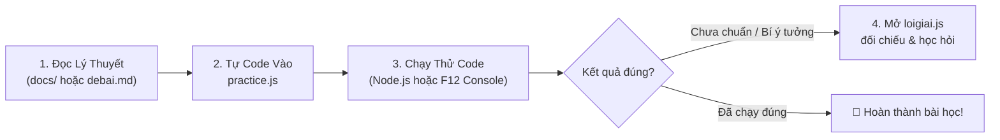

# 🚀 JavaScript Study Program - Lộ Trình Học JS Thực Chiến

Chào mừng bạn đến với kho tài liệu và bài tập thực hành **JavaScript**. Dự án được thiết kế theo phương châm **"Practice-First"** (học lý thuyết kết hợp ngay với thực hành viết code) để giúp bạn hiểu sâu bản chất, nhớ lâu và làm chủ ngôn ngữ JavaScript từ cơ bản đến nâng cao.

---

<a id="mục-lục"></a>

## 📑 Mục Lục

- [📂 Cấu Trúc Dự Án](#-cấu-trúc-dự-án)
- [🧭 Bản Đồ Liên Kết Kiến Thức (Knowledge Dependency Graph)](#-bản-đồ-liên-kết-kiến-thức-knowledge-dependency-graph)
- [🎯 Quy Trình Tối Ưu Để Bạn Tự Học & Làm Lại Từ Đầu](#-quy-trình-tối-ưu-để-bạn-tự-học--làm-lại-từ-đầu)
- [🗺️ Lộ Trình Học Tập (Roadmap Tuyến Tính Chuẩn Mực)](#️-lộ-trình-học-tập-roadmap-tuyến-tính-chuẩn-mực)

---

<a id="-cấu-trúc-dự-án"></a>
## 📂 Cấu Trúc Dự Án

Toàn bộ dự án được tổ chức theo cấu trúc chuẩn mực, khoa học và phân tách rõ ràng giữa Lý thuyết (`docs/`) và Thực hành (`exercises/`):

```text
javascript/
│── README.md                       # Tài liệu hướng dẫn chung của toàn bộ dự án
│── agent.md                        # 🧭 Bản đồ liên kết kiến thức & điều kiện tiên quyết (Prerequisites)
│── index.html                      # Trang chủ Dashboard điều hướng học tập trực quan
│── package.json                    # Các script npm hỗ trợ chạy nhanh bài tập
│
├── docs/                           # 📖 Thư viện tài liệu lý thuyết chi tiết (TOC + Anchor link)
│   ├── 01-javascript-overview.md
│   ├── 02-naming-conventions.md
│   ├── 03-variables-and-data-types.md
│   ├── 04-strings.md
│   ├── 05-conditionals-and-operators.md
│   ├── 06-logical-operators.md
│   ├── 07-truthy-falsy.md
│   ├── 08-loops-and-type-coercion.md
│   ├── 09-function-types.md
│   ├── 10-hoisting-and-scope.md
│   ├── 11-arrays.md
│   ├── 12-objects.md
│   ├── 13-for-in-and-for-of.md
│   ├── 14-prefix-postfix-applications.md
│   ├── 15-map-and-set.md
│   ├── 16-dom-basics.md
│   └── 17-json-and-error-handling.md
│
└── exercises/                      # ⚡ Các bài tập thực hành theo chủ đề
    ├── 01-javascript-overview/     # Tổng quan JS, Dynamic Typing, 5 cách viết JS
    ├── 02-naming-conventions/      # Quy ước đặt tên, Clean Code, Refactoring
    ├── 03-variables-and-data-types/# var/let/const, Scope & Toàn diện 8 kiểu dữ liệu JS
    ├── 04-strings/                 # Bài tập chuỗi & Template Literals
    ├── 05-conditionals-and-operators/# if/else, switch case, ternary, === vs ==
    ├── 06-logical-operators/       # Toán tử Logical (&&, ||, !), thứ tự ưu tiên, bẫy bitwise
    ├── 07-truthy-falsy/            # 8 giá trị Falsy, Type Coercion, Nullish Coalescing ??
    ├── 08-loops-and-type-coercion/ # Ép kiểu tường minh/ngầm định, ++/--, For/While/Do-While, Label
    ├── 09-function-types/          # 3 loại hàm (Declaration, Expression, Arrow)
    ├── 10-hoisting-and-scope/      # Cơ chế Hoisting, TDZ, Scope phạm vi hàm
    ├── 11-arrays/                  # Mảng: Khai báo, Duyệt & Các hàm xử lý
    ├── 12-objects/                 # Object: Enhanced Literals, Nested Destructuring, Noun vs Verb, const & freeze, this
    ├── 13-for-in-and-for-of/       # For-In & For-Of: Duyệt Object keys vs Iterable values
    ├── 14-prefix-postfix-applications/# Ứng dụng ++i/i++, đánh số thứ tự for...of, bẫy 2 lần tăng
    ├── 15-map-and-set/             # Map & Set: Object làm key, lọc trùng mảng
    ├── 16-dom-basics/              # Thao tác DOM & Sự kiện (Todo List App)
    └── 17-json-and-error-handling/ # JSON (stringify, parse) & try/catch/finally
        ├── debai.md                # Đề bài chi tiết từ cơ bản đến nâng cao (kèm TOC)
        ├── practice.js             # Khung sườn TODO để bạn TỰ VIẾT CODE
        ├── loigiai.js              # Lời giải mẫu chuẩn mực & giải thích chi tiết
        └── loigiai.html            # Giao diện F12 Console (chuyển đổi động ?mode=practice/solution)
```

---

<a id="-bản-đồ-liên-kết-kiến-thức-knowledge-dependency-graph"></a>
## 🧭 Bản Đồ Liên Kết Kiến Thức (Knowledge Dependency Graph)

> [!TIP]
> Trước khi bắt đầu một bài học mới, hãy luôn kiểm tra xem mình đã có đủ kiến thức nền tảng hay chưa để tránh bị hổng kiến thức.
>
> 👉 Xem hướng dẫn chi tiết tại: **[Bản Đồ Liên Kết Kiến Thức (agent.md)](file:///d:/github/studyProgram/javascript/agent.md)**

---

<a id="-quy-trình-tối-ưu-để-bạn-tự-học--làm-lại-từ-đầu"></a>
## 🎯 Quy Trình Tối Ưu Để Bạn Tự Học & Làm Lại Từ Đầu

Để việc học đạt hiệu quả cao nhất mà **không làm mất lời giải mẫu**, bạn nên tuân theo quy trình 4 bước sau:



1. **Bước 1 - Đọc tài liệu:** Đọc kỹ lý thuyết trong thư mục `docs/` hoặc phần lý thuyết đầu mỗi file `debai.md`.
2. **Bước 2 - Tự tay code:** Mở file `practice.js`. Đọc các hướng dẫn `// TODO:` và tự gõ mã nguồn của chính bạn vào đó.
3. **Bước 3 - Kiểm tra kết quả:** Chạy file `practice.js` bằng lệnh terminal (`npm run test:...` hoặc `node ...`) hoặc mở `loigiai.html` xem F12 Console (chế độ mặc định `?mode=practice`).
4. **Bước 4 - Đối chiếu & Tối ưu:** Sau khi code xong (hoặc khi bí ý tưởng), hãy mở `loigiai.js` (hoặc bấm nút "Lời giải mẫu" trên `loigiai.html`) để so sánh cách giải, ghi chú các cạm bẫy và học hỏi tư duy viết code chuẩn Clean Code.

---

<a id="️-lộ-trình-học-tập-roadmap-tuyến-tính-chuẩn-mực"></a>
<a id="️-lộ-trình-học-tập-curriculum-roadmap"></a>
## 🗺️ Lộ Trình Học Tập (Roadmap Tuyến Tính Chuẩn Mực)

|  STT   | Chủ đề                              | Thư mục bài tập                                                                                                                    | Tài liệu lý thuyết                                                                                                           | Kiến thức trọng tâm                                                                                               |
| :----: | :---------------------------------- | :--------------------------------------------------------------------------------------------------------------------------------- | :--------------------------------------------------------------------------------------------------------------------------- | :---------------------------------------------------------------------------------------------------------------- |
| **01** | **Tổng Quan Về JavaScript**         | [`exercises/01-javascript-overview/`](file:///d:/github/studyProgram/javascript/exercises/01-javascript-overview/)                 | [`docs/01-javascript-overview.md`](file:///d:/github/studyProgram/javascript/docs/01-javascript-overview.md)                 | Ngôn ngữ thông dịch, Dynamic Typing, 5 cách viết JS, Case-sensitive                                               |
| **02** | **Quy Ước Đặt Tên (Naming)**        | [`exercises/02-naming-conventions/`](file:///d:/github/studyProgram/javascript/exercises/02-naming-conventions/)                   | [`docs/02-naming-conventions.md`](file:///d:/github/studyProgram/javascript/docs/02-naming-conventions.md)                   | Boolean Yes/No, Singular/Plural, Verb+Noun, UPPER_SNAKE, Clean Code                                               |
| **03** | **Từ Khóa Khai Báo & Kiểu Dữ Liệu** | [`exercises/03-variables-and-data-types/`](file:///d:/github/studyProgram/javascript/exercises/03-variables-and-data-types/)       | [`docs/03-variables-and-data-types.md`](file:///d:/github/studyProgram/javascript/docs/03-variables-and-data-types.md)       | var/let/const, Scope, 8 kiểu dữ liệu JS, `typeof`, bug `null/"object"`, `undefined` vs `null`, cạm bẫy ép kiểu    |
| **04** | **Chuỗi & Template Literals**       | [`exercises/04-strings/`](file:///d:/github/studyProgram/javascript/exercises/04-strings/)                                         | [`docs/04-strings.md`](file:///d:/github/studyProgram/javascript/docs/04-strings.md)                                         | Ký tự escape `\`, nối chuỗi `+` vs cộng số, `${expression}`                                                       |
| **05** | **Rẽ Nhánh Điều Kiện**              | [`exercises/05-conditionals-and-operators/`](file:///d:/github/studyProgram/javascript/exercises/05-conditionals-and-operators/)   | [`docs/05-conditionals-and-operators.md`](file:///d:/github/studyProgram/javascript/docs/05-conditionals-and-operators.md)   | `if...else`, `switch...case`, Fall-through, `===` vs `==`, Ternary                                                |
| **06** | **Toán Tử Logical**                 | [`exercises/06-logical-operators/`](file:///d:/github/studyProgram/javascript/exercises/06-logical-operators/)                     | [`docs/06-logical-operators.md`](file:///d:/github/studyProgram/javascript/docs/06-logical-operators.md)                     | `&&` (AND), `\|\|` (OR), `!` (NOT), `!!`, kết hợp đa điều kiện, Short-circuit, bẫy bitwise `&`/`\|`               |
| **07** | **Truthy & Falsy**                  | [`exercises/07-truthy-falsy/`](file:///d:/github/studyProgram/javascript/exercises/07-truthy-falsy/)                               | [`docs/07-truthy-falsy.md`](file:///d:/github/studyProgram/javascript/docs/07-truthy-falsy.md)                               | 8 giá trị falsy trong JS, ép kiểu ngầm định (Type Coercion), `??`                                                 |
| **08** | **Ép Kiểu & Cấu Trúc Vòng Lặp**     | [`exercises/08-loops-and-type-coercion/`](file:///d:/github/studyProgram/javascript/exercises/08-loops-and-type-coercion/)         | [`docs/08-loops-and-type-coercion.md`](file:///d:/github/studyProgram/javascript/docs/08-loops-and-type-coercion.md)         | Explicit vs Implicit Coercion, `++a`/`a++`, `for`, `while`, `do...while`, Empty Statement, Labeled Loops          |
| **09** | **3 Loại Hàm trong JS**             | [`exercises/09-function-types/`](file:///d:/github/studyProgram/javascript/exercises/09-function-types/)                           | [`docs/09-function-types.md`](file:///d:/github/studyProgram/javascript/docs/09-function-types.md)                           | Declaration, Expression, Arrow function, Callback filter/map                                                      |
| **10** | **Cơ Chế Hoisting & Scope**         | [`exercises/10-hoisting-and-scope/`](file:///d:/github/studyProgram/javascript/exercises/10-hoisting-and-scope/)                   | [`docs/10-hoisting-and-scope.md`](file:///d:/github/studyProgram/javascript/docs/10-hoisting-and-scope.md)                   | Creation vs Execution phase, TDZ let/const, Function vs Expression                                                |
| **11** | **Mảng trong JavaScript**           | [`exercises/11-arrays/`](file:///d:/github/studyProgram/javascript/exercises/11-arrays/)                                           | [`docs/11-arrays.md`](file:///d:/github/studyProgram/javascript/docs/11-arrays.md)                                           | Array Literal, `new Array()`, `push`, `pop`, `splice`, `map`, `filter`, `reduce`                                  |
| **12** | **Đối Tượng (Object) & this**       | [`exercises/12-objects/`](file:///d:/github/studyProgram/javascript/exercises/12-objects/)                                         | [`docs/12-objects.md`](file:///d:/github/studyProgram/javascript/docs/12-objects.md)                                         | Bộ ba Object.keys/values/entries, Enhanced Literals (Property/Method/Computed), Nested Destructuring, Noun/Verb, `const` & `freeze`, `this` |
| **13** | **Vòng Lặp For-In & For-Of**        | [`exercises/13-for-in-and-for-of/`](file:///d:/github/studyProgram/javascript/exercises/13-for-in-and-for-of/)                     | [`docs/13-for-in-and-for-of.md`](file:///d:/github/studyProgram/javascript/docs/13-for-in-and-for-of.md)                     | Duyệt Object keys với `for...in`, duyệt Iterable với `for...of`, toán tử `in`, cạm bẫy Prototype & `not iterable` |
| **14** | **Ứng Dụng ++ Tiền Tố & Hậu Tố**    | [`exercises/14-prefix-postfix-applications/`](file:///d:/github/studyProgram/javascript/exercises/14-prefix-postfix-applications/) | [`docs/14-prefix-postfix-applications.md`](file:///d:/github/studyProgram/javascript/docs/14-prefix-postfix-applications.md) | Phân biệt `++i` vs `i++`, đánh số thứ tự trong `for...of`, bẫy tăng biến 2 lần, V8 Engine bytecode                |
| **15** | **Cấu Trúc Map & Set**              | [`exercises/15-map-and-set/`](file:///d:/github/studyProgram/javascript/exercises/15-map-and-set/)                                 | [`docs/15-map-and-set.md`](file:///d:/github/studyProgram/javascript/docs/15-map-and-set.md)                                 | Cặp key-value linh hoạt, Object làm key, lọc trùng mảng, toán tử tập hợp                                          |
| **16** | **Thao Tác DOM & Sự Kiện**          | [`exercises/16-dom-basics/`](file:///d:/github/studyProgram/javascript/exercises/16-dom-basics/)                                   | [`docs/16-dom-basics.md`](file:///d:/github/studyProgram/javascript/docs/16-dom-basics.md)                                   | querySelector, addEventListener, Todo app thực chiến, Dark mode                                                   |
| **17** | **JSON & Xử Lý Lỗi**                | [`exercises/17-json-and-error-handling/`](file:///d:/github/studyProgram/javascript/exercises/17-json-and-error-handling/)         | [`docs/17-json-and-error-handling.md`](file:///d:/github/studyProgram/javascript/docs/17-json-and-error-handling.md)         | `JSON.stringify`, `JSON.parse`, `try...catch...finally`, return override                                          |
| **18** | **Sổ Tay Tra Cứu Thuộc Tính & Phương Thức** | [`exercises/18-javascript-methods-and-properties-reference/`](file:///d:/github/studyProgram/javascript/exercises/18-javascript-methods-and-properties-reference/) | [`docs/18-javascript-methods-and-properties-reference.md`](file:///d:/github/studyProgram/javascript/docs/18-javascript-methods-and-properties-reference.md) | Thống kê toàn bộ API JavaScript: Tham số nhận vào (Input) & Giá trị trả về (Output), Mutating vs Non-Mutating |

---

_Chúc bạn học tập hiệu quả và làm chủ JavaScript từng ngày!_
