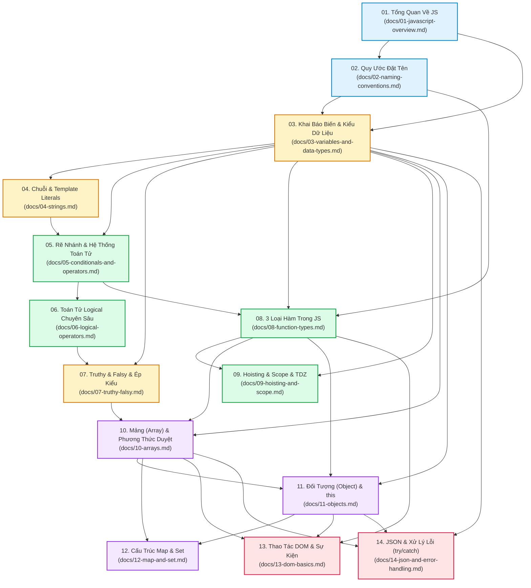

# 🧭 BẢN ĐỒ LIÊN KẾT KIẾN THỨC (KNOWLEDGE DEPENDENCY GRAPH)
### Dự án: JavaScript Study Program
**Mentor phụ trách:** Senior Programming Mentor  
**Phiên bản cập nhật:** 2026  
**Mục tiêu:** Xác định chính xác các mảnh ghép kiến thức nền tảng (Prerequisites) cần chuẩn bị trước khi bước vào từng bài học, loại bỏ triệt để tình trạng "hổng kiến thức" khi học JavaScript.

---

## 📌 LỜI NHẮN TỪ SENIOR MENTOR

> *"Học lập trình cũng giống như xây một tòa cao ốc: Bạn tuyệt đối không thể đổ bê tông sàn tầng 10 (Mảng & Đối tượng nâng cao) khi trụ tầng 3 (Kiểu dữ liệu & Tham chiếu) hay dầm tầng 8 (Hàm & Callback) vẫn còn đang lung lay.*
>
> *Hầu hết người học cảm thấy JavaScript 'khó hiểu' hay 'kỳ quặc' không phải vì JavaScript phức tạp, mà vì họ đã **nhảy cóc qua một mắt xích kiến thức tiên quyết**. Bản đồ liên kết này được thiết kế để chỉ đích danh cho bạn biết: Trước khi mở bất kỳ file bài học nào, bạn BẮT BUỘC phải mang theo những hành trang gì từ các bài trước."*

---

## 🗺️ SƠ ĐỒ PHỤ THUỘC TỔNG QUAN (MERMAID GRAPH)



---

## 🔍 PHÂN TÍCH CHI TIẾT KIẾN THỨC NỀN TẢNG (PREREQUISITES) THEO TỪNG BÀI

---

### 🟢 BÀI 01: Tổng Quan Về JavaScript
* **Tài liệu:** [`docs/01-javascript-overview.md`](file:///d:/github/studyProgram/javascript/docs/01-javascript-overview.md)
* **Bài tập:** [`exercises/01-javascript-overview/`](file:///d:/github/studyProgram/javascript/exercises/01-javascript-overview/)
* **Kiến thức tiên quyết bắt buộc:**
  - *Không có.* Đây là vạch xuất phát khởi đầu cho toàn bộ lộ trình.
* **Mục tiêu cốt lõi cần đạt được:**
  - Hiểu bản chất JavaScript là ngôn ngữ thông dịch (Interpreted) chạy trên V8 Engine.
  - Khái niệm **Dynamic Typing** (kiểu dữ liệu động, biến không bị gắn chặt vào một kiểu).
  - Phân biệt tính nhạy chữ hoa - chữ thường (**Case-sensitive**) trong JS.
  - Nắm được cách thực thi code JS bằng Node.js Terminal và DevTools Console.

---

### 🟢 BÀI 02: Quy Ước Đặt Tên Trong JavaScript (Clean Code Naming)
* **Tài liệu:** [`docs/02-naming-conventions.md`](file:///d:/github/studyProgram/javascript/docs/02-naming-conventions.md)
* **Bài tập:** [`exercises/02-naming-conventions/`](file:///d:/github/studyProgram/javascript/exercises/02-naming-conventions/)
* **Kiến thức tiên quyết bắt buộc từ bài trước:**
  1. **Tính nhạy chữ hoa - chữ thường (Case-sensitive)** tại [`docs/01-javascript-overview.md` (Mục 2.4)](file:///d:/github/studyProgram/javascript/docs/01-javascript-overview.md#24-phân-biệt-chữ-hoa---chữ-thường-case-sensitivity):
     - *Vì sao bắt buộc?* Quy ước `camelCase` (`isLoggedIn`), `PascalCase` (`BankAccount`), và `UPPER_SNAKE_CASE` (`MAX_RETRIES`) hoàn toàn dựa trên sự phân biệt chữ hoa/thường. Nếu không hiểu case-sensitive, bạn sẽ gọi sai tên biến và sinh lỗi `ReferenceError`.
* **Mục tiêu cốt lõi cần đạt được:**
  - Biến Boolean phải đặt dạng câu hỏi Yes/No (`is/has/can/should`).
  - Biến đơn lẻ dùng danh từ số ít (`user`), mảng chứa danh sách dùng danh từ số nhiều (`users`).
  - Hàm phải bắt đầu bằng động từ hành động (`get`, `create`, `calculate`).

---

### 🟡 BÀI 03: Từ Khóa Khai Báo (var, let, const), Scope & 8 Kiểu Dữ Liệu
* **Tài liệu:** [`docs/03-variables-and-data-types.md`](file:///d:/github/studyProgram/javascript/docs/03-variables-and-data-types.md)
* **Bài tập:** [`exercises/03-variables-and-data-types/`](file:///d:/github/studyProgram/javascript/exercises/03-variables-and-data-types/)
* **Kiến thức tiên quyết bắt buộc từ bài trước:**
  1. **Dynamic Typing** tại [`docs/01-javascript-overview.md` (Mục 2.3)](file:///d:/github/studyProgram/javascript/docs/01-javascript-overview.md#23-ngôn-ngữ-định-kiểu-động-dynamic-typing):
     - *Vì sao bắt buộc?* Để hiểu tại sao từ khóa `let` cho phép gán lại biến sang một kiểu dữ liệu hoàn toàn khác, trong khi `const` ngăn chặn việc gán lại nhãn biến.
  2. **Quy ước đặt tên Clean Code** tại [`docs/02-naming-conventions.md` (Mục 2 & 3)](file:///d:/github/studyProgram/javascript/docs/02-naming-conventions.md#2-quy-tắc-đặt-tên-biến-boolean-dạng-câu-hỏi-yesno):
     - *Vì sao bắt buộc?* Bài 03 yêu cầu bạn đặt tên cho 8 kiểu dữ liệu khác nhau (boolean bắt đầu bằng `is`, mảng số nhiều, object số ít).
* **Mục tiêu cốt lõi cần đạt được:**
  - Phân biệt rạch ròi Block Scope (`let`, `const`) vs Function Scope (`var`).
  - Hiểu nguyên lý `const` khóa địa chỉ ô nhớ chứ không khóa ruột mảng/object.
  - Nhận diện toàn diện 8 kiểu dữ liệu: `String`, `Number` (ngưỡng an toàn IEEE 754), `BigInt`, `Boolean`, `Undefined`, `Null`, `Symbol`, `Object`.
  - Nắm lòng bí kíp **Phòng khám Dr. JavaScript**: 4 ca bệnh khó (`typeof null === "object"`, `Array.isArray()`, loại trừ `NaN`, kiểm tra Plain Object).

---

### 🟡 BÀI 04: Chuỗi (Strings) & Template Literals
* **Tài liệu:** [`docs/04-strings.md`](file:///d:/github/studyProgram/javascript/docs/04-strings.md)
* **Bài tập:** [`exercises/04-strings/`](file:///d:/github/studyProgram/javascript/exercises/04-strings/)
* **Kiến thức tiên quyết bắt buộc từ bài trước:**
  1. **Từ khóa khai báo `let` & `const`** tại [`docs/03-variables-and-data-types.md` (Mục 2)](file:///d:/github/studyProgram/javascript/docs/03-variables-and-data-types.md#2-khác-biệt-cốt-lõi-scope-re-assign-re-declaration-bảng-so-sánh-var-let-const):
     - *Vì sao bắt buộc?* Chuỗi cần được lưu trữ trong biến để tái sử dụng và nối chuỗi.
  2. **Tính bất biến (Immutability) của kiểu Primitive String** tại [`docs/03-variables-and-data-types.md` (Mục 11.1)](file:///d:/github/studyProgram/javascript/docs/03-variables-and-data-types.md#111-string-chuỗi):
     - *Vì sao bắt buộc?* Người học hay lầm tưởng có thể đổi ký tự chuỗi bằng `str[0] = 'H'`, cần nắm bản chất chuỗi trong Stack là bất biến để tránh viết code sai.
  3. **Cạm bẫy toán tử `+` ghép chuỗi vs cộng số** tại [`docs/03-variables-and-data-types.md` (Mục 11.9.1)](file:///d:/github/studyProgram/javascript/docs/03-variables-and-data-types.md#cạm-bẫy-1-nhầm-lẫn-giữa-string-và-number):
     - *Vì sao bắt buộc?* Bài 04 đi sâu vào bẫy `'2' + 2 = '22'`, bạn phải hiểu trước cơ chế ép kiểu này để biết khi nào nên dùng Template Literals `` `${expression}` ``.
* **Mục tiêu cốt lõi cần đạt được:**
  - Thành thạo nháy đơn `''`, nháy kép `""`, ký tự thoát escape `\`, và Template Literals ``` `` ```.

---

### 🟡 BÀI 05: Câu Lệnh Rẽ Nhánh & Hệ Thống Toán Tử (Operators)
* **Tài liệu:** [`docs/05-conditionals-and-operators.md`](file:///d:/github/studyProgram/javascript/docs/05-conditionals-and-operators.md)
* **Bài tập:** [`exercises/05-conditionals-and-operators/`](file:///d:/github/studyProgram/javascript/exercises/05-conditionals-and-operators/)
* **Kiến thức tiên quyết bắt buộc từ bài trước:**
  1. **Kiểu dữ liệu Boolean** tại [`docs/03-variables-and-data-types.md` (Mục 11.4)](file:///d:/github/studyProgram/javascript/docs/03-variables-and-data-types.md#114-boolean-đúng--sai):
     - *Vì sao bắt buộc?* Mọi câu lệnh `if...else`, `switch...case` hay toán tử ba ngôi `? :` đều hoạt động dựa trên việc đánh giá biểu thức ra `true` hoặc `false`.
  2. **Phân biệt `null` vs `undefined`** tại [`docs/03-variables-and-data-types.md` (Mục 11.9.2)](file:///d:/github/studyProgram/javascript/docs/03-variables-and-data-types.md#cạm-bẫy-2-không-hiểu-rõ-sự-khác-biệt-giữa-null-và-undefined):
     - *Vì sao bắt buộc?* Để hiểu bản chất của toán tử Nullish Coalescing `??` (chỉ bắt null/undefined) và toán tử `void 0` (chống shadowing undefined ở Mục 8.4).
  3. **Nối chuỗi & Template Literals** tại [`docs/04-strings.md`](file:///d:/github/studyProgram/javascript/docs/04-strings.md):
     - *Vì sao bắt buộc?* Kết quả rẽ nhánh thường in ra các chuỗi thông báo động ghép biến (`"Chào bạn " + name`).
* **Mục tiêu cốt lõi cần đạt được:**
  - Phân biệt tuyệt đối so sánh nghiêm ngặt `===` vs lỏng lẻo `==`.
  - Cấu trúc rẽ nhánh `if...else`, `switch...case` (kỹ thuật Fall-through) và toán tử ba ngôi `? :`.
  - Nắm vững bảng xếp hạng độ ưu tiên toán tử (Operator Precedence) và toán tử `void 0`.

---

### 🟡 BÀI 06: Toán Tử Logical Chuyên Sâu (&&, ||, !, ??)
* **Tài liệu:** [`docs/06-logical-operators.md`](file:///d:/github/studyProgram/javascript/docs/06-logical-operators.md)
* **Bài tập:** [`exercises/06-logical-operators/`](file:///d:/github/studyProgram/javascript/exercises/06-logical-operators/)
* **Kiến thức tiên quyết bắt buộc từ bài trước:**
  1. **Khái niệm cơ bản về Short-Circuit** tại [`docs/05-conditionals-and-operators.md` (Mục 7)](file:///d:/github/studyProgram/javascript/docs/05-conditionals-and-operators.md#7-toán-tử-logic-cơ-bản-đoản-mạch-short-circuit):
     - *Vì sao bắt buộc?* Bài 06 đào sâu cơ chế `&&` và `||` không chỉ trả về boolean mà trả về **chính giá trị của toán hạng dừng lại**. Nếu chưa nắm khái niệm cơ bản ở Bài 05, bạn sẽ bị bất ngờ.
  2. **Toán tử `??` vs `||`** tại [`docs/05-conditionals-and-operators.md` (Mục 8.2)](file:///d:/github/studyProgram/javascript/docs/05-conditionals-and-operators.md#82-nullish-coalescing-operator-):
     - *Vì sao bắt buộc?* Bài 06 phân tích cạm bẫy cú pháp: Bắt buộc dùng dấu ngoặc đơn `()` khi kết hợp `??` với `&&`/`||`.
* **Mục tiêu cốt lõi cần đạt được:**
  - Làm chủ thứ tự ưu tiên: `!` (cao nhất) $\rightarrow$ `&&` $\rightarrow$ `||` (thấp nhất).
  - Phân biệt bẫy Bitwise `&`/`|` vs Logical `&&`/`||`.
  - Kỹ thuật Guarding (`user && user.profile`) và Fallback chuẩn xác.

---

### 🟡 BÀI 07: Truthy, Falsy & Cơ Chế Ép Kiểu Ngầm Định (Type Coercion)
* **Tài liệu:** [`docs/07-truthy-falsy.md`](file:///d:/github/studyProgram/javascript/docs/07-truthy-falsy.md)
* **Bài tập:** [`exercises/07-truthy-falsy/`](file:///d:/github/studyProgram/javascript/exercises/07-truthy-falsy/)
* **Kiến thức tiên quyết bắt buộc từ bài trước:**
  1. **8 Kiểu dữ liệu JS** tại [`docs/03-variables-and-data-types.md` (Mục 11)](file:///d:/github/studyProgram/javascript/docs/03-variables-and-data-types.md#11-toàn-diện-về-kiểu-dữ-liệu-trong-javascript-data-types):
     - *Vì sao bắt buộc?* 8 giá trị Falsy trong JavaScript (`false`, `0`, `-0`, `0n`, `""`, `null`, `undefined`, `NaN`) xuất phát trực tiếp từ các kiểu dữ liệu đã học ở Bài 03.
  2. **Toán tử phủ định `!` và `!!`** tại [`docs/06-logical-operators.md` (Mục 4)](file:///d:/github/studyProgram/javascript/docs/06-logical-operators.md#4-toán-tử-not--kỹ-thuật-double-not-):
     - *Vì sao bắt buộc?* Bài 07 dùng kỹ thuật Double NOT `!!val` để ép bất kỳ giá trị nào về đúng chuẩn Boolean chân lý (`true`/`false`).
  3. **So sánh `==` vs `===`** tại [`docs/05-conditionals-and-operators.md` (Mục 5)](file:///d:/github/studyProgram/javascript/docs/05-conditionals-and-operators.md#5-toán-tử-so-sánh-comparison-operators):
     - *Vì sao bắt buộc?* Hiểu cơ chế ép kiểu ngầm định của `==` (ToNumber, ToPrimitive algorithm) giải thích vì sao `[] == false` lại ra `true`.
* **Mục tiêu cốt lõi cần đạt được:**
  - Thuộc lòng 8 giá trị Falsy; ghi nhớ mọi thứ còn lại (kể cả `[]`, `{}`, `"0"`, `"-0"`) đều là Truthy.
  - Viết biểu thức kiểm tra điều kiện an toàn, không bị bẫy số `0` hoặc chuỗi rỗng `""`.

---

### 🔵 BÀI 08: 3 Loại Hàm Trong JavaScript (Function Types)
* **Tài liệu:** [`docs/08-function-types.md`](file:///d:/github/studyProgram/javascript/docs/08-function-types.md)
* **Bài tập:** [`exercises/08-function-types/`](file:///d:/github/studyProgram/javascript/exercises/08-function-types/)
* **Kiến thức tiên quyết bắt buộc từ bài trước:**
  1. **Quy tắc đặt tên hàm: Động từ + Tân ngữ** tại [`docs/02-naming-conventions.md` (Mục 4)](file:///d:/github/studyProgram/javascript/docs/02-naming-conventions.md#4-quy-tắc-đặt-tên-hàm-và-phương-thức-động-từ--tân-ngữ):
     - *Vì sao bắt buộc?* Để viết hàm sạch chuẩn Clean Code (`calculateTotal`, `getUserById`), tránh đặt tên danh từ gây nhầm với biến.
  2. **Hàm là một dạng Object đặc biệt (kiểu Function)** tại [`docs/03-variables-and-data-types.md` (Mục 11.8.2)](file:///d:/github/studyProgram/javascript/docs/03-variables-and-data-types.md#1182-function-hàm):
     - *Vì sao bắt buộc?* Giúp bạn hiểu vì sao có thể gán một hàm vào một biến (`const myFunc = function() {}` - Function Expression) và truyền hàm như một tham số (First-class Citizens).
  3. **Lệnh `return` và rẽ nhánh `if...else`** tại [`docs/05-conditionals-and-operators.md` (Mục 1)](file:///d:/github/studyProgram/javascript/docs/05-conditionals-and-operators.md#1-câu-lệnh-điều-kiện-if-else-if-else-if-else):
     - *Vì sao bắt buộc?* Bên trong hàm cần xử lý rẽ nhánh điều kiện và trả về giá trị qua từ khóa `return`.
* **Mục tiêu cốt lõi cần đạt được:**
  - Phân biệt cú pháp: Function Declaration, Function Expression, Arrow Function.
  - Thuộc lòng các cấp độ rút gọn Arrow Function (bỏ ngoặc đơn tham số, bỏ ngoặc nhọn `{}` và `return` ngầm).
  - Nắm vững khái niệm **Callback Function** (hàm truyền vào làm đối số của hàm khác).

---

### 🔵 BÀI 09: Cơ Chế Hoisting, Scope & Vùng Chết Tạm Thời (TDZ)
* **Tài liệu:** [`docs/09-hoisting-and-scope.md`](file:///d:/github/studyProgram/javascript/docs/09-hoisting-and-scope.md)
* **Bài tập:** [`exercises/09-hoisting-and-scope/`](file:///d:/github/studyProgram/javascript/exercises/09-hoisting-and-scope/)
* **Kiến thức tiên quyết bắt buộc từ bài trước:**
  1. **Phân biệt Declaration vs Expression** tại [`docs/08-function-types.md`](file:///d:/github/studyProgram/javascript/docs/08-function-types.md):
     - *Vì sao bắt buộc?* Trọng tâm bài 09 là giải thích tại sao Function Declaration được hoisted lên đầu và gọi trước khi khai báo được, trong khi Function Expression gọi trước sẽ bị bắn lỗi `ReferenceError` hoặc `TypeError`.
  2. **Bản chất Scope (Block vs Function Scope)** tại [`docs/03-variables-and-data-types.md` (Mục 3)](file:///d:/github/studyProgram/javascript/docs/03-variables-and-data-types.md#3-bản-chất-toàn-diện-về-phạm-vi-scope-trong-javascript-xóa-bỏ-hoàn-toàn-nhầm-lẫn):
     - *Vì sao bắt buộc?* Hoisting diễn ra trong từng Scope cụ thể. Nếu không nắm Lexical Scope và Scope Chain ở Bài 03, bạn sẽ không giải thích được hiện tượng Variable Shadowing (che khuất biến).
* **Mục tiêu cốt lõi cần đạt được:**
  - Hiểu 2 pha chạy của JS Engine: Creation Phase (cấp phát bộ nhớ) & Execution Phase (thực thi mã).
  - Nắm vững cơ chế Temporal Dead Zone (TDZ) của `let` và `const`.

---

### 🟣 BÀI 10: Mảng (Arrays) & Các Phương Thức Duyệt Xử Lý
* **Tài liệu:** [`docs/10-arrays.md`](file:///d:/github/studyProgram/javascript/docs/10-arrays.md)
* **Bài tập:** [`exercises/10-arrays/`](file:///d:/github/studyProgram/javascript/exercises/10-arrays/)
* **Kiến thức tiên quyết bắt buộc từ bài trước:**
  1. **Arrow Function & Callback** tại [`docs/08-function-types.md`](file:///d:/github/studyProgram/javascript/docs/08-function-types.md):
     - *Vì sao bắt buộc?* **ĐÂY LÀ ĐIỀU KIỆN TIÊN QUYẾT SỐ 1**. Toàn bộ các phương thức cốt lõi của Mảng gồm `map`, `filter`, `reduce`, `find`, `some`, `every` đều yêu cầu truyền vào một **Arrow Function Callback**:
       `products.filter(item => item.price > 100)`. Nếu chưa vững Bài 08, bạn sẽ hoàn toàn không hiểu `item` từ đâu sinh ra và `=>` hoạt động thế nào.
  2. **Truthy & Falsy** tại [`docs/07-truthy-falsy.md`](file:///d:/github/studyProgram/javascript/docs/07-truthy-falsy.md):
     - *Vì sao bắt buộc?* Hàm callback của phương thức `.filter()` và `.find()` giữ lại phần tử khi biểu thức bên trong trả về giá trị Truthy.
  3. **Bản chất mảng là Object tham chiếu & phương thức `push/pop/splice`** tại [`docs/03-variables-and-data-types.md` (Mục 11.8.1)](file:///d:/github/studyProgram/javascript/docs/03-variables-and-data-types.md#1181-array-mảng):
     - *Vì sao bắt buộc?* Nắm vững các thao tác biến đổi mảng gốc (mutate) vs các hàm trả về mảng mới (immutable).
* **Mục tiêu cốt lõi cần đạt được:**
  - Thành thạo bộ ba Functional Programming: `map()` (biến đổi), `filter()` (lọc dữ liệu), `reduce()` (tích lũy/tính tổng).
  - Xử lý tìm kiếm (`find`, `findIndex`), kiểm tra điều kiện (`some`, `every`), làm phẳng (`flat`), và sắp xếp (`sort`).

---

### 🟣 BÀI 11: Đối Tượng Trong JavaScript (Objects) & Từ Khóa this
* **Tài liệu:** [`docs/11-objects.md`](file:///d:/github/studyProgram/javascript/docs/11-objects.md)
* **Bài tập:** [`exercises/11-objects/`](file:///d:/github/studyProgram/javascript/exercises/11-objects/)
* **Kiến thức tiên quyết bắt buộc từ bài trước:**
  1. **Sự khác biệt về `this` giữa Regular Function và Arrow Function** tại [`docs/08-function-types.md`](file:///d:/github/studyProgram/javascript/docs/08-function-types.md):
     - *Vì sao bắt buộc?* Khi viết phương thức (Method) cho Object, dùng Function thường thì `this` trỏ đúng vào đối tượng gọi nó; nếu dùng Arrow Function thì `this` bị mất ngữ cảnh (trỏ ra ngoài Window/Global). Không học Bài 08 trước sẽ dẫn đến bug tai hại này.
  2. **Bản chất Object lưu theo tham chiếu Heap** tại [`docs/03-variables-and-data-types.md` (Mục 11.7)](file:///d:/github/studyProgram/javascript/docs/03-variables-and-data-types.md#117-object-đối-tượng-dạng-tổng-quát-key-value):
     - *Vì sao bắt buộc?* Để hiểu vì sao copy object bằng dấu `=` (`obj2 = obj1`) sẽ làm thay đổi cả object gốc, từ đó hiểu tại sao cần dùng Spread Operator `{...obj}` hoặc `Object.assign()`.
  3. **Thao tác duyệt Mảng** tại [`docs/10-arrays.md`](file:///d:/github/studyProgram/javascript/docs/10-arrays.md):
     - *Vì sao bắt buộc?* Các hàm tĩnh của Object gồm `Object.keys()`, `Object.values()`, `Object.entries()` đều trả về một **Mảng**; bạn cần kỹ năng duyệt mảng từ Bài 10 để biến đổi dữ liệu.
* **Mục tiêu cốt lõi cần đạt được:**
  - Phân biệt Dot notation (`obj.key`) vs Bracket notation (`obj[dynamicKey]`).
  - Viết Method chuẩn mực với từ khóa `this`.
  - Thành thạo các hàm tĩnh `Object.keys`, `Object.values`, `Object.entries`, `Object.fromEntries`.

---

### 🟣 BÀI 12: Cấu Trúc Dữ Liệu Map & Set
* **Tài liệu:** [`docs/12-map-and-set.md`](file:///d:/github/studyProgram/javascript/docs/12-map-and-set.md)
* **Bài tập:** [`exercises/12-map-and-set/`](file:///d:/github/studyProgram/javascript/exercises/12-map-and-set/)
* **Kiến thức tiên quyết bắt buộc từ bài trước:**
  1. **Hạn chế của Object thông thường** tại [`docs/11-objects.md`](file:///d:/github/studyProgram/javascript/docs/11-objects.md):
     - *Vì sao bắt buộc?* Trong Object thông thường, key luôn bị ép kiểu thành `String`, không thể lấy một Object khác làm key. Bạn phải hiểu hạn chế này ở Bài 11 thì mới thấy được sức mạnh vượt trội của `Map`.
  2. **Spread Operator `...` và phương thức mảng** tại [`docs/10-arrays.md`](file:///d:/github/studyProgram/javascript/docs/10-arrays.md):
     - *Vì sao bắt buộc?* Ứng dụng phổ biến nhất của `Set` là lọc trùng lặp mảng: `[...new Set(array)]`. Cú pháp này sử dụng Spread Operator của Mảng.
  3. **So sánh tham chiếu đối tượng** tại [`docs/03-variables-and-data-types.md` (Mục 11.7)](file:///d:/github/studyProgram/javascript/docs/03-variables-and-data-types.md#117-object-đối-tượng-dạng-tổng-quát-key-value):
     - *Vì sao bắt buộc?* Để hiểu vì sao 2 object rỗng `map.set({}, "A")` và `map.get({})` trả về `undefined` (do 2 object là 2 địa chỉ ô nhớ hoàn toàn khác nhau).
* **Mục tiêu cốt lõi cần đạt được:**
  - Thành thạo CRUD trên `Map`: `set`, `get`, `has`, `delete`, thuộc tính `.size`.
  - Ứng dụng `Set` để lọc trùng lặp dữ liệu và thực hiện các phép toán tập hợp (Hợp - Union, Giao - Intersection, Hiệu - Difference).

---

### 🔴 BÀI 13: Thao Tác DOM & Sự Kiện (Web Interactive UI)
* **Tài liệu:** [`docs/13-dom-basics.md`](file:///d:/github/studyProgram/javascript/docs/13-dom-basics.md)
* **Bài tập:** [`exercises/13-dom-basics/`](file:///d:/github/studyProgram/javascript/exercises/13-dom-basics/)
* **Kiến thức tiên quyết bắt buộc từ bài trước:**
  1. **Callback Function & Arrow Function** tại [`docs/08-function-types.md`](file:///d:/github/studyProgram/javascript/docs/08-function-types.md):
     - *Vì sao bắt buộc?* Lắng nghe sự kiện người dùng (`click`, `submit`, `input`) trong DOM 100% sử dụng Callback Function: `btn.addEventListener("click", (event) => {})`.
  2. **Thao tác Đối tượng (Object Properties)** tại [`docs/11-objects.md`](file:///d:/github/studyProgram/javascript/docs/11-objects.md):
     - *Vì sao bắt buộc?* Mỗi phần tử HTML trên trang khi được JavaScript chọn (`querySelector`) đều là một **DOM Element Object**. Việc đổi nội dung (`el.textContent = "..."`), đổi màu (`el.style.color = "..."`), hay đọc `event.target.value` thực chất là truy cập và gán lại thuộc tính của Object.
  3. **Duyệt mảng danh sách phần tử** tại [`docs/10-arrays.md`](file:///d:/github/studyProgram/javascript/docs/10-arrays.md):
     - *Vì sao bắt buộc?* Lệnh `querySelectorAll` trả về một tập hợp `NodeList`; bạn cần kỹ năng duyệt mảng để gán sự kiện đồng loạt cho nhiều nút bấm hoặc danh sách Todo.
  4. **Toán tử `event.preventDefault()`** tại [`docs/05-conditionals-and-operators.md` (Mục 8.4)](file:///d:/github/studyProgram/javascript/docs/05-conditionals-and-operators.md#84-toán-tử-void--khái-niệm-cơ-chế--3-ứng-dụng-thực-tế):
     - *Vì sao bắt buộc?* Ngăn chặn hành vi mặc định của form reload trang hoặc thẻ `<a>` nhảy trang khi người dùng submit.
* **Mục tiêu cốt lõi cần đạt được:**
  - Truy xuất DOM bằng `querySelector`, `querySelectorAll`.
  - Thay đổi nội dung, thuộc tính và CSS Class động (`classList.add`, `remove`, `toggle`).
  - Xây dựng ứng dụng Todo List hoàn chỉnh có giao diện tương tác người dùng.

---

### 🔴 BÀI 14: Định Dạng JSON & Xử Lý Lỗi (try...catch...finally)
* **Tài liệu:** [`docs/14-json-and-error-handling.md`](file:///d:/github/studyProgram/javascript/docs/14-json-and-error-handling.md)
* **Bài tập:** [`exercises/14-json-and-error-handling/`](file:///d:/github/studyProgram/javascript/exercises/14-json-and-error-handling/)
* **Kiến thức tiên quyết bắt buộc từ bài trước:**
  1. **Cấu trúc Mảng & Đối Tượng (Array & Object)** tại [`docs/10-arrays.md`](file:///d:/github/studyProgram/javascript/docs/10-arrays.md) & [`docs/11-objects.md`](file:///d:/github/studyProgram/javascript/docs/11-objects.md):
     - *Vì sao bắt buộc?* JSON (JavaScript Object Notation) là chuỗi đại diện tuần tự hóa của Mảng và Đối tượng. Bạn không thể hiểu cú pháp JSON nếu chưa thành thạo Object key-value và mảng lồng nhau.
  2. **Các kiểu dữ liệu đặc biệt bị JSON bỏ qua** tại [`docs/03-variables-and-data-types.md` (Mục 11)](file:///d:/github/studyProgram/javascript/docs/03-variables-and-data-types.md#11-toàn-diện-về-kiểu-dữ-liệu-trong-javascript-data-types):
     - *Vì sao bắt buộc?* Khi chạy `JSON.stringify()`, các trường có giá trị là `undefined`, `Function`, `Symbol` sẽ bị xóa sổ; còn `NaN` và `Infinity` bị ép thành `null`. Bạn cần nắm các kiểu này ở Bài 03 để không bị bất ngờ khi dữ liệu biến mất sau khi parse.
  3. **Khối lệnh Block Scope `{}`** tại [`docs/03-variables-and-data-types.md` (Mục 3)](file:///d:/github/studyProgram/javascript/docs/03-variables-and-data-types.md#3-bản-chất-toàn-diện-về-phạm-vi-scope-trong-javascript-xóa-bỏ-hoàn-toàn-nhầm-lẫn):
     - *Vì sao bắt buộc?* Khối `try {} catch (error) {} finally {}` tạo ra các Block Scope độc lập; biến khai báo bằng `let`/`const` bên trong khối `try` sẽ không thể truy cập từ khối `catch` hay bên ngoài.
* **Mục tiêu cốt lõi cần đạt được:**
  - Thành thạo `JSON.stringify(obj, null, 2)` và `JSON.parse()`.
  - Làm chủ cấu trúc bắt lỗi ngoại lệ `try...catch...finally` và đối tượng `Error`.
  - Hiểu cạm bẫy câu lệnh `return` trong khối `finally` ghi đè toàn bộ kết quả trước đó.

---

## 🎯 BẢNG TRA CỨU NHANH MA TRẬN PHỤ THUỘC (DEPENDENCY MATRIX)

| Bài học hiện tại | Phụ thuộc TRỰC TIẾP vào các bài | Mảnh ghép kiến thức mấu chốt cần xem lại |
| :--- | :--- | :--- |
| **02. Quy ước đặt tên** | 01 | Phân biệt hoa-thường (`Case-sensitive`) |
| **03. Biến & Kiểu dữ liệu** | 01, 02 | `Dynamic typing`, quy tắc đặt tên boolean `is/has`, mảng số nhiều |
| **04. Chuỗi** | 03 | `let/const`, tính bất biến của Primitive, bẫy cộng số vs ghép chuỗi |
| **05. Rẽ nhánh & Toán tử** | 03, 04 | Boolean, `null` vs `undefined`, Template Literals |
| **06. Toán tử Logical** | 03, 05 | Short-Circuit cơ bản, so sánh `??` vs `\|\|`, độ ưu tiên toán tử |
| **07. Truthy & Falsy** | 03, 05, 06 | 8 giá trị Falsy, ép kiểu lỏng lẻo `==`, toán tử `!!` |
| **08. 3 Loại hàm** | 02, 03, 05 | Tên hàm Động từ + Tân ngữ, kiểu Function, câu lệnh `return` |
| **09. Hoisting & Scope** | 03, 08 | Function Declaration vs Expression, Block Scope vs TDZ |
| **10. Mảng (Arrays)** | 03, 07, 08 | **Arrow Function Callback**, điều kiện Truthy lọc mảng, `Array.isArray` |
| **11. Đối tượng (Object)** | 03, 08, 10 | Từ khóa `this` trong hàm vs Arrow function, tham chiếu Heap, duyệt mảng |
| **12. Map & Set** | 03, 10, 11 | Hạn chế key của Object, lọc trùng mảng với `...`, so sánh tham chiếu |
| **13. Thao tác DOM** | 05, 08, 10, 11 | Event Listener Callback, DOM Object properties, `event.preventDefault` |
| **14. JSON & Xử lý lỗi** | 03, 10, 11 | Cấu trúc Object/Array, các kiểu bị loại bỏ (`undefined`, `Symbol`), `try...catch` |

---

## 💡 LỜI KHUYÊN DÀNH CHO BẠN KHI TỰ HỌC

1. **Nếu bạn gặp khó khăn ở Bài 10 (Mảng):** Đừng vội đọc lại bài Mảng! 90% nguyên nhân là bạn chưa thành thạo **Arrow Function (Bài 08)**. Hãy quay lại làm bài tập rút gọn hàm mũi tên trước.
2. **Nếu bạn thấy từ khóa `this` trong Bài 11 (Object) quá khó hiểu:** Hãy mở lại **Bài 08** để xem lại điểm khác biệt sinh tử giữa Regular Function và Arrow Function.
3. **Nếu bạn không hiểu tại sao `find()` hay `filter()` trả về kết quả lạ:** Hãy kiểm tra lại bảng 8 giá trị Falsy tại **Bài 07**.

---
*Tài liệu hướng dẫn được biên soạn độc quyền cho hệ thống JavaScript Study Program.*
