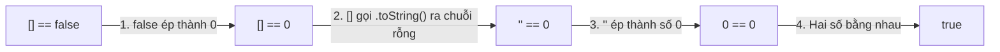

# 07 - Truthy & Falsy trong JavaScript (Bản Chất & Ép Kiểu Ngầm Định)

> [!NOTE]
> **Câu chuyện ẩn dụ:**
> Hãy tưởng tượng JavaScript là một **nhân viên soát vé rạp chiếu phim**:
>
> - Trước cửa vào phòng chiếu, nhân viên này chỉ quan tâm đúng một câu hỏi nhị phân: **"Có được vào xem hay không (true/false)?"**
> - Thay vì đòi hỏi một tấm vé boolean thuần túy, người xem có thể đưa ra rất nhiều thứ khác nhau: một chuỗi văn bản `"hello"`, một mảng rỗng `[]`, số `0`, hay chiếc ví rỗng `null`.
> - Người soát vé sẽ tự động "phiên dịch" (ép kiểu ngầm):
>   - Bất cứ thứ gì mang tính "rỗng", "hư vô", "số không" hoặc "không tồn tại" sẽ bị coi là **Falsy** (bị chặn lại).
>   - Tất cả mọi thứ còn lại — kể cả một chiếc hộp rỗng `[]` hay một object chưa có gì `{}` — đều được coi là **Truthy** (cho qua cửa).

---

> [!IMPORTANT]
> ### 🔗 Kiến Thức Tiên Quyết (Prerequisites)
> Để hiểu tường tận cơ chế Truthy/Falsy và thuật toán ép kiểu ngầm định (Type Coercion) trong bài này, bạn bắt buộc phải nắm vững:
> 1. **8 Kiểu dữ liệu trong JavaScript** tại [03 - Khai Báo Biến & Kiểu Dữ Liệu (Mục 11)](file:///d:/github/studyProgram/javascript/docs/03-variables-and-data-types.md#11-toàn-diện-về-kiểu-dữ-liệu-trong-javascript-data-types):
>    - *Vì sao bắt buộc?* 8 giá trị Falsy trong JavaScript (`false`, `0`, `-0`, `0n`, `""`, `null`, `undefined`, `NaN`) xuất phát trực tiếp từ các kiểu dữ liệu đã học ở Bài 03.
> 2. **Toán tử phủ định `!` và kỹ thuật Double NOT `!!`** tại [06 - Toán Tử Logical (Mục 4)](file:///d:/github/studyProgram/javascript/docs/06-logical-operators.md#4-toán-tử-not--kỹ-thuật-double-not-):
>    - *Vì sao bắt buộc?* Bài 07 dùng kỹ thuật `!!value` để ép bất kỳ giá trị nào về đúng chuẩn Boolean chân lý (`true`/`false`).
> 3. **So sánh `==` vs `===`** tại [05 - Rẽ Nhánh & Hệ Thống Toán Tử (Mục 5)](file:///d:/github/studyProgram/javascript/docs/05-conditionals-and-operators.md#5-toán-tử-so-sánh-comparison-operators):
>    - *Vì sao bắt buộc?* Hiểu cơ chế ép kiểu ngầm định của `==` (ToNumber, ToPrimitive algorithm) giải thích vì sao `[] == false` lại ra `true`.
> * **Đích đến tiếp theo:** Khái niệm Truthy/Falsy là điều kiện bắt buộc để viết callback cho các phương thức lọc mảng `.filter()` và `.find()` tại [10 - Mảng (Arrays)](file:///d:/github/studyProgram/javascript/docs/10-arrays.md).
> * 🗺️ *Xem bản đồ lộ trình tổng thể:* [Bản đồ liên kết kiến thức toàn dự án (agent.md)](file:///d:/github/studyProgram/javascript/agent.md).

---

## Mục Lục

<a id="mục-lục"></a>

1. [Khái Niệm Truthy & Falsy](#1-khái-niệm-truthy-falsy)
2. [Danh Sách 8 Giá Trị Falsy Trong JavaScript](#2-danh-sách-8-giá-trị-falsy-trong-javascript)
   - [Tại Sao Mảng Rỗng và Object Rỗng Lại Là Truthy?](#tại-sao-mảng-rỗng-và-object-rỗng-lại-là-truthy)
3. [Cơ Chế Ép Kiểu Ngầm Định (Implicit Type Coercion)](#3-cơ-chế-ép-kiểu-ngầm-định)
4. [Toán Tử Logic: &&, ||, ?? và !!](#4-toán-tử-logic)
5. [Cạm Bẫy Phổ Biến & So Sánh == vs ===](#5-cạm-bẫy-phổ-biến-và-so-sánh)
6. [Best Practices Trong Thực Tế Dự Án](#6-best-practices-trong-thực-tế-dự-án)

---

<a id="1-khái-niệm-truthy-falsy"></a>
## 1. Khái Niệm Truthy & Falsy

Trong JavaScript, một giá trị **Truthy** là giá trị được coi là `true` khi đặt trong ngữ cảnh luận lý (Boolean context) như câu lệnh điều kiện `if`, vòng lặp `while`, hoặc biểu thức toán tử 3 ngôi (`? :`).

Ngược lại, một giá trị **Falsy** là giá trị sẽ được chuyển đổi thành `false` trong ngữ cảnh luận lý.

```javascript
if ("JavaScript") {
  console.log("Chuỗi không rỗng là Truthy -> Chạy vào đây!");
}

if (0) {
  // Sẽ không chạy vì 0 là Falsy
} else {
  console.log("0 là Falsy -> Chạy vào nhánh else!");
}
```

[⬆️ Quay lại Mục lục](#mục-lục)

---

<a id="2-danh-sách-8-giá-trị-falsy-trong-javascript"></a>
## 2. Danh Sách 8 Giá Trị Falsy Trong JavaScript

JavaScript chỉ có duy nhất **8 giá trị Falsy** (tính đến ECMAScript hiện đại). Mọi giá trị khác ngoài 8 giá trị này đều là **Truthy**:

| STT | Giá trị Falsy          | Kiểu dữ liệu (`typeof`) | Ý nghĩa thực tế                        |
| :-: | :--------------------- | :---------------------- | :------------------------------------- |
|  1  | `false`                | `boolean`               | Giá trị boolean sai nguyên bản         |
|  2  | `0`                    | `number`                | Số không                               |
|  3  | `-0`                   | `number`                | Số âm không                            |
|  4  | `0n`                   | `bigint`                | Số 0 kiểu BigInt                       |
|  5  | `""` (hoặc `''`, ````) | `string`                | Chuỗi ký tự rỗng (độ dài 0)            |
|  6  | `null`                 | `object` (bug lịch sử)  | Giá trị rỗng có chủ ý                  |
|  7  | `undefined`            | `undefined`             | Biến chưa được gán giá trị             |
|  8  | `NaN`                  | `number`                | "Not-a-Number" (kết quả phép toán lỗi) |

> [!TIP]
> **Mẹo ghi nhớ siêu nhanh — Câu vè thần chú Falsy:**
>
> 🗣️ **"false – không – rỗng – null – ăn – nak"**
>
> | Từ khóa vè | Đại diện cho giá trị JS | Ý nghĩa / Giải thích |
> | :--- | :--- | :--- |
> | **false** | `false` | Giá trị boolean sai nguyên bản |
> | **không** | `0`, `-0`, `0n` | Số 0 (số thường, số âm không, BigInt zero) |
> | **rỗng** | `""` (hoặc `''`, ````) | Chuỗi ký tự rỗng (độ dài 0) |
> | **null** | `null` | Giá trị rỗng có chủ ý |
> | **ăn** | `undefined` | Đọc chệch từ âm đầu **un-** / **ân-** của `undefined` |
> | **nak** | `NaN` | Đọc vui theo phiên âm tắt của **NaN** ("Not a Number") |
>
> 💡 **Quy tắc vàng:** Chỉ cần thuộc câu vè 6 từ trên, **tất cả mọi giá trị khác** trong JavaScript (kể cả mảng rỗng `[]`, object rỗng `{}`, chuỗi `"0"`, chuỗi `"false"`) đều là **Truthy**!

> [!IMPORTANT]
> **Đặc biệt lưu ý:**
>
> - `[]` (mảng rỗng) là **Truthy**!
> - `{}` (object rỗng) là **Truthy**!
> - `"0"` (chuỗi có số không) là **Truthy**!
> - `"false"` (chuỗi chữ false) là **Truthy**!

<a id="tại-sao-mảng-rỗng-và-object-rỗng-lại-là-truthy"></a>
### Tại Sao Mảng Rỗng và Object Rỗng Lại Là Truthy?

Nhiều người thắc mắc: *"Đã là rỗng sao không phải là Falsy?"* — Hãy nhớ 3 điểm cốt lõi:

1. **Ẩn dụ "Chiếc hộp rỗng":**
   - `null`: Không có chiếc hộp nào trên bàn.
   - `[]` hay `{}`: **Có một chiếc hộp carton đặt ngay trên bàn**, chỉ là bên trong chưa có đồ. Bản thân chiếc hộp vẫn tồn tại $\rightarrow$ **Truthy**!
2. **Bản chất vùng nhớ (Reference Type):**
   - Biến `const arr = []` không chứa giá trị rỗng, mà giữ **địa chỉ ô nhớ** (con trỏ tham chiếu trên RAM) trỏ đến một Object hợp lệ.
   - Theo chuẩn ECMAScript: **Mọi Object luôn luôn là `true`** khi ép kiểu Boolean (`Boolean([]) === true`).
3. **Ý nghĩa thực tế:**
   - `if (cart)`: Kiểm tra đối tượng giỏ hàng **đã được khởi tạo / tải thành công chưa**.
   - `if (cart.length === 0)`: Kiểm tra giỏ hàng **có món đồ nào bên trong không**.

> [!WARNING]
> **Cạm bẫy `[] == false`:**
> Phép so sánh `[] == false` trả về `true` vì toán tử `==` ép kiểu ngầm `[]` thành chuỗi rỗng `""` rồi thành số `0`, `false` thành số `0` (`0 == 0`). Nhưng khi đặt trực tiếp trong câu lệnh điều kiện `if ([])`, JS dùng `Boolean([])` nên **luôn luôn là `true`**!

[⬆️ Quay lại Mục lục](#mục-lục)

---

<a id="3-cơ-chế-ép-kiểu-ngầm-định"></a>
## 3. Cơ Chế Ép Kiểu Ngầm Định (Implicit Type Coercion)

Nhiều bạn thường thắc mắc: *"Trong biểu thức so sánh, các số hạng luôn tự ép kiểu về 0 hoặc 1 à? Tôi tưởng ép kiểu ngầm là luôn gọi hàm `Boolean(val)` để ra `true/false`?"*

👉 **Câu trả lời là:** JavaScript **KHÔNG PHẢI** lúc nào cũng ép về Boolean! Ngôn ngữ này có **3 ngữ cảnh ép kiểu ngầm hoàn toàn khác nhau**:

| Ngữ cảnh | Ví dụ điển hình | Hàm nội bộ JS gọi | Kết quả ép kiểu |
| :--- | :--- | :--- | :--- |
| **1. Ngữ cảnh Luận lý** *(Boolean Context)* | `if (x)`, `while (x)`, `!x`, `x ? a : b` | **`ToBoolean(x)`** *(tương đương `Boolean(x)`)* | `true` hoặc `false` |
| **2. Ngữ cảnh Số học & So sánh** *(Numeric / Equality)* | `-`, `*`, `/`, `%`, `>`, `<`, và **phép so sánh `==`** | **`ToNumber(x)`** *(tương đương `Number(x)`)* | Số (`0`, `1`, `NaN`...) |
| **3. Ngữ cảnh Chuỗi** *(String Context)* | Phép cộng `+` có 1 vế là chuỗi (`5 + "px"`) | **`ToString(x)`** *(tương đương `String(x)`)* | Chuỗi ký tự (`"5px"`) |

### 3.1. Ngữ cảnh Luận lý (Boolean Context): Chỉ quan tâm Đúng hay Sai

Trong các câu lệnh rẽ nhánh (`if`, `while`, toán tử `!`), JS chỉ cần biết biểu thức mang tính **Truthy** (cho qua) hay **Falsy** (chặn lại), nên nó gọi ngầm `Boolean(val)`:

```javascript
// JS Engine tự động gọi Boolean(username):
const username = "Huy";
if (username) {
  // Tương đương: if (Boolean(username) === true)
  console.log(`Xin chào ${username}`);
}

// Mảng rỗng [] là Object -> Boolean([]) trả về true:
if ([]) {
  console.log("Mảng rỗng vào đây vì là Truthy!"); // ✅ Chạy bình thường!
}
```

### 3.2. Ngữ cảnh Phép so sánh lỏng lẻo (`==`): Cố gắng đưa về Số (ToNumber)

> [!CAUTION]
> **Quy tắc cốt lõi của toán tử `==`:** 
> Thuật toán của `==` (Abstract Equality) **KHÔNG BAO GIỜ ép 2 vế về Boolean rồi so sánh!** 
> *(Nếu ép về Boolean thì `[] == false` sẽ thành `true == false` → `false`, nhưng thực tế nó lại ra `true`)*.
>
> Thay vào đó, quy tắc của `==` là: **Hễ gặp Boolean, hãy ép cái Boolean đó thành SỐ (`ToNumber`) trước** để so sánh độ lớn!

Hãy xem từng bước vì sao biểu thức `[] == false` lại trả về `true`:



1. **Bước 1:** Thấy có boolean `false` $\rightarrow$ JS ép thành số: `Number(false) = 0`. Biểu thức trở thành: `[] == 0`.
2. **Bước 2:** So sánh Object (`[]`) với Số (`0`) $\rightarrow$ JS bắt mảng biến thành kiểu nguyên thủy (gọi `[].toString()`) $\rightarrow$ ra chuỗi rỗng `""`. Biểu thức trở thành: `"" == 0`.
3. **Bước 3:** So sánh Chuỗi (`""`) với Số (`0`) $\rightarrow$ JS ép chuỗi thành số: `Number("") = 0`. Biểu thức trở thành: `0 == 0`.
4. **Bước 4:** Cả hai vế đều là số `0`, kết quả cuối cùng: `0 == 0` là **`true`**!

### 3.3. Nghịch lý kinh điển của JavaScript

Chính vì sự khác biệt giữa hai ngữ cảnh trên, JavaScript tạo ra nghịch lý nổi tiếng:

```javascript
// 1. Trong if (Boolean Context): [] là Truthy!
if ([]) {
  console.log("1. Mảng rỗng là Truthy!"); // ✅ In ra màn hình
}

// 2. Trong phép == (Numeric Context): [] lại bằng false!
if ([] == false) {
  console.log("2. Nhưng mảng rỗng == false lại là true?!"); // ✅ In ra màn hình luôn!
}
```

> [!TIP]
> **Giải pháp tối thượng trong dự án:**
> Tuyệt đối không dùng `==`. Luôn dùng **`===` (Strict Equality)** vì `===` cấm tuyệt đối việc ép kiểu ngầm định:
> ```javascript
> [] === false; // ❌ false ngay lập tức (Object khác kiểu Boolean)
> ```

[⬆️ Quay lại Mục lục](#mục-lục)

---

<a id="4-toán-tử-logic"></a>
## 4. Toán Tử Logic: &&, ||, ?? và !!

### 4.1. Toán tử `&&` (Logical AND - Tìm Falsy đầu tiên)

Toán tử `&&` trả về **giá trị Falsy đầu tiên** mà nó bắt gặp. Nếu tất cả đều Truthy, nó trả về giá trị cuối cùng.

```javascript
console.log(true && "An" && 0 && "Linh"); // 0 (Falsy đầu tiên)
console.log("An" && "Bình" && "Cường"); // "Cường" (Truthy cuối)
```

### 4.2. Toán tử `||` (Logical OR - Tìm Truthy đầu tiên)

Toán tử `||` trả về **giá trị Truthy đầu tiên** mà nó bắt gặp. Nếu tất cả đều Falsy, nó trả về giá trị cuối cùng.

```javascript
const defaultName = userInput || "Khách vãng lai";
```

### 4.3. Toán tử `??` (Nullish Coalescing)

Toán tử `??` chỉ coi `null` và `undefined` là giá trị rỗng, cho phép giữ lại `0`, `""`, và `false`.

```javascript
const count = 0;
console.log(count || 10); // 10 (vì 0 là falsy -> sai mong muốn!)
console.log(count ?? 10); // 0 (vì 0 không phải null/undefined -> chuẩn xác!)
```

### 4.4. Toán tử `!!` (Double NOT)

Ép kiểu tường minh bất kỳ biến nào về `true` hoặc `false` primitive:

```javascript
const token = "eyJhbGciOi...";
const isAuthenticated = !!token; // true
```

[⬆️ Quay lại Mục lục](#mục-lục)

---

<a id="5-cạm-bẫy-phổ-biến-và-so-sánh"></a>
## 5. Cạm Bẫy Phổ Biến & So Sánh == vs ===

Toán tử so sánh bằng lỏng lẻo (`==`) thực hiện ép kiểu ngầm định phức tạp và gây ra nhiều cạm bẫy:

```javascript
0 == false; // true (0 và false đều ép về số 0)
"" == false; // true ("" ép về 0)
[] == false; // true ([] ép về "" rồi ép về 0)
null == undefined; // true (quy ước đặc biệt)
null == false; // false (null chỉ bằng null hoặc undefined)
NaN == NaN; // false (NaN không bằng chính nó!)
```

> [!TIP]
> **Quy tắc vàng:** Luôn dùng so sánh nghiêm ngặt (`===` và `!==`) để kiểm tra cả giá trị lẫn kiểu dữ liệu mà không lo bị ép kiểu ngầm.

[⬆️ Quay lại Mục lục](#mục-lục)

---

<a id="6-best-practices-trong-thực-tế-dự-án"></a>
## 6. Best Practices Trong Thực Tế Dự Án

### 6.1. Kiểm tra mảng rỗng

```javascript
// ❌ SAI:
if (arr) { ... } // Luôn true dù mảng rỗng!

// ✅ ĐÚNG:
if (arr.length === 0) {
  console.log("Mảng rỗng");
}
```

### 6.2. Kiểm tra object rỗng

```javascript
// ❌ SAI:
if (obj) { ... } // Luôn true dù {} rỗng!

// ✅ ĐÚNG:
if (Object.keys(obj).length === 0) {
  console.log("Object rỗng");
}
```

[⬆️ Quay lại Mục lục](#mục-lục)
