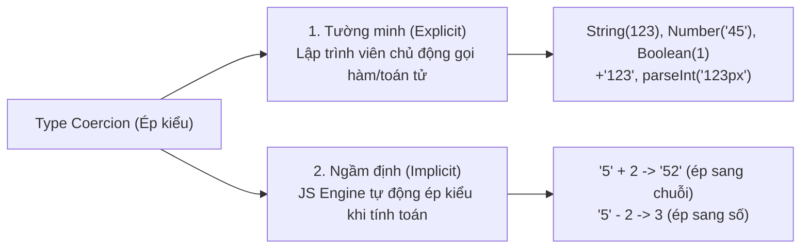
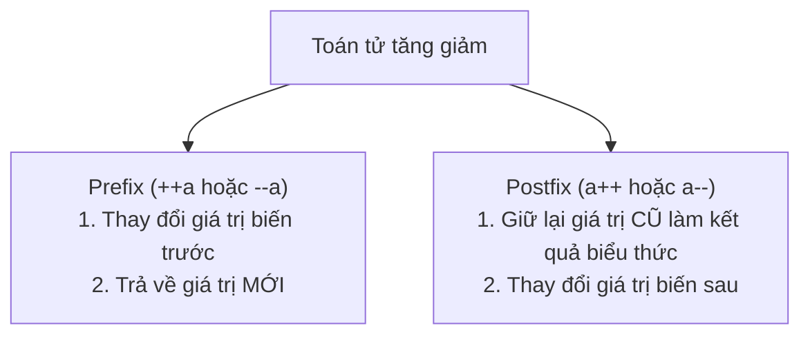
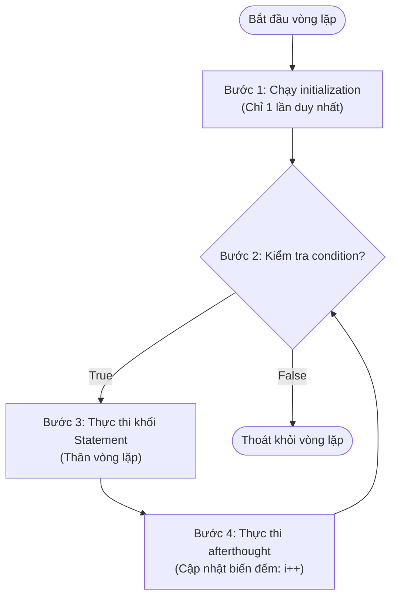

# 08 - Ép Kiểu & Các Cấu Trúc Vòng Lặp Trong JavaScript (Type Coercion & Loops)

<a id="mục-lục"></a>
## Mục Lục

- [1. Ép Kiểu Dữ Liệu Trong JavaScript (Type Coercion)](#1-ép-kiểu-dữ-liệu-trong-javascript-type-coercion)
  - [1.1. Ép kiểu tường minh (Explicit Coercion)](#11-ép-kiểu-tường-minh-explicit-coercion)
  - [1.2. Ép kiểu ngầm định (Implicit Coercion)](#12-ép-kiểu-ngầm-định-implicit-coercion)
  - [1.3. So sánh chuyên sâu: `Number()` vs `parseInt()` vs `parseFloat()`](#13-so-sánh-chuyên-sâu-number-vs-parseint-vs-parsefloat)
- [2. Toán Tử Tăng Giảm (++, --) — Giải Mã Prefix vs Postfix](#2-toán-tử-tăng-giảm----giải-mã-prefix-vs-postfix)
  - [2.1. Tiền tố (Prefix: `++a`, `--a`)](#21-tiền-tố-prefix-a--a)
  - [2.2. Hậu tố (Postfix: `a++`, `a--`)](#22-hậu-tố-postfix-a-a-)
  - [2.3. Quy trình từng bước khi đánh giá biểu thức phức tạp](#23-quy-trình-từng-bước-khi-đánh-giá-biểu-thức-phức-tạp)
- [3. Vòng Lặp For (For Loop) Toàn Diện](#3-vòng-lặp-for-for-loop-toàn-diện)
  - [3.1. Định nghĩa & Cú pháp](#31-định-nghĩa--cú-pháp)
  - [3.2. Quy trình 4 bước vận hành của JavaScript Engine](#32-quy-trình-4-bước-vận-hành-của-javascript-engine)
  - [3.3. So sánh Scope biến đếm: `var i` vs `let i` (Cạm bẫy bất đồng bộ)](#33-so-sánh-scope-biến-đếm-var-i-vs-let-i-cạm-bẫy-bất-đồng-bộ)
  - [3.4. 3 Dạng Statement trong vòng lặp for](#34-3-dạng-statement-trong-vòng-lặp-for)
  - [3.5. Vòng lặp vô hạn (Infinite Loop) & Cách kiểm soát](#35-vòng-lặp-vô-hạn-infinite-loop--cách-kiểm-soát)
  - [3.6. Các từ khóa điều khiển: `break` và `continue`](#36-các-từ-khóa-điều-khiển-break-và-continue)
  - [3.7. Nhãn điều khiển (Labelled Statements) cho vòng lặp lồng nhau](#37-nhãn-điều-khiển-labelled-statements-cho-vòng-lặp-lồng-nhau)
- [4. Vòng Lặp While (While Loop)](#4-vòng-lặp-while-while-loop)
  - [4.1. Định nghĩa & Cú pháp](#41-định-nghĩa--cú-pháp)
  - [4.2. Quy trình 4 bước hoạt động](#42-quy-trình-4-bước-hoạt-động)
  - [4.3. Ví dụ thực tế & Nguy cơ vòng lặp vô hạn](#43-ví-dụ-thực-tế--nguy-cơ-vòng-lặp-vô-hạn)
  - [4.4. Điều khiển nhãn (Label) trong vòng lặp While](#44-điều-khiển-nhãn-label-trong-vòng-lặp-while)
- [5. Vòng Lặp Do-While (Do-While Loop)](#5-vòng-lặp-do-while-do-while-loop)
  - [5.1. Định nghĩa & Điểm khác biệt chí mạng với While](#51-định-nghĩa--điểm-khác-biệt-chí-mạng-với-while)
  - [5.2. Cú pháp & Quy trình thực thi](#52-cú-pháp--quy-trình-thực-thi)
  - [5.3. Ứng dụng thực tế: Menu tương tác & Nhập liệu có kiểm tra](#53-ứng-dụng-thực-tế-menu-tương-tác--nhập-liệu-có-kiểm-tra)
- [6. Cạm Bẫy Thường Gặp Khi Sử Dụng Vòng Lặp (Common Pitfalls)](#6-cạm-bẫy-thường-gặp-khi-sử-dụng-vòng-lặp-common-pitfalls)
- [7. Bảng So Sánh Tổng Kết 3 Loại Vòng Lặp](#7-bảng-so-sánh-tổng-kết-3-loại-vòng-lặp)

---

> [!NOTE]
> **Câu chuyện ẩn dụ:**
> Hãy tưởng tượng bạn đang điều hành một **dây chuyền sản xuất bánh kẹo tự động**:
> - **Ép kiểu (Type Coercion):** Là chiếc máy đúc khuôn nguyên liệu đầu vào:
>   - *Ép kiểu tường minh (Explicit):* Người thợ chủ động cho đường cát vào máy xay nghiền mịn thành đường bột mịn (`String(123)`, `Number("123")`, `parseInt("123px")`). Mọi người đều biết rõ nguyên liệu được biến đổi thế nào.
>   - *Ép kiểu ngầm định (Implicit):* Cảm biến dây chuyền tự động phát hiện: Nếu gặp chuỗi ký tự, nó tự động dán nhãn ghép chuỗi (`'5' + 2 = '52'`); nếu gặp phép tính toán trừ/nhân/chia, nó tự động ép chuỗi số về số học để tính toán (`'5' - 2 = 3`).
> - **Toán tử tăng giảm (`++`, `--`):**
>   - *Prefix (`++i`):* Bấm nút nhảy số đếm trên bảng điện tử **trước**, rồi mới in nhãn dán lên gói kẹo (tăng trước, trả về giá trị mới sau).
>   - *Postfix (`i++`):* In nhãn dán với con số hiện tại **trước**, rồi sau đó bộ đếm mới nhảy lên số tiếp theo (trả về giá trị cũ trước, tăng sau).
> - **Vòng lặp `for`:** Dây chuyền biết trước số lượng cần đóng thùng (ví dụ: đóng đúng 100 hộp kẹo), với 4 bước nhịp nhàng: Khởi tạo biến đếm, kiểm tra điều kiện, thực thi đóng gói, và bước nhảy cập nhật.
> - **Vòng lặp `while`:** Dây chuyền đóng gói theo tín hiệu cảm biến: *"Khi nào bồn si-rô còn chưa cạn (`while (hasSyrup)`) thì tiếp tục bơm"*. Nếu bồn cạn ngay từ đầu, máy không bơm giọt nào!
> - **Vòng lặp `do...while`:** Dây chuyền kiểm định chất lượng: Luôn chạy thử nghiệm mẻ bánh đầu tiên (`do`), sau đó mới đo lường xem có đạt chuẩn để chạy tiếp hay không (`while`).
> - **`break`, `continue`, `label`:** Nút dừng khẩn cấp toàn dây chuyền (`break`), nút loại bỏ gói kẹo rách để làm tiếp gói sau (`continue`), và bảng điều khiển đa tầng định danh dây chuyền mẹ/con (`outer: for ... inner: for`).

---

> [!IMPORTANT]
> ### 🔗 Kiến Thức Tiên Quyết (Prerequisites)
> Để hiểu sâu và thực hành hiệu quả các cấu trúc vòng lặp và ép kiểu trong bài này, bạn bắt buộc phải nắm vững:
> 1. **Khai báo biến `let` vs `var` và Block Scope** tại [03 - Khai Báo Biến & Kiểu Dữ Liệu (Mục 3)](file:///d:/github/studyProgram/javascript/docs/03-variables-and-data-types.md#3-bản-chất-toàn-diện-về-phạm-vi-scope-trong-javascript-xóa-bỏ-hoàn-toàn-nhầm-lẫn):
>    - *Vì sao bắt buộc?* Biến đếm khai báo bằng `let i` trong vòng lặp `for` có Block Scope, được cấp phát độc lập ở mỗi lượt lặp; trong khi `var i` bị rò rỉ ra ngoài phạm vi và gây bẫy logic nghiêm trọng.
> 2. **Toán tử so sánh & Rẽ nhánh điều kiện** tại [05 - Rẽ Nhánh & Hệ Thống Toán Tử (Mục 1 & 5)](file:///d:/github/studyProgram/javascript/docs/05-conditionals-and-operators.md):
>    - *Vì sao bắt buộc?* Biểu thức điều kiện (`condition`) trong vòng `for`, `while`, `do-while` quyết định vòng lặp tiếp tục hay dừng lại dựa trên giá trị chân lý Boolean.
> 3. **Bản chất Truthy & Falsy** tại [07 - Truthy & Falsy](file:///d:/github/studyProgram/javascript/docs/07-truthy-falsy.md):
>    - *Vì sao bắt buộc?* Điều kiện dừng của vòng lặp không bắt buộc phải là một phép so sánh boolean thuần túy mà có thể là bất kỳ biểu thức Truthy/Falsy nào (`while (items.length)`, `for (; count; )`).
> * **Đích đến tiếp theo:** Vòng lặp và ép kiểu là viên gạch nền tảng để bạn học tiếp [09 - 3 Loại Hàm Trong JavaScript](file:///d:/github/studyProgram/javascript/docs/09-function-types.md) và thuật toán duyệt mảng trong [11 - Mảng (Arrays)](file:///d:/github/studyProgram/javascript/docs/11-arrays.md).
> * 🗺️ *Xem bản đồ lộ trình tổng thể:* [Bản đồ liên kết kiến thức toàn dự án (agent.md)](file:///d:/github/studyProgram/javascript/agent.md).

---

<a id="1-ép-kiểu-dữ-liệu-trong-javascript-type-coercion"></a>
## 1. Ép Kiểu Dữ Liệu Trong JavaScript (Type Coercion)

JavaScript là một ngôn ngữ **định kiểu động (Dynamically Typed)** và **định kiểu yếu (Weakly Typed)**. Điều này đồng nghĩa với việc kiểu dữ liệu của một biến có thể thay đổi linh hoạt trong quá trình chạy, và JavaScript Engine có thể chủ động chuyển đổi kiểu dữ liệu của một giá trị sang kiểu khác để thực hiện phép toán.

Quá trình chuyển đổi này được chia thành 2 hình thức: **Tường minh (Explicit)** và **Ngầm định (Implicit)**.



<a id="11-ép-kiểu-tường-minh-explicit-coercion"></a>
### 1.1. Ép kiểu tường minh (Explicit Coercion)

**Định nghĩa:** Là hành động lập trình viên chủ động sử dụng các hàm dựng sẵn (Built-in Constructors) hoặc các toán tử đặc biệt để chuyển đổi một giá trị từ kiểu này sang kiểu khác một cách rõ ràng, minh bạch.

```javascript
// 1. Ép sang Chuỗi (String)
const num = 123;
const str1 = String(num);        // '123'
const str2 = num.toString();     // '123'
const boolStr = String(true);    // 'true'
const nullStr = String(null);    // 'null'

// 2. Ép sang Số (Number)
const num1 = Number('123');      // 123
const num2 = Number('  456  ');  // 456 (tự động loại bỏ khoảng trắng hai đầu)
const num3 = Number('123px');    // NaN (chứa ký tự chữ cái không hợp lệ)
const num4 = Number(true);       // 1
const num5 = Number(false);      // 0
const num6 = Number(null);       // 0
const num7 = Number(undefined);  // NaN (Cực kỳ quan trọng: null thành 0, nhưng undefined thành NaN!)

// Toán tử Unary Plus (+) là cách viết tắt phổ biến của Number()
const fastNum = +'123';          // 123 (nhanh, gọn, thường gặp trong thực tế)
const fastNaN = +'abc';          // NaN

// 3. Ép sang Boolean (Đúng / Sai)
const b1 = Boolean(0);           // false (0 là Falsy)
const b2 = Boolean(1);           // true
const b3 = Boolean('');          // false (Chuỗi rỗng là Falsy)
const b4 = Boolean('Hello');     // true (Chuỗi có nội dung là Truthy)
const b5 = Boolean([]);          // true (Mảng rỗng vẫn là Truthy!)
const b6 = Boolean({});          // true (Object rỗng vẫn là Truthy!)

// Toán tử Double NOT (!!) là cách viết tắt của Boolean()
const fastBool = !!'JavaScript'; // true
```

<a id="12-ép-kiểu-ngầm-định-implicit-coercion"></a>
### 1.2. Ép kiểu ngầm định (Implicit Coercion)

**Định nghĩa:** Là quá trình JavaScript Engine tự động âm thầm chuyển đổi kiểu dữ liệu của các toán hạng khi bạn áp dụng các toán tử số học (`+`, `-`, `*`, `/`, `%`) hoặc toán tử so sánh (`==`).

Quy tắc cốt lõi cần ghi nhớ:
1. **Phép cộng (`+`) ưu tiên Chuỗi (String Concatenation):** Nếu ít nhất 1 trong 2 toán hạng là chuỗi, toán hạng còn lại sẽ bị tự động ép thành chuỗi để thực hiện ghép nối.
2. **Các phép toán số học khác (`-`, `*`, `/`, `%`):** Luôn luôn cố gắng ép các toán hạng về dạng Số (`Number`) để tính toán.

```javascript
// Bẫy phép cộng '+'
console.log('5' + 2);        // "52" (số 2 bị ép ngầm thành chuỗi "2")
console.log(1 + 2 + '3');    // "33" (1 + 2 = 3 trước, sau đó 3 + "3" = "33")
console.log('1' + 2 + 3);    // "123" ("1" + 2 = "12", sau đó "12" + 3 = "123")
console.log('Giá trị: ' + true); // "Giá trị: true"

// Phép trừ, nhân, chia ép về Number
console.log('5' - 2);        // 3 (chuỗi '5' bị ép ngầm thành số 5)
console.log('6' * '2');      // 12 (cả hai chuỗi đều bị ép thành số)
console.log('10' / 2);       // 5
console.log('10' % 3);       // 1
console.log('abc' - 2);      // NaN (chuỗi 'abc' không thể ép thành số hợp lệ)

// Toán tử so sánh lỏng lẻo (==) ép kiểu ngầm định
console.log('5' == 5);       // true (chuỗi '5' ép thành số 5)
console.log(0 == false);     // true (false ép thành 0)
console.log('' == false);    // true (cả hai ép thành 0)
console.log(null == undefined); // true (quy ước đặc biệt của JS)
```

<a id="13-so-sánh-chuyên-sâu-number-vs-parseint-vs-parsefloat"></a>
### 1.3. So sánh chuyên sâu: `Number()` vs `parseInt()` vs `parseFloat()`

Đây là một trong những câu hỏi phỏng vấn kinh điển về JavaScript. Cả 3 hàm đều dùng để chuyển chuỗi sang số nhưng có cách hoạt động rất khác nhau:

| Đặc điểm | `Number(str)` | `parseInt(str, radix)` | `parseFloat(str)` |
| :--- | :--- | :--- | :--- |
| **Cơ chế** | Ép kiểu toàn bộ chuỗi | Quét từ trái sang phải, lấy phần nguyên đến khi gặp ký tự lạ | Quét từ trái sang phải, lấy cả phần số thực |
| `'123'` | `123` | `123` | `123` |
| `'123px'` | `NaN` (lỗi vì dính chữ) | `123` (bỏ qua 'px') | `123` |
| `'12.34em'` | `NaN` | `12` (chỉ lấy phần nguyên) | `12.34` |
| `'px123'` | `NaN` | `NaN` (ký tự đầu tiên không phải số) | `NaN` |
| `''` (rỗng) | `0` | `NaN` | `NaN` |
| `true` / `false` | `1` / `0` | `NaN` | `NaN` |
| `null` | `0` | `NaN` | `NaN` |

> [!TIP]
> **Best Practice:** Luôn truyền tham số cơ số (radix) khi dùng `parseInt` (ví dụ: `parseInt('123', 10)`) để tránh việc các chuỗi bắt đầu bằng `0` bị hiểu nhầm thành hệ cơ số 8 (Octal) trên các trình duyệt cũ.

[⬆️ Quay lại Mục lục](#mục-lục)

---

<a id="2-toán-tử-tăng-giảm----giải-mã-prefix-vs-postfix"></a>
## 2. Toán Tử Tăng Giảm (++, --) — Giải Mã Prefix vs Postfix

Toán tử tăng (`++`) và giảm (`--`) dùng để cộng thêm 1 hoặc trừ đi 1 đơn vị từ giá trị hiện tại của biến. Tuy nhiên, vị trí đặt toán tử (đứng trước hay đứng sau biến) sẽ quyết định **thời điểm giá trị trả về được tính toán**.



<a id="21-tiền-tố-prefix-a--a"></a>
### 2.1. Tiền tố (Prefix: `++a`, `--a`)
- **Cú pháp:** `++a` hoặc `--a`.
- **Cơ chế:** Tăng hoặc giảm giá trị của `a` đi 1 đơn vị ngay lập tức, sau đó trả về **giá trị mới** cho biểu thức chứa nó.

```javascript
let x = 5;
let y = ++x; // Bước 1: x tăng lên 6. Bước 2: gán giá trị mới (6) cho y.

console.log(x); // 6
console.log(y); // 6 (y nhận giá trị đã được tăng)
```

<a id="22-hậu-tố-postfix-a-a-"></a>
### 2.2. Hậu tố (Postfix: `a++`, `a--`)
- **Cú pháp:** `a++` hoặc `a--`.
- **Cơ chế:** Trả về **giá trị hiện tại (giá trị cũ)** của `a` cho biểu thức trước, sau đó mới âm thầm tăng hoặc giảm `a` đi 1 đơn vị trong bộ nhớ.

```javascript
let m = 5;
let n = m++; // Bước 1: trả về giá trị hiện tại (5) cho n. Bước 2: m tăng lên 6.

console.log(m); // 6 (m đã được tăng lên 6)
console.log(n); // 5 (n nhận giá trị cũ của m trước khi tăng!)
```

<a id="23-quy-trình-từng-bước-khi-đánh-giá-biểu-thức-phức-tạp"></a>
### 2.3. Quy trình từng bước khi đánh giá biểu thức phức tạp

Hãy xem ví dụ "cân não" thường gặp trong các bài test tuyển dụng:

```javascript
let a = 5;
let result = a++ + ++a - a--;

// Phân tích từng bước từ trái sang phải:
// 1. a++ : Trả về 5 (nhưng sau đó biến a trong bộ nhớ tăng lên 6)
// 2. ++a : Biến a đang là 6, được tăng lên 7 và trả về 7
// 3. a-- : Trả về 7 (nhưng sau đó biến a trong bộ nhớ giảm xuống 6)
// Biểu thức tính: 5 + 7 - 7 = 5
console.log(result); // 5
console.log(a);      // 6 (giá trị cuối cùng của biến a sau bước 3)
```

[⬆️ Quay lại Mục lục](#mục-lục)

---

<a id="3-vòng-lặp-for-for-loop-toàn-diện"></a>
## 3. Vòng Lặp For (For Loop) Toàn Diện

Vòng lặp `for` là cấu trúc lặp phổ biến và kinh điển nhất trong hầu hết các ngôn ngữ lập trình. Nó được sử dụng khi bạn **biết trước số lần lặp** hoặc muốn lặp qua một phạm vi chỉ mục có trật tự xác định.

<a id="31-định-nghĩa--cú-pháp"></a>
### 3.1. Định nghĩa & Cú pháp

Cú pháp chuẩn của vòng lặp `for`:

```javascript
for (initialization; condition; afterthought) {
    // Thân vòng lặp: Khối code được thực thi lặp lại
}
```

Trong đó:
1. **`initialization` (Khởi tạo):** Thực thi duy nhất **1 lần** trước khi vòng lặp bắt đầu. Dùng để khai báo và khởi tạo biến đếm.
2. **`condition` (Điều kiện kiểm tra):** Biểu thức được đánh giá **trước mỗi lượt lặp**. Nếu `true` $\rightarrow$ chạy thân vòng lặp; nếu `false` $\rightarrow$ kết thúc vòng lặp.
3. **`afterthought` (Cập nhật / Bước nhảy):** Thực thi **sau mỗi lượt lặp**. Thường dùng để tăng hoặc giảm biến đếm (`i++`, `i += 2`, v.v.).

<a id="32-quy-trình-4-bước-vận-hành-của-javascript-engine"></a>
### 3.2. Quy trình 4 bước vận hành của JavaScript Engine



Ví dụ cơ bản:
```javascript
for (let i = 0; i < 5; i++) {
    console.log("Giá trị i:", i);
}
// Kết quả in ra lần lượt: 0, 1, 2, 3, 4
```

<a id="33-so-sánh-scope-biến-đếm-var-i-vs-let-i-cạm-bẫy-bất-đồng-bộ"></a>
### 3.3. So sánh Scope biến đếm: `var i` vs `let i` (Cạm bẫy bất đồng bộ)

Đây là khác biệt sống còn giữa ES5 (`var`) và ES6 (`let`):
- Khi dùng `var i`: Biến `i` có Function Scope / Global Scope. Chỉ có **duy nhất 1 biến `i`** được chia sẻ chung cho toàn bộ các lần lặp và rò rỉ ra bên ngoài vòng lặp.
- Khi dùng `let i`: Mỗi lần lặp tạo ra một **Block Scope `{}` hoàn toàn mới** với giá trị `i` riêng biệt, được khóa chặt bên trong vòng lặp.

```javascript
// 1. Kiểm tra rò rỉ biến ra ngoài
for (var a = 0; a < 3; a++) {}
console.log("Giá trị a ngoài vòng lặp:", a); // 3 (Rò rỉ biến!)

for (let b = 0; b < 3; b++) {}
// console.log(b); // ReferenceError: b is not defined (An toàn tuyệt đối!)

// 2. Cạm bẫy bất đồng bộ kinh điển với setTimeout
for (var i = 0; i < 3; i++) {
    setTimeout(() => console.log("var i:", i), 100);
}
// In ra: var i: 3, var i: 3, var i: 3 (Vì cả 3 timer cùng trỏ về 1 biến i chung đã lên 3)

for (let j = 0; j < 3; j++) {
    setTimeout(() => console.log("let j:", j), 100);
}
// In ra: let j: 0, let j: 1, let j: 2 (Mỗi callback bắt giữ biến j độc lập của lượt lặp đó!)
```

<a id="34-3-dạng-statement-trong-vòng-lặp-for"></a>
### 3.4. 3 Dạng Statement trong vòng lặp for

JavaScript cho phép linh hoạt cấu trúc phần thân vòng lặp theo 3 dạng:

#### Dạng 1: Câu lệnh đơn (Single Statement)
Nếu thân vòng lặp chỉ có 1 câu lệnh duy nhất, bạn có thể lược bỏ dấu ngoặc nhọn `{}`:
```javascript
for (let i = 0; i < 3; i++)
    console.log("Single line:", i);
```

#### Dạng 2: Khối câu lệnh (Block Statement - Khuyến nghị 100%)
Bao bọc nhiều câu lệnh trong cặp ngoặc nhọn `{}`. Đây là chuẩn mực Clean Code:
```javascript
for (let i = 0; i < 3; i++) {
    const step = i + 1;
    console.log(`Lần lặp thứ ${step}: i = ${i}`);
}
```

#### Dạng 3: Câu lệnh rỗng (Empty Statement)
Tất cả logic được dồn hết vào phần `afterthought` hoặc `condition`, thân vòng lặp chỉ là một dấu chấm phẩy `;` hoặc cặp ngoặc nhọn rỗng `{ ; }`:

```javascript
// Tính tổng từ 1 đến 10 chỉ với một dòng code dùng Empty Statement:
let sum = 0;
for (let i = 1; i <= 10; sum += i++); 

console.log("Tổng từ 1 đến 10 là:", sum); // 55
```
> [!WARNING]
> Mặc dù cú pháp Empty Statement là hợp lệ trong JavaScript, trong dự án thực tế bạn nên hạn chế lạm dụng vì nó làm giảm độ đọc hiểu mã nguồn và dễ khiến đồng đội nhầm là lỗi gõ thừa dấu `;`.

<a id="35-vòng-lặp-vô-hạn-infinite-loop--cách-kiểm-soát"></a>
### 3.5. Vòng lặp vô hạn (Infinite Loop) & Cách kiểm soát

Nếu phần `condition` bị bỏ trống, JavaScript Engine mặc định coi điều kiện luôn là `true`. Nếu bên trong không có cơ chế thoát, vòng lặp sẽ chạy mãi mãi và làm ứng dụng bị treo (freeze/crash):

```javascript
// Vòng lặp vô hạn nếu không có break:
for (let i = 0; ; i++) {
    if (i >= 5) break; // Thoát an toàn
    console.log("Đếm:", i);
}
```

<a id="36-các-từ-khóa-điều-khiển-break-và-continue"></a>
### 3.6. Các từ khóa điều khiển: `break` và `continue`

- **`break`:** Dừng và **thoát ngay lập tức** khỏi vòng lặp gần nhất, bỏ qua toàn bộ các lần lặp còn lại.
- **`continue`:** Bỏ qua phần code còn lại của **lượt lặp hiện tại** và nhảy ngay sang bước cập nhật (`afterthought`) để tiếp tục lượt lặp kế tiếp.

```javascript
// Ví dụ break: Dừng tìm kiếm khi tìm thấy mục tiêu
for (let i = 1; i <= 10; i++) {
    if (i === 4) {
        console.log("Đã tìm thấy mục tiêu tại i = 4. Dừng lặp!");
        break;
    }
    console.log("Đang quét:", i);
}
// In ra: 1, 2, 3

// Ví dụ continue: Chỉ in ra các số lẻ (bỏ qua số chẵn)
for (let i = 1; i <= 6; i++) {
    if (i % 2 === 0) {
        continue; // Bỏ qua lượt này nếu là số chẵn
    }
    console.log("Số lẻ:", i);
}
// In ra: 1, 3, 5
```

<a id="37-nhãn-điều-khiển-labelled-statements-cho-vòng-lặp-lồng-nhau"></a>
### 3.7. Nhãn điều khiển (Labelled Statements) cho vòng lặp lồng nhau

Khi có 2 hoặc nhiều vòng lặp lồng nhau, lệnh `break` hoặc `continue` mặc định chỉ tác động lên **vòng lặp trong cùng chứa nó**. Để điều khiển thoát hoặc bỏ qua cả vòng lặp cha bên ngoài, JavaScript cung cấp cú pháp **Label (Nhãn)**:

```javascript
// Đặt tên nhãn 'outerLoop' cho vòng lặp ngoài và 'innerLoop' cho vòng trong
outerLoop: for (let i = 0; i < 3; i++) {
    innerLoop: for (let j = 0; j < 3; j++) {
        if (i === 1 && j === 1) {
            console.log(`Gặp tọa độ nguy hiểm (${i}, ${j}) -> Thoát toàn bộ vòng lặp ngoài!`);
            break outerLoop; // Thoát thẳng ra ngoài outerLoop!
        }
        console.log(`Tọa độ: (${i}, ${j})`);
    }
}
// Kết quả in ra: (0,0), (0,1), (0,2), (1,0) -> Dừng hẳn khi gặp (1,1)
```

[⬆️ Quay lại Mục lục](#mục-lục)

---

<a id="4-vòng-lặp-while-while-loop"></a>
## 4. Vòng Lặp While (While Loop)

Vòng lặp `while` được sử dụng khi bạn **chưa biết chính xác số lần lặp**, mà chỉ muốn lặp lại một hành động chừng nào một **điều kiện logic vẫn còn thỏa mãn (`true`)**.

<a id="41-định-nghĩa--cú-pháp"></a>
### 4.1. Định nghĩa & Cú pháp

```javascript
while (condition) {
    // Thân vòng lặp: Khối lệnh thực thi khi condition là true
}
```

<a id="42-quy-trình-4-bước-hoạt-động"></a>
### 4.2. Quy trình 4 bước hoạt động

1. **Bước 1:** Kiểm tra biểu thức `condition`.
2. **Bước 2:** Nếu `condition` là **Truthy**, thực thi khối lệnh bên trong `{}`.
3. **Bước 3:** Sau khi thực thi xong khối lệnh, quay trở lại **Bước 1**.
4. **Bước 4:** Nếu `condition` là **Falsy**, vòng lặp kết thúc ngay lập tức và chuyển xuống dòng lệnh tiếp theo bên dưới.

> [!IMPORTANT]
> Vì điều kiện được kiểm tra **ngay từ đầu**, nếu điều kiện là `false` ngay từ lượt kiểm tra đầu tiên thì thân vòng lặp `while` sẽ **không được chạy một lần nào**!

<a id="43-ví-dụ-thực-tế--nguy-cơ-vòng-lặp-vô-hạn"></a>
### 4.3. Ví dụ thực tế & Nguy cơ vòng lặp vô hạn

```javascript
// Ví dụ chuẩn mực: Rút tiền dần từ tài khoản cho đến khi hết
let balance = 100;
let withdrawAmount = 30;

while (balance >= withdrawAmount) {
    balance -= withdrawAmount;
    console.log(`Đã rút ${withdrawAmount}k, số dư còn lại: ${balance}k`);
}
console.log("Số dư không đủ để rút tiếp!");

// Nguy cơ vòng lặp vô hạn nếu quên cập nhật biến điều kiện:
let count = 0;
while (count < 5) {
    console.log("count:", count);
    // QUÊN VIẾT count++ Ở ĐÂY SẼ GÂY TREO TRÌNH DUYỆT!
    count++; // Bắt buộc phải có bước cập nhật đưa điều kiện về false
}
```

<a id="44-điều-khiển-nhãn-label-trong-vòng-lặp-while"></a>
### 4.4. Điều khiển nhãn (Label) trong vòng lặp While

Tương tự như `for`, bạn hoàn toàn có thể gắn nhãn cho các vòng lặp `while` lồng nhau:

```javascript
let i = 0;
outerWhile: while (i < 3) {
    let j = 0;
    while (j < 3) {
        if (i === 1 && j === 1) {
            console.log("Thoát outerWhile từ vòng lặp trong!");
            break outerWhile;
        }
        console.log(`[While] i = ${i}, j = ${j}`);
        j++;
    }
    i++;
}
```

[⬆️ Quay lại Mục lục](#mục-lục)

---

<a id="5-vòng-lặp-do-while-do-while-loop"></a>
## 5. Vòng Lặp Do-While (Do-While Loop)

<a id="51-định-nghĩa--điểm-khác-biệt-chí-mạng-với-while"></a>
### 5.1. Định nghĩa & Điểm khác biệt chí mạng với While

Vòng lặp `do...while` là biến thể đặc biệt của `while`. Điểm khác biệt duy nhất nhưng mang tính quyết định:
- Vòng lặp `while`: **Kiểm tra trước $\rightarrow$ Thực thi sau**.
- Vòng lặp `do...while`: **Thực thi trước $\rightarrow$ Kiểm tra sau**.

> [!IMPORTANT]
> Vòng lặp `do...while` **luôn luôn thực thi thân vòng lặp ít nhất 1 lần**, bất kể điều kiện ban đầu là `true` hay `false`!

<a id="52-cú-pháp--quy-trình-thực-thi"></a>
### 5.2. Cú pháp & Quy trình thực thi

```javascript
do {
    // Khối lệnh luôn được thực thi ít nhất 1 lần
} while (condition); // Lưu ý: Có dấu chấm phẩy ';' ở cuối!
```

Minh họa sự khác biệt:
```javascript
let conditionFalse = false;

// Với While thông thường:
while (conditionFalse) {
    console.log("Dòng này SẼ KHÔNG BAO GIỜ được in ra!");
}

// Với Do...While:
do {
    console.log("Dòng này CHẮC CHẮN được in ra đúng 1 lần dù điều kiện là false!");
} while (conditionFalse);
```

<a id="53-ứng-dụng-thực-tế-menu-tương-tác--nhập-liệu-có-kiểm-tra"></a>
### 5.3. Ứng dụng thực tế: Menu tương tác & Nhập liệu có kiểm tra

`do...while` cực kỳ thích hợp cho các bài toán:
1. Hiển thị Menu bảng chọn cho người dùng ít nhất 1 lần rồi mới hỏi xem có muốn thoát không.
2. Tung xúc xắc ngẫu nhiên cho đến khi ra mặt số mong muốn.
3. Nhập mật khẩu: Yêu cầu nhập ít nhất 1 lần, nếu sai mới yêu cầu nhập lại.

```javascript
// Mô phỏng tung xúc xắc cho đến khi ra số 6:
let dice;
let attempts = 0;

do {
    dice = Math.floor(Math.random() * 6) + 1; // Tạo số ngẫu nhiên 1 - 6
    attempts++;
    console.log(`Lần tung ${attempts}: Ra mặt ${dice}`);
} while (dice !== 6);

console.log(`🎉 Chúc mừng! Bạn đã tung ra mặt số 6 sau ${attempts} lần!`);
```

[⬆️ Quay lại Mục lục](#mục-lục)

---

<a id="6-cạm-bẫy-thường-gặp-khi-sử-dụng-vòng-lặp-common-pitfalls"></a>
## 6. Cạm Bẫy Thường Gặp Khi Sử Dụng Vòng Lặp (Common Pitfalls)

### 🛑 Cạm bẫy 1: Vô tình thêm dấu chấm phẩy `;` ngay sau câu lệnh `for` hoặc `while`
Đây là lỗi cực kỳ tai hại khiến chương trình chạy sai logic mà không hề báo lỗi cú pháp:

```javascript
// SAI: Dấu ';' sau for biến thân vòng lặp thành Empty Statement!
for (let i = 0; i < 5; i++); // Vòng for chạy rỗng 5 lần xong kết thúc!
{
    console.log("Hello"); // Khối lệnh này chỉ chạy đúng 1 lần duy nhất sau khi for đã kết thúc!
}
```

### 🛑 Cạm bẫy 2: Quên bước nhảy trong vòng lặp `while`
Trong vòng `for`, bước nhảy nằm trong cú pháp `afterthought`. Nhưng trong `while`, bạn phải tự tay viết cập nhật trong thân vòng lặp. Nếu quên, biến điều kiện không bao giờ đổi và gây tràn tài nguyên trình duyệt/Node.js.

### 🛑 Cạm bẫy 3: Sử dụng `continue` trong `while` nhưng đặt sau bước nhảy
Nếu bạn đặt `continue` trước dòng tăng biến đếm, lượt lặp sẽ bị bỏ qua và không bao giờ chạm đến dòng tăng biến đếm $\rightarrow$ biến thành vòng lặp vô hạn!

```javascript
let count = 0;
while (count < 5) {
    if (count === 2) {
        // NGUY HIỂM: Nhảy tiếp mà chưa tăng count -> count mãi mãi là 2!
        continue; 
    }
    console.log(count);
    count++;
}
```
*Cách sửa:* Luôn tăng biến đếm trước khi gọi `continue` trong `while`.

[⬆️ Quay lại Mục lục](#mục-lục)

---

<a id="7-bảng-so-sánh-tổng-kết-3-loại-vòng-lặp"></a>
## 7. Bảng So Sánh Tổng Kết 3 Loại Vòng Lặp

| Tiêu chí so sánh | Vòng lặp `for` | Vòng lặp `while` | Vòng lặp `do...while` |
| :--- | :--- | :--- | :--- |
| **Số lần lặp** | Biết trước số lần lặp cụ thể | Chưa biết trước số lần lặp | Chưa biết trước số lần lặp |
| **Thời điểm kiểm tra điều kiện** | Trước mỗi lượt lặp | Trước mỗi lượt lặp | **Sau mỗi lượt lặp** |
| **Số lần chạy tối thiểu** | $0$ lần (nếu điều kiện sai ngay) | $0$ lần (nếu điều kiện sai ngay) | **Luôn luôn ít nhất 1 lần** |
| **Vị trí biến đếm** | Nằm gọn trong phần `initialization` | Khai báo trước vòng lặp | Khai báo trước vòng lặp |
| **Phạm vi biến đếm** | Thu gọn trong Block Scope (với `let`) | Tồn tại ở Scope bên ngoài | Tồn tại ở Scope bên ngoài |
| **Trường hợp sử dụng lý tưởng** | Duyệt mảng theo index, chạy $N$ bước | Lặp theo trạng thái mạng, cờ hiệu boolean | Nhập liệu kiểm tra (Validation), Game loop, Menu |

[⬆️ Quay lại Mục lục](#mục-lục)

---
*Tài liệu hướng dẫn được biên soạn độc quyền cho hệ thống JavaScript Study Program.*
