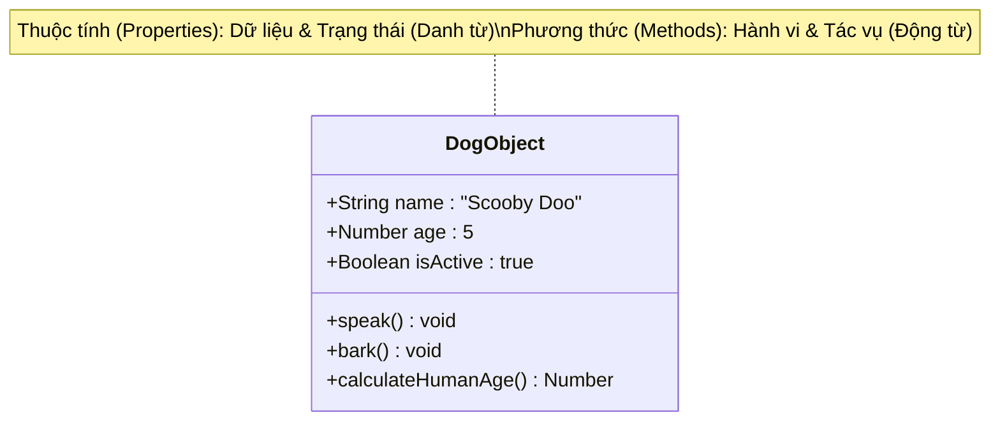
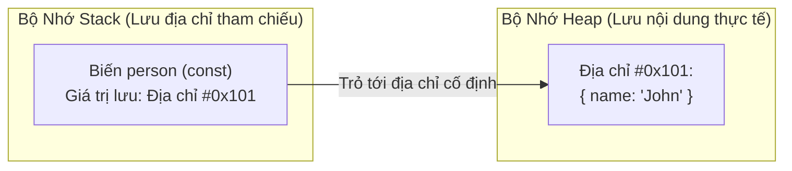
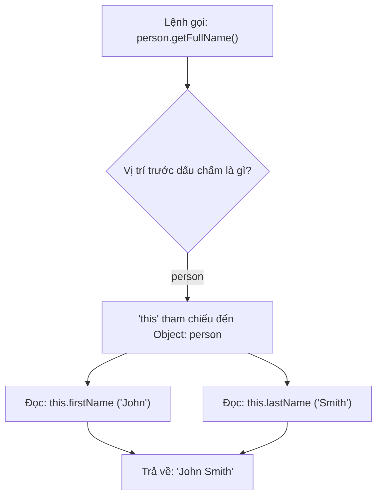

# 12 - Đối Tượng Trong JavaScript (Object: Cấu Trúc, Thao Tác & Từ Khóa this)

<a id="mục-lục"></a>
## Mục Lục

1. [Khái Niệm Object Literals Trong JavaScript](#1-khái-niệm-object-literals-trong-javascript)
   - [1.1. Object Literals là gì? Cú pháp cơ bản](#11-object-literals-là-gì-cú-pháp-cơ-bản)
   - [1.2. Ví dụ thực tế: Dữ liệu người dùng & Cấu hình ứng dụng](#12-ví-dụ-thực-tế-dữ-liệu-người-dùng--cấu-hình-ứng-dụng)
   - [1.3. Sơ bộ về các cách tạo Object khác (Constructor, Object.create)](#13-sơ-bộ-về-các-cách-tạo-object-khác-constructor-objectcreate)
   - [1.4. Enhanced Object Literals (Cú Pháp Cải Tiến ES6)](#14-enhanced-object-literals-cú-pháp-cải-tiến-es6)
     - [1.4.1. Property shorthand (Viết tắt thuộc tính)](#141-property-shorthand-viết-tắt-thuộc-tính)
     - [1.4.2. Method shorthand (Viết tắt phương thức)](#142-method-shorthand-viết-tắt-phương-thức)
     - [1.4.3. Computed property names (Tên thuộc tính động bằng [biểu thức])](#143-computed-property-names-tên-thuộc-tính-động-bằng-biểu-thức)
2. [Thuộc Tính (Properties) và Phương Thức (Methods) Trong Object](#2-thuộc-tính-properties-và-phương-thức-methods-trong-object)
   - [2.1. Thuộc tính (Properties) là gì? Lưu trữ dữ liệu và trạng thái](#21-thuộc-tính-properties-là-gì-lưu-trữ-dữ-liệu-và-trạng-thái)
   - [2.2. Phương thức (Methods) là gì? Hành vi và chức năng của đối tượng](#22-phương-thức-methods-là-gì-hành-vi-và-chức-năng-của-đối-tượng)
   - [2.3. Cách đặt tên thuộc tính & phương thức (Naming Conventions)](#23-cách-đặt-tên-thuộc-tính--phương-thức-naming-conventions)
     - [2.3.1. Lưu ý chung khi đặt tên (camelCase, case-sensitivity, từ khóa riêng)](#231-lưu-ý-chung-khi-đặt-tên)
     - [2.3.2. Đối với Thuộc tính (Properties): Sử dụng DANH TỪ & Tiền tố boolean](#232-đối-với-thuộc-tính-properties-sử-dụng-danh-từ)
     - [2.3.3. Đối với Phương thức (Methods): Bắt đầu bằng ĐỘNG TỪ](#233-đối-với-phương-thức-methods-bắt-đầu-bằng-động-từ)
     - [2.3.4. Bảng tổng hợp chuẩn mực đặt tên (Clean Code)](#234-bảng-tổng-hợp-chuẩn-mực-đặt-tên-clean-code)
3. [Làm Việc Với Object Cơ Bản (CRUD)](#3-làm-việc-với-object-cơ-bản-crud)
   - [3.1. Thêm một cặp key-value mới (Dot vs Bracket Notation)](#31-thêm-một-cặp-key-value-mới-dot-vs-bracket-notation)
   - [3.2. Truy cập và cập nhật giá trị thuộc tính](#32-truy-cập-và-cập-nhật-giá-trị-thuộc-tính)
   - [3.3. Xóa một cặp key-value với từ khóa delete](#33-xóa-một-cặp-key-value-với-từ-khóa-delete)
4. [Tại Sao Vẫn Sửa Được Object Tạo Bởi const? (Tham Chiếu vs Gán Lại)](#4-tại-sao-vẫn-sửa-được-object-tạo-bởi-const-tham-chiếu-vs-gán-lại)
   - [4.1. Bản chất của const: Khóa biến chứ không khóa giá trị](#41-bản-chất-của-const-khóa-biến-chứ-không-khóa-giá-trị)
   - [4.2. Cơ chế phân bổ bộ nhớ: Stack vs Heap](#42-cơ-chế-phân-bổ-bộ-nhớ-stack-vs-heap)
   - [4.3. Sửa thuộc tính vs Gán lại toàn bộ Object (TypeError)](#43-sửa-thuộc-tính-vs-gán-lại-toàn-bộ-object-typeerror)
   - [4.4. Đóng băng Object thật sự với Object.freeze()](#44-đóng-băng-object-thật-sự-với-objectfreeze)
   - [4.5. Cạm bẫy Shallow Freeze (Đóng băng nông)](#45-cạm-bẫy-shallow-freeze-đóng-băng-nông)
5. [Kỹ Thuật Object Destructuring (Phân Rã Thuộc Tính)](#5-kỹ-thuật-object-destructuring-phân-rã-thuộc-tính)
   - [5.1. Bản chất và cú pháp cơ bản](#51-bản-chất-và-cú-pháp-cơ-bản)
   - [5.2. Đổi tên biến (Alias) và Giá trị mặc định (Default Values)](#52-đổi-tên-biến-alias-và-giá-trị-mặc-định-default-values)
   - [5.3. Phân rã đối tượng lồng nhau (Nested Destructuring) & Đổi tên biến](#53-phân-rã-đối-tượng-lồng-nhau-nested-destructuring--đổi-tên-biến)
6. [Duyệt Qua Các Cặp Key-Value Của Object](#6-duyệt-qua-các-cặp-key-value-của-object)
   - [6.1. Vòng lặp for...in duyệt qua các Keys](#61-vòng-lặp-forin-duyệt-qua-các-keys)
   - [6.2. Duyệt qua bộ ba phương thức tĩnh: Object.keys, Object.values, Object.entries](#62-duyệt-qua-bộ-ba-phương-thức-tĩnh-objectkeys-objectvalues-objectentries)
7. [Phương Thức (Method) Nâng Cao và Bản Chất Từ Khóa this](#7-phương-thức-method-nâng-cao-và-bản-chất-từ-khóa-this)
   - [7.1. Từ khóa this là gì? Ngữ cảnh gọi phương thức](#71-từ-khóa-this-là-gì-ngữ-cảnh-gọi-phương-thức)
   - [7.2. Tại sao cần sử dụng this? (So sánh this.name vs person.name)](#72-tại-sao-cần-sử-dụng-this-so-sánh-thisname-vs-personname)
   - [7.3. Cú pháp khai báo phương thức: ES5 vs Cú pháp rút gọn ES6](#73-cú-pháp-khai-báo-phương-thức-es5-vs-cú-pháp-rút-gọn-es6)
   - [7.4. Cạm bẫy sống còn khi dùng this (Arrow Function & Mất ngữ cảnh)](#74-cạm-bẫy-sống-còn-khi-dùng-this-arrow-function--mất-ngữ-cảnh)
8. [Chuyển Đổi Qua Lại Giữa Object và Array](#8-chuyển-đổi-qua-lại-giữa-object-và-array)
9. [Các Sai Lầm & Cạm Bẫy Phổ Biến (Common Pitfalls)](#9-các-sai-lầm--cạm-bẫy-phổ-biến-common-pitfalls)
   - [9.1. Không kiểm tra sự tồn tại của key trước khi truy cập](#91-không-kiểm-tra-sự-tồn-tại-của-key-trước-khi-truy-cập)
   - [9.2. Sử dụng từ khóa dành riêng (Reserved Keywords) làm key](#92-sử-dụng-từ-khóa-dành-riêng-reserved-keywords-làm-key)
   - [9.3. Nhầm lẫn giữa Dot notation và Bracket notation với biến động](#93-nhầm-lẫn-giữa-dot-notation-và-bracket-notation-với-biến-động)
10. [Bảng So Sánh Tổng Kết Cốt Lõi](#10-bảng-so-sánh-tổng-kết-cốt-lõi)

---

> [!NOTE]
> **Câu chuyện ẩn dụ:**
> Hãy tưởng tượng một **hồ sơ nhân sự điện tử** trong một doanh nghiệp:
> - Hồ sơ chứa các thông tin định danh (Thuộc tính / Properties): Tên, tuổi, chức vụ, mức lương — được tổ chức theo cặp nhãn tên và giá trị (`key: value`).
> - Hồ sơ cũng quy định các hành động nhân viên đó có thể thực hiện (Phương thức / Methods): Điểm danh, tính lương thưởng, ký báo cáo.
> - Từ khóa **`this`** chính là đại từ xưng hô **"Tôi"** của nhân viên đó: Khi nhân viên An nói "Lương của tôi (`this.salary`)", nó trỏ chính xác vào mức lương trong hồ sơ của An, chứ không nhầm sang hồ sơ của đồng nghiệp bên cạnh!
> - Chiếc nhãn **`const`** đóng đinh trên cửa tủ hồ sơ: Bạn không được phép nhổ chiếc nhãn đó sang dán lên chiếc tủ khác (`person = { ... }` $\rightarrow$ lỗi), nhưng bạn hoàn toàn có thể mở ngăn kéo tủ ra để cập nhật năm sinh hay đổi chức vụ cho nhân viên (`person.age = 26`). Nếu muốn niêm phong tuyệt đối cả ruột lẫn vỏ, bạn cần ổ khóa bảo mật **`Object.freeze()`**!
> - Kỹ thuật **Object Destructuring** giống như chiếc máy quét tự động: Chỉ cần bạn yêu cầu "Hãy trích xuất cho tôi Tên và Email", máy sẽ tự động rút trích 2 thông tin đó ra thành 2 biến riêng biệt để dùng ngay mà không cần bạn phải mở từng trang hồ sơ xem thủ công.

---

> [!IMPORTANT]
> ### 🔗 Kiến Thức Tiên Quyết (Prerequisites)
> Để hiểu sâu cấu trúc Object, từ khóa `this` và các phương thức tĩnh trong bài này, bạn bắt buộc phải nắm vững:
> 1. **Bản chất Object lưu theo tham chiếu vùng nhớ Heap** tại [03 - Khai Báo Biến & Kiểu Dữ Liệu (Mục 11.7)](file:///d:/github/studyProgram/javascript/docs/03-variables-and-data-types.md#117-object-đối-tượng-dạng-tổng-quát-key-value):
>    - *Vì sao bắt buộc?* Để hiểu vì sao gán `obj2 = obj1` là dùng chung một ô nhớ (thay đổi một bên làm đổi cả hai bên), và vì sao `const` khóa địa chỉ tham chiếu chứ không khóa nội dung đối tượng.
> 2. **Ngữ cảnh `this` của Regular Function vs Arrow Function** tại [09 - 3 Loại Hàm Trong JavaScript](file:///d:/github/studyProgram/javascript/docs/09-function-types.md):
>    - *Vì sao bắt buộc?* Khi viết phương thức cho Object, Regular Function giữ đúng ngữ cảnh `this` trỏ về Object, còn Arrow Function không có `this` riêng nên trỏ ra ngoài phạm vi bao quanh.
> 3. **Thao tác duyệt Mảng** tại [11 - Mảng (Arrays)](file:///d:/github/studyProgram/javascript/docs/11-arrays.md):
>    - *Vì sao bắt buộc?* `Object.keys()`, `Object.values()`, `Object.entries()` đều trả về một **Mảng**; bạn cần kỹ năng duyệt mảng từ Bài 11 để xử lý dữ liệu.
> * **Đích đến tiếp theo:** Object là nền móng cốt lõi để bạn học [13 - Vòng Lặp For-In & For-Of](file:///d:/github/studyProgram/javascript/docs/13-for-in-and-for-of.md), kỹ thuật [14 - Ứng Dụng Toán Tử ++ Tiền Tố](file:///d:/github/studyProgram/javascript/docs/14-prefix-postfix-applications.md), cấu trúc dữ liệu hiện đại [15 - Map & Set](file:///d:/github/studyProgram/javascript/docs/15-map-and-set.md), thao tác phần tử DOM tại [16 - Thao Tác DOM](file:///d:/github/studyProgram/javascript/docs/16-dom-basics.md), và tuần tự hóa dữ liệu trong [17 - JSON & Xử Lý Lỗi](file:///d:/github/studyProgram/javascript/docs/17-json-and-error-handling.md).
> * 🗺️ *Xem bản đồ lộ trình tổng thể:* [Bản đồ liên kết kiến thức toàn dự án (agent.md)](file:///d:/github/studyProgram/javascript/agent.md).

---

<a id="1-khái-niệm-object-literals-trong-javascript"></a>
## 1. Khái Niệm Object Literals Trong JavaScript

<a id="11-object-literals-là-gì-cú-pháp-cơ-bản"></a>
### 1.1. Object Literals là gì? Cú pháp cơ bản

**Object Literals (Cú pháp khởi tạo đối tượng trực tiếp)** là cách phổ biến, trực quan và ngắn gọn nhất để tạo ra một đối tượng trong JavaScript bằng việc sử dụng cặp dấu ngoặc nhọn `{}`.

Một đối tượng bao gồm tập hợp các cặp **key-value** (khóa - giá trị):
- **Key (Khóa / Tên thuộc tính):** Luôn là một chuỗi (`string`) hoặc một `symbol`. Dù bạn viết key không có dấu ngoặc kép (`name: "Alice"`), JavaScript Engine vẫn tự động coi key đó là chuỗi `"name"`.
- **Value (Giá trị thuộc tính):** Có thể là **bất kỳ kiểu dữ liệu hợp lệ nào** trong JavaScript: Chuỗi, Số, Boolean, `null`, `undefined`, Mảng (`Array`), Hàm (`Function`), hoặc thậm chí là một Object khác lồng bên trong.

```javascript
const objectName = {
  key1: value1,
  key2: value2,
  // Thêm nhiều cặp key-value khác tại đây
};
```

<a id="12-ví-dụ-thực-tế-dữ-liệu-người-dùng--cấu-hình-ứng-dụng"></a>
### 1.2. Ví dụ thực tế: Dữ liệu người dùng & Cấu hình ứng dụng

Trong phát triển ứng dụng thực tế, Object Literals giúp tổ chức các dữ liệu có liên quan mật thiết với nhau vào chung một cấu trúc rõ ràng:

```javascript
// 1. Lưu trữ thông tin tài khoản người dùng
const user = {
  username: "user123",
  email: "user@example.com",
  signUpDate: "2021-01-01",
  isActive: true,
  roles: ["admin", "editor"]
};

// 2. Định nghĩa cấu hình kết nối mạng cho ứng dụng
const config = {
  apiUrl: "https://api.example.com",
  apiKey: "abc123secret",
  timeout: 5000,
  retryAttempts: 3
};
```

<a id="13-sơ-bộ-về-các-cách-tạo-object-khác-constructor-objectcreate"></a>
### 1.3. Sơ bộ về các cách tạo Object khác (Constructor, Object.create)

Bên cạnh Object Literals `{}` là cách tạo đối tượng đơn giản và dùng nhiều nhất, JavaScript còn cung cấp các cách tạo đối tượng khác phục vụ mô hình Lập trình hướng đối tượng (OOP):
- **Hàm khởi tạo (Constructor Function):** `function Person(name) { this.name = name; } const p = new Person("Bob");` — Dùng làm khuôn mẫu tạo nhiều đối tượng có cùng thuộc tính.
- **`Object.create(proto)`:** Tạo một object mới kế thừa trực tiếp từ một prototype chỉ định sẵn.
- **ES6 Class:** Cú pháp hướng đối tượng hiện đại bọc trên nền tảng prototype.
*(Các phương pháp trên sẽ được đào sâu ở các bài học nâng cao về OOP & Prototype).*

<a id="14-enhanced-object-literals-cú-pháp-cải-tiến-es6"></a>
### 1.4. Enhanced Object Literals (Cú Pháp Cải Tiến ES6)

**Enhanced Object Literals (ES6)** cung cấp một cách viết ngắn gọn, trực quan và mạnh mẽ hơn cho object literals. Tính năng này bao gồm 3 cải tiến vượt trội giúp việc khai báo và làm việc với object trở nên dễ dàng hơn:

<a id="141-property-shorthand-viết-tắt-thuộc-tính"></a>
#### 1.4.1. Property shorthand (Viết tắt thuộc tính)
Cho phép bạn khai báo các thuộc tính của object mà không cần viết lặp lại kiểu `name: name` khi tên thuộc tính trùng với tên biến chứa giá trị. Điều này làm cho code trở nên ngắn gọn hơn:

```javascript
const name = "John Doe";
const age = 30;

// Cách viết truyền thống ES5:
// const person = { name: name, age: age };

// Cách viết hiện đại với Property Shorthand (ES6):
const person = { name, age };

console.log(person); // { name: 'John Doe', age: 30 }
```

<a id="142-method-shorthand-viết-tắt-phương-thức"></a>
#### 1.4.2. Method shorthand (Viết tắt phương thức)
Cung cấp cú pháp ngắn gọn hơn để định nghĩa các phương thức trong object literals bằng cách loại bỏ từ khóa `: function`:

```javascript
// Cú pháp rút gọn phương thức ES6:
const dog = {
  name: "Scooby Doo",
  speak() {
    console.log("Go go...");
  }
};

dog.speak(); // "Go go..."
```

<a id="143-computed-property-names-tên-thuộc-tính-động-bằng-biểu-thức"></a>
#### 1.4.3. Computed property names (Tên thuộc tính động bằng [biểu thức])
Cho phép bạn sử dụng biểu thức đặt trong cặp ngoặc vuông `[expression]` để tính toán động tên cho các thuộc tính của object ngay tại thời điểm khởi tạo:

```javascript
const property = "lastName";

const person = {
  firstName: "John",
  [property]: "Smith" // Tên thuộc tính được tính toán động từ biến 'property'
};

console.log(person.lastName); // "Smith"

// Tính toán biểu thức phức tạp:
const prefix = "role_";
const roleConfig = {
  [`${prefix}admin`]: "Toàn quyền hệ thống",
  [`${prefix}editor`]: "Chỉnh sửa bài viết"
};
console.log(roleConfig.role_admin); // "Toàn quyền hệ thống"
```

[⬆️ Quay lại Mục lục](#mục-lục)

---

<a id="2-thuộc-tính-properties-và-phương-thức-methods-trong-object"></a>
## 2. Thuộc Tính (Properties) và Phương Thức (Methods) Trong Object

Trong JavaScript, một **Object (Đối tượng)** là một tập hợp gồm hai thành phần chủ đạo:
- **Thuộc tính (Properties):** Lưu trữ dữ liệu và mô tả đặc điểm, trạng thái của đối tượng.
- **Phương thức (Methods):** Các hàm được định nghĩa bên trong đối tượng, đại diện cho hành vi, quy trình hoặc tác vụ mà đối tượng có thể thực thi.



<a id="21-thuộc-tính-properties-là-gì-lưu-trữ-dữ-liệu-và-trạng-thái"></a>
### 2.1. Thuộc tính (Properties) là gì? Lưu trữ dữ liệu và trạng thái

**Thuộc tính (Properties)** là các giá trị được lưu trữ trong object. Mỗi thuộc tính bao gồm một tên định danh (**key**) và một giá trị tương ứng (**value**):
- Tên thuộc tính (key) là một chuỗi định danh.
- Giá trị của thuộc tính (value) có thể là **bất kỳ kiểu dữ liệu nào** trong JavaScript: Chuỗi, Số, Boolean, `null`, `undefined`, Mảng, hoặc thậm chí là một Object khác lồng bên trong.
- Thuộc tính phản ánh các **đặc điểm, trạng thái hoặc thông tin tĩnh** của đối tượng.

**Ví dụ:** Khởi tạo object `dog` đơn giản với các thuộc tính:
```javascript
const dog = {
  // Thuộc tính (Properties)
  name: "Scooby Doo",
  age: 5,
};

// Truy cập đọc giá trị thuộc tính bằng Dot notation
console.log(dog.name); // Scooby Doo
console.log(dog.age);  // 5
```
Trong ví dụ trên, `name` và `age` là các thuộc tính của object `dog`, với các giá trị tương ứng là `"Scooby Doo"` (chuỗi) và `5` (số).

<a id="22-phương-thức-methods-là-gì-hành-vi-và-chức-năng-của-đối-tượng"></a>
### 2.2. Phương thức (Methods) là gì? Hành vi và chức năng của đối tượng

**Phương thức (Methods)** là các hàm (Functions) được định nghĩa bên trong object:
- Các phương thức này có thể thực thi các hành động trên dữ liệu được lưu trữ trong thuộc tính của object hoặc thực hiện các chức năng khác liên quan đến đối tượng đó.
- Khi gọi phương thức, ta dùng cú pháp `object.tenPhuongThuc()`.

**Ví dụ:** Bổ sung phương thức `speak()` vào object `dog`:
```javascript
const dog = {
  // Thuộc tính
  name: "Scooby Doo",
  age: 5,

  // Phương thức (Cách 1: Function Expression truyền thống)
  speak: function() {
    console.log("Go go...");
  },

  // Phương thức (Cách 2: Cú pháp rút gọn ES6 Method Shorthand)
  bark() {
    console.log("Gâu gâu!");
  }
};

// Gọi thực thi phương thức
dog.speak(); // Go go...
dog.bark();  // Gâu gâu!
```
Trong ví dụ trên, `speak` và `bark` là các phương thức của object `dog`. Khi được gọi, phương thức sẽ thực thi khối lệnh bên trong và in ra màn hình.

<a id="23-cách-đặt-tên-thuộc-tính--phương-thức-naming-conventions"></a>
### 2.3. Cách đặt tên thuộc tính & phương thức (Naming Conventions)

Trong phát triển phần mềm, áp dụng đúng quy ước đặt tên (Naming Conventions) là nguyên tắc sống còn giúp mã nguồn trở nên **"tự giải thích" (Self-documenting code)**. Bạn và các đồng nghiệp có thể đọc lướt qua là hiểu ngay ý định lập trình mà không cần phải đoán mò hay đọc hàng chục dòng chú thích dài dòng.

<a id="231-lưu-ý-chung-khi-đặt-tên"></a>
#### 2.3.1. Lưu ý chung khi đặt tên
Cách đặt tên thuộc tính và phương thức tương tự như cách đặt tên biến trong JavaScript:
1. **Sử dụng cú pháp Camel Case (`camelCase`):** Bắt đầu bằng chữ thường, các từ tiếp theo viết hoa chữ cái đầu (ví dụ: `firstName`, `calculateTotal`, `isUserActive`).
2. **Rõ ràng và có tính mô tả cao:** Tên cần mô tả được chính xác ý nghĩa và mục đích sử dụng. Tránh các tên vô nghĩa như `x`, `temp`, `fn1`.
3. **Phân biệt chữ HOA - chữ thường (Case-sensitivity):** Tên thuộc tính có phân biệt hoa - thường, nên `name` và `Name` là hai thuộc tính hoàn toàn khác nhau nằm ở hai vị trí độc lập trong bộ nhớ object.
4. **Tránh trùng với các từ khóa riêng của JavaScript:** Không dùng các từ khóa như `for`, `class`, `function`, `return`, `delete` làm tên thuộc tính hoặc phương thức.

<a id="232-đối-với-thuộc-tính-properties-sử-dụng-danh-từ"></a>
#### 2.3.2. Đối với Thuộc tính (Properties): Sử dụng DANH TỪ
Thuộc tính thường được đặt tên bằng **danh từ (Noun)** hoặc **cụm danh từ (Noun phrase)** vì chúng thể hiện các đối tượng, đặc điểm, hoặc giá trị dữ liệu cụ thể:
- `name`: Chứa họ và tên.
- `email`: Chứa địa chỉ hòm thư điện tử.
- `age`: Chứa số tuổi.
- `price`: Chứa giá tiền.
- `userInfo`: Chứa thông tin hồ sơ người dùng.
- **Trường hợp thuộc tính Boolean (Đặc biệt):** Luôn kết hợp tiền tố `is...`, `has...`, `can...`, `should...` để biểu thị trạng thái nhị phân đúng/sai:
  - `isActive`: Biểu thị trạng thái hoạt động của một đối tượng (`true`/`false`).
  - `isVaccinated`: Biểu thị thú cưng đã được tiêm phòng hay chưa.
  - `hasDiscount`: Có áp dụng phiếu giảm giá hay không.
  *(Lưu ý: Dù có chứa trợ động từ, nhưng đây là quy ước chuẩn quốc tế được sử dụng để thể hiện thuộc tính có tính chất boolean).*

<a id="233-đối-với-phương-thức-methods-bắt-đầu-bằng-động-từ"></a>
#### 2.3.3. Đối với Phương thức (Methods): Bắt đầu bằng ĐỘNG TỪ
Phương thức thường được đặt tên **bắt đầu bằng động từ (Verb)** hoặc **cụm từ bắt đầu bằng động từ** vì chúng biểu thị hành động, quy trình, hoặc tác vụ được thực hiện:
- `calculateTotal()`: Tính toán tổng số tiền hoặc số lượng.
- `getName()`: Trả về tên của đối tượng.
- `isValid()`: Kiểm tra tính hợp lệ của dữ liệu.
- `updateProfile()`: Cập nhật hồ sơ người dùng.
- `sendNotification()`: Gửi thông báo đến người dùng.

Sử dụng động từ giúp làm rõ chức năng hoặc tác dụng của phương thức đó đối với dữ liệu hoặc đối tượng khác.

<a id="234-bảng-tổng-hợp-chuẩn-mực-đặt-tên-clean-code"></a>
#### 2.3.4. Bảng tổng hợp chuẩn mực đặt tên (Clean Code)

| Loại thành phần | Cú pháp quy ước | Từ loại chủ đạo | Ví dụ chuẩn mực | Ví dụ không nên dùng | Giải thích lý do |
| :--- | :--- | :--- | :--- | :--- | :--- |
| **Thuộc tính thường** | `camelCase` | Danh từ / Cụm danh từ | `userName`, `totalPrice`, `createdDate` | `getUserName`, `doPrice` | Thuộc tính lưu trữ dữ liệu tĩnh, không phải hành động |
| **Thuộc tính Boolean** | `camelCase` | Tiền tố `is`, `has`, `can` | `isActive`, `hasPermission`, `isVerified` | `active`, `checkActive` | Tiền tố giúp nhận diện giá trị boolean mà không cần xem ruột |
| **Phương thức** | `camelCase` | Bắt đầu bằng Động từ | `calculateTotal()`, `findUser()`, `updateAge()` | `total()`, `userData()`, `age()` | Phương thức là hàm thực thi, cần động từ để thể hiện rõ hành động |

[⬆️ Quay lại Mục lục](#mục-lục)

---

<a id="3-làm-việc-với-object-cơ-bản-crud"></a>
## 3. Làm Việc Với Object Cơ Bản (CRUD)

Khi đã có một object, bạn có toàn quyền thêm, đọc, cập nhật và xóa các thuộc tính bên trong nó.

<a id="31-thêm-một-cặp-key-value-mới-dot-vs-bracket-notation"></a>
### 3.1. Thêm một cặp key-value mới (Dot vs Bracket Notation)

Có 2 cú pháp chính để thêm thuộc tính mới vào object:
1. **Dot Notation (`.` - Dấu chấm):** Cú pháp ngắn gọn, trực quan, dùng khi tên key là định danh hợp lệ (không chứa khoảng trắng, không chứa dấu gạch ngang, không bắt đầu bằng số).
2. **Bracket Notation (`[]` - Dấu ngoặc vuông):** Linh hoạt tuyệt đối, bắt buộc dùng khi:
   - Tên key chứa ký tự đặc biệt hoặc khoảng trắng (`"home address"`, `"user-agent"`).
   - Tên key được lưu trong một biến động (`obj[dynamicKey]`).

```javascript
const car = {
  make: "Toyota",
  model: "Camry"
};

// 1. Thêm mới bằng Dot notation
car.year = 2021;

// 2. Thêm mới bằng Bracket notation
car["color"] = "Gray";
car["car-engine"] = "V6 3.5L"; // Key có dấu gạch ngang bắt buộc dùng []

console.log(`Năm sản xuất: ${car.year}`); // Năm sản xuất: 2021
console.log(`Màu sắc: ${car.color}`);     // Màu sắc: Gray
```

<a id="32-truy-cập-và-cập-nhật-giá-trị-thuộc-tính"></a>
### 3.2. Truy cập và cập nhật giá trị thuộc tính

Việc cập nhật giá trị cũng sử dụng toán tử gán `=` tương tự như khi thêm mới:

```javascript
const person = {
  name: "Alice",
  age: 25
};

// Truy cập đọc giá trị
console.log(`Tuổi hiện tại: ${person.age}`); // 25

// Cập nhật giá trị mới
person.age = 26;

// Kiểm tra lại sau cập nhật
console.log(`Tuổi sau sinh nhật: ${person.age}`); // 26
```

<a id="33-xóa-một-cặp-key-value-với-từ-khóa-delete"></a>
### 3.3. Xóa một cặp key-value với từ khóa delete

Để loại bỏ hoàn toàn một cặp key-value ra khỏi object, sử dụng toán tử `delete`:

```javascript
const employee = {
  name: "Bob",
  position: "Manager",
  salary: 5000
};

console.log(`Vị trí công việc: ${employee.position}`); // "Manager"

// Xóa thuộc tính position
delete employee.position;

console.log(employee);
// Kết quả: { name: 'Bob', salary: 5000 }
// Thuộc tính position đã biến mất hoàn toàn!
console.log(employee.position); // undefined
```

> [!TIP]
> Gán `employee.position = undefined` hoặc `null` **không làm biến mất key**, key đó vẫn tồn tại trong object. Chỉ duy nhất `delete employee.position` mới gỡ bỏ hoàn toàn key ra khỏi bộ nhớ object.

[⬆️ Quay lại Mục lục](#mục-lục)

---

<a id="4-tại-sao-vẫn-sửa-được-object-tạo-bởi-const-tham-chiếu-vs-gán-lại"></a>
## 4. Tại Sao Vẫn Sửa Được Object Tạo Bởi const? (Tham Chiếu vs Gán Lại)

Một trong những thắc mắc kinh điển nhất của mọi lập trình viên khi mới tiếp cận JavaScript là:
> *"Tại sao từ khóa `const` dùng để khai báo hằng số không thể thay đổi, nhưng khi khai báo một Object bằng `const`, ta vẫn thoải mái thêm, sửa, thậm chí xóa các thuộc tính bên trong nó?"*

<a id="41-bản-chất-của-const-khóa-biến-chứ-không-khóa-giá-trị"></a>
### 4.1. Bản chất của const: Khóa biến chứ không khóa giá trị

Trong JavaScript, từ khóa `const` **chỉ ngăn chặn việc gán lại biến (Re-assignment)**, chứ **không biến giá trị mà biến đang giữ thành bất biến (Immutable)**!
- `const` chỉ đảm bảo biến đó luôn luôn trỏ vào đúng một địa chỉ vùng nhớ duy nhất từ lúc khai báo cho đến khi kết thúc.
- `const` hoàn toàn không ngăn cản việc thay đổi dữ liệu bên trong vùng nhớ mà biến đó đang trỏ đến.

<a id="42-cơ-chế-phân-bổ-bộ-nhớ-stack-vs-heap"></a>
### 4.2. Cơ chế phân bổ bộ nhớ: Stack vs Heap

Để hiểu tận gốc rễ cơ chế này, hãy nhìn vào cách JavaScript Engine tổ chức bộ nhớ:
1. **Bộ nhớ Stack (Nhanh, kích thước cố định):** Chứa các biến cục bộ và các giá trị nguyên thủy (`number`, `string`, `boolean`). Với Object, biến khai báo bằng `const` nằm trên Stack và **chỉ lưu địa chỉ con trỏ tham chiếu** (ví dụ: `#0x101`).
2. **Bộ nhớ Heap (Linh hoạt, kích thước động):** Chứa dữ liệu thực tế của Object `{ name: "John" }` tại địa chỉ `#0x101`.



- Khi bạn sửa thuộc tính `person.name = "Jane"`: Biến `person` trên Stack vẫn giữ nguyên địa chỉ `#0x101`, chỉ có nội dung bên trong Heap tại ô nhớ `#0x101` là thay đổi. Do địa chỉ không bị gán lại nên **hoàn toàn hợp lệ!**
- Khi bạn gán `person = { name: "Mike" }`: Một Object mới được sinh ra tại ô nhớ khác (ví dụ `#0x202`), và lệnh này cố gắng ghi đè địa chỉ mới `#0x202` vào biến `person` trên Stack $\rightarrow$ Vi phạm quy tắc của `const` $\rightarrow$ Ném lỗi `TypeError` ngay lập tức!

<a id="43-sửa-thuộc-tính-vs-gán-lại-toàn-bộ-object-typeerror"></a>
### 4.3. Sửa thuộc tính vs Gán lại toàn bộ Object (TypeError)

```javascript
const person = { name: "John" };

// 1. Thay đổi thuộc tính bên trong: HOÀN TOÀN HỢP LỆ!
person.name = "Jane";
person.age = 30;
delete person.name;
console.log(person); // { age: 30 }

// 2. Gán lại toàn bộ Object: BÁO LỖI TYPEERROR!
try {
  person = { name: "Mike" }; // Cố tình đổi tham chiếu
} catch (error) {
  console.log(error.name);    // "TypeError"
  console.log(error.message); // "Assignment to constant variable."
}
```

> [!TIP]
> Đây chính là lý do vì sao trong JavaScript hiện đại, **95% trường hợp bạn nên khai báo Object và Array bằng `const`**. Điều này giúp bảo vệ chương trình không bao giờ bị ghi đè nhầm sang một đối tượng khác, trong khi vẫn giữ được sự linh hoạt cần thiết để cập nhật dữ liệu.

<a id="44-đóng-băng-object-thật-sự-với-objectfreeze"></a>
### 4.4. Đóng băng Object thật sự với Object.freeze()

Nếu bạn muốn tạo ra một đối tượng **hoàn toàn bất biến (True Immutable Object)** — không ai có quyền thêm, sửa hay xóa bất kỳ thuộc tính nào — JavaScript cung cấp phương thức `Object.freeze()`:

```javascript
const user = {
  name: "John",
  role: "admin"
};

// Đóng băng đối tượng:
Object.freeze(user);

// Kiểm tra trạng thái đóng băng:
console.log(Object.isFrozen(user)); // true

// Thử sửa đổi:
user.name = "Jane";    // Không có tác dụng!
user.age = 25;         // Không thể thêm mới!
delete user.role;      // Không thể xóa!

console.log(user); // { name: "John", role: "admin" } (Dữ liệu nguyên vẹn 100%)
```

> [!NOTE]
> Trong chế độ bình thường (Non-strict mode), các thao tác sửa đổi Object đã bị đóng băng sẽ âm thầm bị bỏ qua. Trong chế độ nghiêm ngặt (`"use strict";`), JavaScript sẽ ném lỗi `TypeError: Cannot assign to read only property` để bảo vệ dữ liệu!

<a id="45-cạm-bẫy-shallow-freeze-đóng-băng-nông"></a>
### 4.5. Cạm bẫy Shallow Freeze (Đóng băng nông)

`Object.freeze()` chỉ có tác dụng ở **cấp độ ngoài cùng (Shallow Freeze)**. Nếu Object chứa các Object con lồng nhau (`nested objects`), các Object con đó vẫn có thể bị sửa đổi:

```javascript
const company = {
  name: "Tech Corp",
  address: {
    city: "Hà Nội"
  }
};

Object.freeze(company);
company.name = "New Corp"; // Bị chặn!

// Nhưng Object lồng nhau thì KHÔNG bị đóng băng:
company.address.city = "TP. Hồ Chí Minh"; // ✅ VẪN SỬA ĐƯỢC!
console.log(company.address.city); // "TP. Hồ Chí Minh"
```
*Để đóng băng triệt để mọi tầng lồng nhau, bạn cần viết một hàm đệ quy đóng băng (Deep Freeze).*

[⬆️ Quay lại Mục lục](#mục-lục)

---

<a id="5-kỹ-thuật-object-destructuring-phân-rã-thuộc-tính"></a>
## 5. Kỹ Thuật Object Destructuring (Phân Rã Thuộc Tính)

<a id="51-bản-chất-và-cú-pháp-cơ-bản"></a>
### 5.1. Bản chất và cú pháp cơ bản

**Object Destructuring (ES6)** là cú pháp cho phép bạn "mở hộp" đối tượng và trích xuất trực tiếp các giá trị của thuộc tính vào các biến độc lập chỉ trong một dòng code:

```javascript
const book = {
  title: "The Great Gatsby",
  author: "F. Scott Fitzgerald",
  year: 1925
};

// Cách hiện đại dùng Destructuring:
const { title, author } = book;

console.log(`Tiêu đề sách: ${title}`);   // The Great Gatsby
console.log(`Tác giả: ${author}`);       // F. Scott Fitzgerald
```

<a id="52-đổi-tên-biến-alias-và-giá-trị-mặc-định-default-values"></a>
### 5.2. Đổi tên biến (Alias) và Giá trị mặc định (Default Values)

Destructuring còn hỗ trợ đổi tên biến (để tránh trùng tên với biến sẵn có) và gán giá trị mặc định khi thuộc tính không tồn tại (`undefined`):

```javascript
const userProfile = {
  username: "nam_dev",
  city: "Hà Nội"
};

// 1. Đổi tên biến bằng dấu hai chấm (: aliasName)
// 2. Gán giá trị mặc định bằng dấu bằng (= defaultValue)
const { username: accountName, city, country = "Việt Nam" } = userProfile;

console.log(accountName); // "nam_dev" (tên biến mới)
console.log(city);        // "Hà Nội"
console.log(country);     // "Việt Nam" (giá trị mặc định fallback)
```

<a id="53-phân-rã-đối-tượng-lồng-nhau-nested-destructuring--đổi-tên-biến"></a>
### 5.3. Phân rã đối tượng lồng nhau (Nested Destructuring) & Đổi tên biến

Đối với các cấu trúc Object phức tạp hơn (Object lồng Object thường gặp khi nhận dữ liệu từ API), Destructuring cho phép bạn đi sâu vào từng tầng thuộc tính bên trong và đổi tên biến chỉ trong một dòng lệnh:

```javascript
const course = {
  title: "JavaScript Pro",
  info: {
    url: "https://fullstack.edu.vn",
    description: "JavaScript Basic, Advanced.",
    keywords: "js basic, js advanced"
  }
};

// Trích xuất 'title' ở tầng ngoài
// Và trích xuất 'keywords' ở tầng 'info', đồng thời đổi tên biến thành 'topics':
const {
  title,
  info: {
    keywords: topics
  }
} = course;

console.log(title);  // JavaScript Pro
console.log(topics); // js basic, js advanced
```

> [!NOTE]
> **Lưu ý quan trọng khi dùng Nested Destructuring:**
> Trong cú pháp `info: { keywords: topics }`, biến `info` **không hề được tạo ra**! Chỉ có biến `topics` ở tầng sâu được khai báo thành công trong phạm vi của bạn.

[⬆️ Quay lại Mục lục](#mục-lục)

---

<a id="6-duyệt-qua-các-cặp-key-value-của-object"></a>
## 6. Duyệt Qua Các Cặp Key-Value Của Object

<a id="61-vòng-lặp-forin-duyệt-qua-các-keys"></a>
### 6.1. Vòng lặp for...in duyệt qua các Keys

Vòng lặp `for...in` là cấu trúc lặp kinh điển trong JavaScript được thiết kế riêng để duyệt qua tất cả các **keys** (thuộc tính có thể liệt kê) của một đối tượng:

```javascript
const person = {
  name: "John",
  age: 30,
  isEmployed: true
};

// Duyệt qua từng key của person
for (const key in person) {
  // Bắt buộc dùng Bracket notation person[key] vì 'key' là một biến!
  console.log(`${key}: ${person[key]}`);
}
// Kết quả:
// name: John
// age: 30
// isEmployed: true
```

<a id="62-duyệt-qua-bộ-ba-phương-thức-tĩnh-objectkeys-objectvalues-objectentries"></a>
### 6.2. Duyệt qua bộ ba phương thức tĩnh: Object.keys, Object.values, Object.entries

Constructor `Object` cung cấp 3 phương thức tĩnh cực kỳ mạnh mẽ giúp chuyển đổi các thành phần của Object thành Mảng để dễ dàng kết hợp cùng `for...of` hoặc các hàm xử lý mảng (`map`, `filter`, `forEach`):

```javascript
const scores = { math: 9, english: 8, physics: 8.5 };

// 1. Object.keys(obj) -> Mảng chứa tất cả các keys
const subjectList = Object.keys(scores);
console.log(subjectList); // ["math", "english", "physics"]

// 2. Object.values(obj) -> Mảng chứa tất cả các values
const scoreList = Object.values(scores);
console.log(scoreList);   // [9, 8, 8.5]

// 3. Object.entries(obj) -> Mảng 2 chiều chứa các cặp [key, value]
const entries = Object.entries(scores);
console.log(entries);     // [["math", 9], ["english", 8], ["physics", 8.5]]

// Duyệt bằng for...of kết hợp Destructuring cặp [key, value]:
for (const [subject, score] of Object.entries(scores)) {
  console.log(`Môn ${subject}: ${score} điểm`);
}
```

[⬆️ Quay lại Mục lục](#mục-lục)

---

<a id="7-phương-thức-method-nâng-cao-và-bản-chất-từ-khóa-this"></a>
## 7. Phương Thức (Method) Nâng Cao và Bản Chất Từ Khóa this

Trong lập trình hướng đối tượng với JavaScript, từ khóa **`this`** là một trong những khái niệm nền tảng và linh hoạt nhất, nhưng cũng là chủ đề thường gây bối rối nhất cho người mới bắt đầu.



<a id="71-từ-khóa-this-là-gì-ngữ-cảnh-gọi-phương-thức"></a>
### 7.1. Từ khóa this là gì? Ngữ cảnh gọi phương thức

**`this` là một từ khóa đặc biệt trong JavaScript, dùng để tham chiếu đến đối tượng mà nó thuộc về.**
- Giá trị của `this` **phụ thuộc vào ngữ cảnh mà nó được sử dụng (Execution Context)**.
- Nghĩa là giá trị của `this` có thể thay đổi tùy thuộc vào **cách thức mà hàm chứa nó được gọi (Call-site)**, chứ không phụ thuộc vào nơi nó được định nghĩa!

#### Trường hợp 1: `this` tham chiếu tới đối tượng sở hữu phương thức
Khi `this` được sử dụng bên trong một phương thức được gọi thông qua một object (ví dụ: `person.getFullName()`):
- Lúc này `this` sẽ trả về **chính object mà nó thuộc về** (tức là object nằm ngay trước dấu chấm được sử dụng để truy cập phương thức).
- Ở ví dụ dưới đây, `this` sẽ tham chiếu tới đối tượng `person`:

```javascript
const person = {
  firstName: "John",
  lastName: "Smith",
  getFullName: function() {
    console.log(this); // In ra chính object person: { firstName: 'John', lastName: 'Smith', ... }
  }
};

person.getFullName();
```

#### Hoàn thiện phương thức `getFullName()` để trả về "Tên đầy đủ":
Sử dụng `this.firstName` và `this.lastName` kết hợp với Template Literals:

```javascript
const person = {
  firstName: "John",
  lastName: "Smith",
  getFullName: function() {
    return `${this.firstName} ${this.lastName}`;
  }
};

console.log(person.getFullName()); // "John Smith"
```

<a id="72-tại-sao-cần-sử-dụng-this-so-sánh-thisname-vs-personname"></a>
### 7.2. Tại sao cần sử dụng this? (So sánh this.name vs person.name)

Nhiều bạn mới học thường tự hỏi: *"Bên trong hàm của object `person`, tại sao không viết thẳng `person.name` cho nhanh mà lại phải dùng `this.name`?"*

Câu trả lời là: **`this` cung cấp một cơ chế cực kỳ linh hoạt để truy cập vào đối tượng mà hàm đang trực tiếp thao tác.**
Điều này mang lại 3 lợi ích cốt tử:

#### 1. Tránh phụ thuộc cứng (Decoupling) và tránh lỗi khi đổi tên biến
Hãy xem ví dụ kinh điển:
```javascript
const person = {
  name: "Alice",
  greet: function() {
    // ✅ NÊN VIẾT LÀ:
    console.log("Hello, " + this.name);

    // ❌ KHÔNG NÊN VIẾT LÀ:
    // console.log("Hello, " + person.name);
  }
};

person.greet(); // Hello, Alice
```

Tại ví dụ trên, sử dụng `person.name` **kém linh hoạt hơn rất nhiều** so với `this.name`. Vì nếu biến `person` sau này được đổi tên thành `author` hay `user`, thì lệnh `person.name` sẽ lập tức báo lỗi `ReferenceError: person is not defined` vì biến `person` không còn tồn tại nữa. Lúc đó bạn sẽ phải lội vào sửa code ở rất nhiều chỗ!

#### 2. Tránh thảm họa crash ứng dụng khi chuyển giao tham chiếu (Reference Reassignment)
Điều gì xảy ra nếu object được chuyển giao cho một biến mới, còn biến cũ bị hủy hoặc gán bằng `null`?

```javascript
let person = {
  name: "Alice",
  greet: function() {
    console.log("Hello, " + this.name);
  },
  greetHardcoded: function() {
    console.log("Hello, " + person.name);
  }
};

// Chuyển giao tham chiếu sang biến mới:
const member = person;
person = null; // Biến cũ person bị hủy!

// 1. Dùng this: Chạy mượt mà vì this trỏ vào đối tượng đang gọi (member)!
member.greet(); // "Hello, Alice"

// 2. Dùng person.name: SẬP ỨNG DỤNG NGAY LẬP TỨC!
// member.greetHardcoded(); // 💥 TypeError: Cannot read properties of null (reading 'name')
```

#### 3. Tăng cường khả năng tái sử dụng (Reusability & Method Sharing)
Nhờ có `this`, một phương thức có thể được chia sẻ và tái sử dụng cho hàng trăm đối tượng khác nhau mà không cần viết lại:

```javascript
// Một hàm duy nhất:
function introduce() {
  console.log(`Tôi là ${this.name}, năm nay tôi ${this.age} tuổi.`);
}

const userA = { name: "Bình", age: 20, introduce };
const userB = { name: "Cường", age: 25, introduce };

userA.introduce(); // "Tôi là Bình, năm nay tôi 20 tuổi." (this trỏ userA)
userB.introduce(); // "Tôi là Cường, năm nay tôi 25 tuổi." (this trỏ userB)
```

<a id="73-cú-pháp-khai-báo-phương-thức-es5-vs-cú-pháp-rút-gọn-es6"></a>
### 7.3. Cú pháp khai báo phương thức: ES5 vs Cú pháp rút gọn ES6

Trong JavaScript có hai cách viết phương thức phổ biến:
1. **ES5 (Function Expression):** `tenPhuongThuc: function() { ... }` — Cú pháp truyền thống.
2. **ES6 Method Shorthand (Khuyên dùng):** `tenPhuongThuc() { ... }` — Cú pháp hiện đại, ngắn gọn, tự nhiên và chuyên nghiệp. Cả hai đều có cơ chế `this` giống hệt nhau!

```javascript
const rectangle = {
  width: 10,
  height: 5,

  // Cú pháp rút gọn ES6 chuẩn mực:
  getArea() {
    return this.width * this.height;
  },
  getPerimeter() {
    return (this.width + this.height) * 2;
  }
};

console.log("Diện tích:", rectangle.getArea());       // 50
console.log("Chu vi:", rectangle.getPerimeter());   // 30
```

<a id="74-cạm-bẫy-sống-còn-khi-dùng-this-arrow-function--mất-ngữ-cảnh"></a>
### 7.4. Cạm bẫy sống còn khi dùng this (Arrow Function & Mất ngữ cảnh)

#### Cạm bẫy 1: Tuyệt đối không dùng Arrow Function làm method cho Object!
> [!WARNING]
> **Arrow Function KHÔNG có `this` của riêng nó.**
> Khi sử dụng `this` bên trong Arrow function, nó sẽ lấy giá trị `this` từ phạm vi bao quanh bên ngoài (Lexical Scope) tại nơi nó được tạo ra, chứ không lấy từ object gọi nó!
> Trong Object Literal, phạm vi bên ngoài chính là Global Scope (`window` trên trình duyệt hoặc `{}` trên Node.js).

```javascript
const person = {
  name: "Bob",
  // ❌ SAI LẦM TAI HẠI:
  sayHi: () => {
    console.log("Hi, " + this.name); // this trỏ ra ngoài Window/Global!
  }
};

person.sayHi(); // "Hi, undefined" (hoặc lỗi trong strict mode)
```

#### Cạm bẫy 2: Mất ngữ cảnh `this` khi gán method thành biến độc lập (Detached Method)
```javascript
const user = {
  name: "Nam",
  getName() { return this.name; }
};

// Tách hàm ra biến độc lập:
const getMyName = user.getName;

// Gọi hàm không có dấu chấm phía trước:
console.log(getMyName()); // undefined! (this bị mất ngữ cảnh, trỏ về Global)
```
*(Để giải quyết vấn đề này, JavaScript cung cấp các phương thức `bind()`, `call()`, `apply()` mà chúng ta sẽ đào sâu ở bài học chuyên đề Function context).*

[⬆️ Quay lại Mục lục](#mục-lục)

---

<a id="8-chuyển-đổi-qua-lại-giữa-object-và-array"></a>
## 8. Chuyển Đổi Qua Lại Giữa Object và Array

```javascript
// 1. Chuyển Mảng các cặp [key, value] thành Object (Object.fromEntries)
const configEntries = [
  ["theme", "dark"],
  ["language", "vi"],
  ["notifications", true]
];

const configObj = Object.fromEntries(configEntries);
console.log(configObj);
// Kết quả: { theme: 'dark', language: 'vi', notifications: true }

// 2. Chuyển Object thành Mảng các cặp [key, value] (Object.entries)
configObj.theme = "light";
const updatedEntries = Object.entries(configObj);
console.log(updatedEntries);
// Kết quả: [ ['theme', 'light'], ['language', 'vi'], ['notifications', true] ]
```

[⬆️ Quay lại Mục lục](#mục-lục)

---

<a id="9-các-sai-lầm--cạm-bẫy-phổ-biến-common-pitfalls"></a>
## 9. Các Sai Lầm & Cạm Bẫy Phổ Biến (Common Pitfalls)

<a id="91-không-kiểm-tra-sự-tồn-tại-của-key-trước-khi-truy-cập"></a>
### 9.1. Không kiểm tra sự tồn tại của key trước khi truy cập

Khi bạn truy cập vào một thuộc tính không hề tồn tại trong object, JavaScript sẽ âm thầm trả về `undefined` chứ không báo lỗi ngay:

```javascript
const person = { name: "John" };
console.log(person.age); // undefined
```

Tuy nhiên, nếu bạn tiếp tục truy cập sâu vào thuộc tính con của `undefined` (`person.age.value`), chương trình sẽ ném lỗi crash ngay lập tức: `TypeError: Cannot read properties of undefined`!

#### Các cách kiểm tra an toàn:
```javascript
// Cách 1: Sử dụng toán tử 'in'
if ("age" in person) {
  console.log(`Tuổi: ${person.age}`);
}

// Cách 2: Sử dụng Object.hasOwn() (ES2022)
if (Object.hasOwn(person, "age")) {
  console.log(`Tuổi: ${person.age}`);
}

// Cách 3: Sử dụng Optional Chaining (?.) khi truy cập lồng nhau
console.log(person?.address?.street); // An toàn, trả về undefined nếu address không có
```

<a id="92-sử-dụng-từ-khóa-dành-riêng-reserved-keywords-làm-key"></a>
### 9.2. Sử dụng từ khóa dành riêng (Reserved Keywords) làm key

Trong JavaScript, có những từ khóa dành riêng của ngôn ngữ như `function`, `var`, `class`, `delete`, `return`, `default`, `new`.
- Đặt tên key trùng từ khóa dành riêng gây xung đột khi dùng Destructuring (`const { function } = obj;` $\rightarrow$ `SyntaxError`).
- **Giải pháp:** Luôn sử dụng danh từ mô tả rõ nghĩa thay thế: `fn`, `action`, `variable`, `isDeleted`.

<a id="93-nhầm-lẫn-giữa-dot-notation-và-bracket-notation-với-biến-động"></a>
### 9.3. Nhầm lẫn giữa Dot notation và Bracket notation với biến động

```javascript
const user = { name: "Alice", age: 25 };
const property = "name";

// ❌ SAI LẦM:
console.log(user.property); // undefined! (tìm key tên "property")

// ✅ ĐÚNG:
console.log(user[property]); // "Alice"
```

[⬆️ Quay lại Mục lục](#mục-lục)

---

<a id="10-bảng-so-sánh-tổng-kết-cốt-lõi"></a>
## 10. Bảng So Sánh Tổng Kết Cốt Lõi

| Thao tác / Khái niệm | Cú pháp | Hành vi với `const` | Ý nghĩa thực tế |
| :--- | :--- | :--- | :--- |
| **Property Shorthand** | `const person = { name, age }` | ES6 Cải tiến | Tự động lấy tên biến làm key khi trùng tên |
| **Method Shorthand** | `{ speak() { ... } }` | ES6 Cải tiến | Bỏ từ khóa `: function` rườm rà |
| **Computed Property** | `{ [property]: "Smith" }` | ES6 Cải tiến | Đặt tên key động bằng biểu thức trong `[]` |
| **Nested Destructuring** | `{ info: { keywords: topics } } = course` | ES6 Phân rã sâu | Trích xuất tầng sâu và đổi tên biến linh hoạt |
| **Thuộc tính (Property)** | `dog.name = "Scooby"` | Đặt tên **Danh từ** | Lưu trữ đặc điểm, dữ liệu và trạng thái |
| **Thuộc tính Boolean** | `dog.isActive = true` | Tiền tố `is`, `has`, `can` | Thể hiện trạng thái đúng/sai nhị phân |
| **Phương thức (Method)** | `dog.speak()` | Bắt đầu bằng **Động từ** | Hàm thực thi hành vi, chức năng |
| **Khai báo Object** | `const obj = { a: 1 }` | Khóa con trỏ tham chiếu trên Stack | Đảm bảo không bị gán đè sang object khác |
| **Sửa/Thêm thuộc tính** | `obj.a = 2`, `obj.b = 3` | ✅ **Cho phép 100%** | Biến đổi dữ liệu trên vùng nhớ Heap |
| **Gán lại Object** | `obj = { a: 2 }` | ❌ **Báo lỗi `TypeError`** | Cố tình thay đổi địa chỉ tham chiếu |
| **Đóng băng Object** | `Object.freeze(obj)` | ✅ **Khóa cả thuộc tính bên trong** | Biến object thành bất biến (Immutable) |
| **Destructuring** | `const { a, b } = obj` | Trích xuất thành biến độc lập | Code sạch sẽ, giảm lặp cú pháp `obj.` |
| **Duyệt keys** | `for (const k in obj)` | Duyệt qua tên thuộc tính | Truy xuất động bằng `obj[k]` |
| **Kiểm tra key** | `'key' in obj` / `Object.hasOwn()` | Trả về `true`/`false` | Phòng thủ trước khi đọc thuộc tính sâu |

[⬆️ Quay lại Mục lục](#mục-lục)
