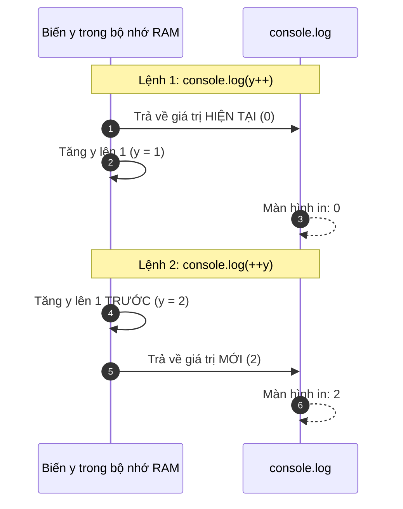
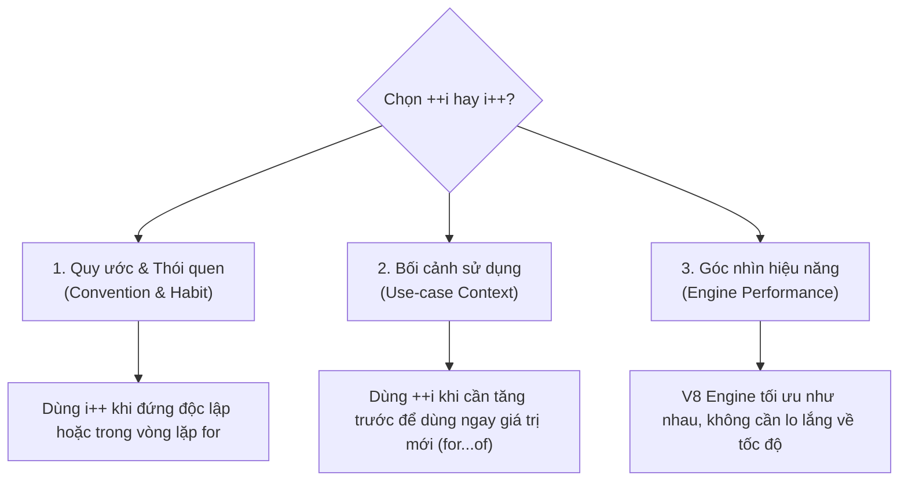
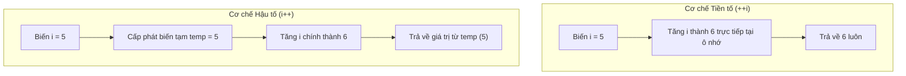
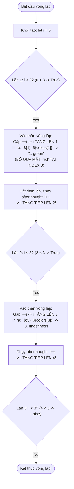

# 14 - Ứng Dụng Toán Tử ++ Dạng Tiền Tố (Prefix) & Hậu Tố (Postfix) Trong Thực Tế

<a id="mục-lục"></a>
## Mục Lục

1. [Ôn Tập Bản Chất: Tiền Tố (++x) vs Hậu Tố (x++)](#1-ôn-tập-bản-chất-tiền-tố-x-vs-hậu-tố-x)
2. [Khi Nào Dùng Tiền Tố, Khi Nào Dùng Hậu Tố? (3 Yếu Tố Quyết Định)](#2-khi-nào-dùng-tiền-tố-khi-nào-dùng-hậu-tố-3-yếu-tố-quyết-định)
   - [2.1. Quy ước và thói quen cộng đồng](#21-quy-ước-và-thói-quen-cộng-đồng)
   - [2.2. Tùy thuộc vào bối cảnh thực tế (Đánh số thứ tự với for...of)](#22-tùy-thuộc-vào-bối-cảnh-thực-tế-đánh-số-thứ-tự-với-forof)
   - [2.3. Góc nhìn hiệu năng (Performance & V8 Engine Optimization)](#23-góc-nhìn-hiệu-năng-performance--v8-engine-optimization)
3. [Cạm Bẫy Chí Mạng: Đừng Tăng Biến 2 Lần Trong Vòng Lặp](#3-cạm-bẫy-chí-mạng-đừng-tăng-biến-2-lần-trong-vòng-lặp)
4. [Các Mẫu Ứng Dụng Thực Chiến Nâng Cao Khác](#4-các-mẫu-ứng-dụng-thực-chiến-nâng-cao-khác)
   - [4.1. Bộ đếm ID tự tăng (Auto-increment ID Generator)](#41-bộ-đếm-id-tự-tăng-auto-increment-id-generator)
   - [4.2. Phân trang hiển thị (Pagination 1-based Index)](#42-phân-trang-hiển-thị-pagination-1-based-index)
   - [4.3. Kỹ thuật hai con trỏ (Two Pointers Technique)](#43-kỹ-thuật-hai-con-trỏ-two-pointers-technique)
5. [Bảng So Sánh Tổng Kết Cốt Lõi: Tiền Tố vs Hậu Tố](#5-bảng-so-sánh-tổng-kết-cốt-lõi-tiền-tố-vs-hậu-tố)

---

> [!NOTE]
> **Câu chuyện ẩn dụ:**
> Hãy tưởng tượng bạn đang đứng trước **máy bấm số thứ tự tự động tại sảnh giao dịch ngân hàng**:
> - Biến đếm nội bộ của máy ban đầu đang ở mốc `0`.
> - **Tiền tố (`++i` - Prefix):** Khách hàng chạm tay vào màn hình cảm ứng, máy lập tức **nhảy số đếm lên trước** ($0 \rightarrow 1$), rồi in ngay tấm vé mang con số $1$ trao cho khách. Khách cầm tấm vé đúng số thứ tự đầu tiên cần phục vụ (Tăng trước, trả về giá trị mới sau).
> - **Hậu tố (`i++` - Postfix):** Khách hàng chạm tay vào màn hình, máy **lấy con số đang hiển thị trên mặt đồng hồ hiện tại** ($0$) in luôn ra vé đưa cho khách, rồi sau khi khách cầm vé đi thì máy mới âm thầm nhảy số đếm nội bộ lên $1$. Kết quả là vị khách đầu tiên nhận được tấm vé số $0$ kỳ lạ (Trả về giá trị cũ trước, tăng sau).
> 
> Trong lập trình thực tế, đặc biệt khi kết hợp cùng vòng lặp duyệt mảng `for...of`, việc làm chủ thời điểm giá trị được trả về sẽ giúp code của bạn vừa tinh gọn, vừa tránh được những lỗi lệch vị trí (Off-by-one error) cực kỳ khó chịu!

---

> [!IMPORTANT]
> ### 🔗 Kiến Thức Tiên Quyết (Prerequisites)
> Để hiểu sâu và vận dụng linh hoạt kỹ thuật tiền tố/hậu tố trong bài này, bạn cần nắm vững:
> 1. **Cơ chế lý thuyết của `++` và `--`** tại [05 - Rẽ Nhánh & Hệ Thống Toán Tử (Mục 3)](file:///d:/github/studyProgram/javascript/docs/05-conditionals-and-operators.md#3-toán-tử-số-học-arithmetic-operators-khác-biệt-x-vs-x) & [08 - Ép Kiểu & Vòng Lặp (Mục 2)](file:///d:/github/studyProgram/javascript/docs/08-loops-and-type-coercion.md#2-toán-tử-tăng-giảm----giải-mã-prefix-vs-postfix):
>    - *Vì sao bắt buộc?* Hiểu rõ cơ chế thay đổi giá trị của biến và giá trị trả về của cả biểu thức.
> 2. **Cấu trúc Mảng (Arrays)** tại [11 - Mảng](file:///d:/github/studyProgram/javascript/docs/11-arrays.md):
>    - *Vì sao bắt buộc?* Kỹ thuật đánh số thứ tự và kiểm soát con trỏ chủ yếu áp dụng trên danh sách phần tử của Mảng.
> 3. **Vòng lặp `for...of` trên cấu trúc Iterable** tại [13 - Vòng Lặp For-In & For-Of (Mục 2)](file:///d:/github/studyProgram/javascript/docs/13-for-in-and-for-of.md#2-vòng-lặp-for-of-duyệt-giá-trị-mảng--chuỗi):
>    - *Vì sao bắt buộc?* Vòng lặp `for...of` không cung cấp sẵn biến đếm chỉ mục `i` như `for` truyền thống, nên việc tạo biến đếm bên ngoài kết hợp `++i` là mẫu thiết kế (design pattern) kinh điển.
> * **Đích đến tiếp theo:** Làm chủ toán tử và vòng lặp giúp bạn xử lý các cấu trúc dữ liệu hiện đại trong [15 - Map & Set](file:///d:/github/studyProgram/javascript/docs/15-map-and-set.md).
> * 🗺️ *Xem bản đồ lộ trình tổng thể:* [Bản đồ liên kết kiến thức toàn dự án (agent.md)](file:///d:/github/studyProgram/javascript/agent.md).

---

<a id="1-ôn-tập-bản-chất-tiền-tố-x-vs-hậu-tố-x"></a>
## 1. Ôn Tập Bản Chất: Tiền Tố (++x) vs Hậu Tố (x++)

Cả `++x` (tiền tố - prefix) và `x++` (hậu tố - postfix) đều có chung một tác dụng phụ (side-effect): **Tăng giá trị của biến $x$ lên 1 đơn vị**.

Tuy nhiên, **điểm khác biệt sống còn nằm ở giá trị trả về của biểu thức**:
- **`x++` (Hậu tố):** Tăng biến $x$ lên 1, nhưng trả về **giá trị cũ** của $x$ trước khi tăng.
- **`++x` (Tiền tố):** Tăng biến $x$ lên 1 trước, sau đó trả về **giá trị mới** của $x$ sau khi tăng.

### 🎯 Kiểm tra nhanh bài cũ:
Bạn hãy dự đoán kết quả in ra của đoạn mã sau:

```javascript
let y = 0;
console.log(y++); // In ra giá trị nào?
console.log(++y); // In ra giá trị nào?
```



**Giải thích chi tiết:**
1. `console.log(y++)`:
   - `y++` đánh giá ra giá trị hiện tại của $y$ (là `0`), chuyển số `0` cho hàm `console.log` in ra màn hình.
   - Ngay sau đó trong RAM, biến $y$ được tăng lên `1`.
2. `console.log(++y)`:
   - Lúc này $y$ đang có giá trị là `1`.
   - Gặp `++y`, biến $y$ lập tức được tăng lên `2` trước.
   - Sau đó trả về giá trị mới là `2` cho `console.log` in ra màn hình.

> [!TIP]
> **Quy tắc vàng ghi nhớ:**
> - Thấy dấu `++` đứng **trước** $\rightarrow$ **Tăng trước**, lấy giá trị mới.
> - Thấy dấu `++` đứng **sau** $\rightarrow$ Lấy giá trị cũ trước, **tăng sau**.

[⬆️ Quay lại Mục lục](#mục-lục)

---

<a id="2-khi-nào-dùng-tiền-tố-khi-nào-dùng-hậu-tố-3-yếu-tố-quyết-định"></a>
## 2. Khi Nào Dùng Tiền Tố, Khi Nào Dùng Hậu Tố? (3 Yếu Tố Quyết Định)

Trong công việc phát triển phần mềm thực tế, việc lựa chọn giữa `++i` hay `i++` chịu sự chi phối của 3 yếu tố chính:



<a id="21-quy-ước-và-thói-quen-cộng-đồng"></a>
### 2.1. Quy ước và thói quen cộng đồng

Trong cộng đồng JavaScript và phần lớn các ngôn ngữ thuộc họ C, cú pháp `i++` phổ biến vượt trội và đã trở thành một **quy ước ngầm (idiomatic convention)**:

```javascript
// Thói quen kinh điển của 99% lập trình viên:
for (let i = 0; i < 10; i++) {
    // ...
}
```

Ở vị trí biểu thức cập nhật (afterthought) của vòng lặp `for`, dù bạn viết `i++` hay `++i` thì kết quả vòng lặp hoàn toàn **y hệt nhau**, bởi vì giá trị trả về của biểu thức ở bước này không hề được gán hay truyền cho ai sử dụng. Do đó, nếu không có lý do đặc thù, hãy luôn ưu tiên viết `i++` để code tự nhiên và quen thuộc với mọi thành viên trong nhóm.

<a id="22-tùy-thuộc-vào-bối-cảnh-thực-tế-đánh-số-thứ-tự-với-forof"></a>
### 2.2. Tùy thuộc vào bối cảnh thực tế (Đánh số thứ tự với for...of)

Đây chính là tình huống mà **tiền tố (`++i`) tỏa sáng rực rỡ và phát huy tối đa sự tiện lợi**.

Giả sử bạn có một danh sách màu sắc và cần in ra danh sách đánh số thứ tự bắt đầu từ $1$:
```text
1. red
2. green
3. blue
```

#### Cách 1: Dùng vòng lặp `for` truyền thống
```javascript
const colors = ["red", "green", "blue"];

for (let i = 0; i < colors.length; i++) {
    console.log(`${i + 1}. ${colors[i]}`);
}
```
* **Nhận xét:** Biến `i` chạy từ `0` (theo chỉ mục mảng), muốn hiển thị số thứ tự từ `1` ta phải viết phép tính biểu thức `i + 1`. Cách viết này rõ ràng nhưng hơi rườm rà.

#### Cách 2: Dùng `for...of` kết hợp biến đếm ngoài
Vòng lặp `for...of` giúp ta lấy trực tiếp từng phần tử mảng mà không cần truy cập qua chỉ mục `colors[i]`. Nhưng vì `for...of` không có biến đếm, ta phải tạo một biến đếm bên ngoài:

```javascript
const colors = ["red", "green", "blue"];

// Trường hợp A: Sử dụng tiền tố ++i (CHUẨN XÁC & GỌN GÀNG)
let i = 0;
for (const color of colors) {
    console.log(`${++i}. ${color}`);
}
// Kết quả in ra:
// 1. red
// 2. green
// 3. blue
```

**Tại sao ở đây dùng `++i` lại hoàn hảo?**
- Ban đầu `i = 0`.
- Ở lần lặp 1: `++i` tăng $i$ từ `0` lên `1` ngay lập tức, rồi trả về `1` để ghép vào chuỗi $\rightarrow$ In ra `"1. red"`.
- Ở lần lặp 2: `++i` tăng $i$ từ `1` lên `2` ngay lập tức $\rightarrow$ In ra `"2. green"`.
- Ở lần lặp 3: `++i` tăng $i$ từ `2` lên `3` ngay lập tức $\rightarrow$ In ra `"3. blue"`.

**Điều gì sẽ xảy ra nếu bạn dùng `i++` ở đây?**
```javascript
let i = 0;
for (const color of colors) {
    console.log(`${i++}. ${color}`); // ⚠️ SAI LOGIC HIỂN THỊ!
}
// Kết quả in ra:
// 0. red   <-- Bị đánh số 0 thay vì 1!
// 1. green
// 2. blue
```
*Vì `i++` trả về giá trị cũ trước khi tăng, nên lần lặp đầu tiên nó trả về số `0`! Muốn dùng `i++` đúng, bạn buộc phải khởi tạo biến `let i = 1`, nhưng như vậy biến $i$ kết thúc sẽ vọt lên `4`, gây rối rắm khi muốn tái sử dụng biến đếm để lấy tổng số lượng phần tử đã duyệt.*

<a id="23-góc-nhìn-hiệu-năng-performance--v8-engine-optimization"></a>
### 2.3. Góc nhìn hiệu năng (Performance & V8 Engine Optimization)

Trong giới lập trình thường truyền tai nhau quan điểm: *"Luôn luôn nên dùng `++i` vì nó chạy nhanh hơn `i++`"*. Thực hư chuyện này ra sao?

#### Nguồn gốc lý thuyết (Từ các ngôn ngữ cấp thấp như C / C++):
- Với **`++i`**: Trình biên dịch chỉ cần phát ra 1 chỉ lệnh máy đơn lẻ: Tăng giá trị ô nhớ lên 1 rồi đọc ra.
- Với **`i++`**: Vì phải giữ lại giá trị ban đầu để trả về, chương trình phải:
  1. Tạo một biến phụ / thanh ghi tạm thời (Temporary variable) để copy lưu trữ giá trị cũ.
  2. Tăng biến chính lên 1.
  3. Trả về giá trị lưu trong biến tạm.
  *(Tốn thêm bộ nhớ tạm và thêm chu kỳ xung nhịp CPU).*



#### Thực tế trên JavaScript hiện đại (V8 Engine):
JavaScript chạy trên các máy ảo thông minh (như Google V8 trong Chrome & Node.js, SpiderMonkey trong Firefox):
1. Khi một biểu thức tăng giảm đứng độc lập (như `i++;` hay `++i;` hay ở bước thứ 3 của vòng lặp `for`), trình tối ưu hóa Just-In-Time (JIT Compiler) phân tích Abstract Syntax Tree (AST) và nhận thấy kết quả trả về **không được sử dụng**.
2. Máy ảo sẽ dịch cả `i++` và `++i` ra **cùng một mã Bytecode tối ưu duy nhất** (ví dụ: lệnh bytecode `Inc` và `Star`), hoàn toàn không tạo bất kỳ biến tạm nào.
3. Độ chênh lệch thời gian thực thi giữa hai cách là $0.0000\%$.

> [!IMPORTANT]
> **Kết luận về hiệu năng:**
> Tuyệt đối **không chọn `++i` chỉ vì lý do "nghe nói nó chạy nhanh hơn"**. Hãy lựa chọn dựa trên sự tự nhiên của quy ước (`i++` cho vòng lặp chuẩn) hoặc yêu cầu của bối cảnh logic (`++i` khi cần giá trị mới tăng ngay lập tức).

[⬆️ Quay lại Mục lục](#mục-lục)

---

<a id="3-cạm-bẫy-chí-mạng-đừng-tăng-biến-2-lần-trong-vòng-lặp"></a>
## 3. Cạm Bẫy Chí Mạng: Đừng Tăng Biến 2 Lần Trong Vòng Lặp

Khi các lập trình viên mới bắt đầu học về sự tiện lợi của `++i`, một lỗi phổ biến cực kỳ nguy hiểm thường xuyên xảy ra khi chuyển đổi giữa `for` và `for...of`:

```javascript
const colors = ["red", "green", "blue"];

// ❌ BẪY TỬ THẦN: Tăng biến đếm 2 lần trong một vòng lặp!
for (let i = 0; i < colors.length; i++) {
    console.log(`${++i}. ${colors[i]}`);
}
```

### Kết quả console in ra sẽ làm bạn ngỡ ngàng:
```text
1. green
```

### Tại sao lại in ra kết quả quái lạ như vậy? Hãy giải phẫu từng bước:
Mảng `colors` có độ dài `length = 3` (gồm index `0: 'red'`, `1: 'green'`, `2: 'blue'`).



- **Hậu quả 1:** Phần tử đầu tiên `'red'` (ở index 0) bị bỏ qua hoàn toàn do biến $i$ bị đẩy lên $1$ trước khi truy xuất `colors[i]`.
- **Hậu quả 2:** Vòng lặp bị nhảy cóc bước tiến (nhảy bước 2 đơn vị mỗi vòng), dẫn tới truy cập vượt quá biên mảng (`colors[3]` $\rightarrow$ `undefined`) và kết thúc vòng lặp sớm bất thường!

> [!CAUTION]
> **Quy tắc an toàn bất biến:**
> - Trong vòng lặp `for (let i = 0; ...; i++)`: Biến $i$ **đã được JavaScript Engine tự động quản lý cập nhật** ở bước cuối mỗi vòng lặp. **Tuyệt đối không được gọi `++i` hay `i++` bên trong thân vòng lặp lên chính biến $i$** (trừ phi bạn chủ động muốn nhảy cóc chỉ mục có chủ đích).
> - Nếu muốn in số thứ tự trong `for`, hãy dùng phép cộng không làm biến đổi biến gốc: ``${i + 1}. ${colors[i]}``.
> - Chỉ dùng `++i` để sinh số thứ tự khi bạn **tự mình quản lý hoàn toàn vòng đời của biến đếm** (ví dụ: dùng kèm `for...of` hoặc `while`).

[⬆️ Quay lại Mục lục](#mục-lục)

---

<a id="4-các-mẫu-ứng-dụng-thực-chiến-nâng-cao-khác"></a>
## 4. Các Mẫu Ứng Dụng Thực Chiến Nâng Cao Khác

Ngoài việc phối hợp cùng `for...of` để đánh số thứ tự từ 1, tiền tố `++` và hậu tố `++` còn xuất hiện trong nhiều mẫu thiết kế phần mềm kinh điển:

<a id="41-bộ-đếm-id-tự-tăng-auto-increment-id-generator"></a>
### 4.1. Bộ đếm ID tự tăng (Auto-increment ID Generator)

Khi thiết kế một hàm tạo đối tượng (Factory function) hoặc Closure để sinh ID tự tăng cho dữ liệu trong bộ nhớ:

```javascript
function createIdGenerator(startFrom = 0) {
    let currentId = startFrom;
    
    return {
        // Dùng ++currentId: Người tạo đầu tiên sẽ nhận ID = 1 ngay
        nextIdPrefix: () => ++currentId,
        
        // Dùng currentId++: Người tạo đầu tiên nhận ID = 0 (0-based ID)
        nextIdPostfix: () => currentId++
    };
}

const userGen = createIdGenerator(0);
console.log(userGen.nextIdPrefix()); // 1 (Thích hợp cho User Facing ID: Đơn hàng số 1, Khách hàng 1)
console.log(userGen.nextIdPrefix()); // 2

const sysGen = createIdGenerator(0);
console.log(sysGen.nextPostfix());   // 0 (Thích hợp cho Computer Science / Offset index)
console.log(sysGen.nextPostfix());   // 1
```

<a id="42-phân-trang-hiển-thị-pagination-1-based-index"></a>
### 4.2. Phân trang hiển thị (Pagination 1-based Index)

Giao diện người dùng (UI) luôn hiển thị trang bắt đầu từ trang số $1$ (Trang 1, 2, 3), nhưng các thuật toán tính toán độ lệch dữ liệu (Offset) phía máy chủ lại dùng hệ đếm bắt đầu từ $0$:

```javascript
let internalPage = 0; // Backend lưu trữ: trang 0 là offset = 0

function goToNextPage() {
    // Tăng trang và lấy ngay số trang hiển thị cho người dùng:
    const displayPage = ++internalPage;
    console.log(`Đang chuyển đến trang hiển thị: ${displayPage}`);
    // displayPage = 1 -> URL: /products?page=1
}

goToNextPage(); // "Đang chuyển đến trang hiển thị: 1"
goToNextPage(); // "Đang chuyển đến trang hiển thị: 2"
```

<a id="43-kỹ-thuật-hai-con-trỏ-two-pointers-technique"></a>
### 4.3. Kỹ thuật hai con trỏ (Two Pointers Technique)

Trong các bài toán thuật toán xử lý mảng (như đảo ngược mảng, kiểm tra chuỗi đối xứng Palindrome), việc kết hợp con trỏ với `++` và `--` giúp mã nguồn cực kỳ cô đọng:

```javascript
function isPalindrome(str) {
    let left = 0;
    let right = str.length - 1;
    
    while (left < right) {
        // So sánh 2 ký tự ở hai đầu, sau đó di chuyển con trỏ vào trong
        if (str[left++] !== str[right--]) {
            return false;
        }
    }
    return true;
}

console.log(isPalindrome("radar")); // true
console.log(isPalindrome("hello")); // false
```
*Ở đây, `str[left++]` sẽ lấy ký tự tại vị trí `left` hiện tại để so sánh trước, rồi ngay sau đó đẩy `left` tiến lên 1 đơn vị. Tương tự, `right--` lấy ký tự tại `right` trước rồi lùi `right` về sau.*

[⬆️ Quay lại Mục lục](#mục-lục)

---

<a id="5-bảng-so-sánh-tổng-kết-cốt-lõi-tiền-tố-vs-hậu-tố"></a>
## 5. Bảng So Sánh Tổng Kết Cốt Lõi: Tiền Tố vs Hậu Tố

| Tiêu chí | Tiền tố (`++x` / `--x`) | Hậu tố (`x++` / `x--`) |
| :--- | :--- | :--- |
| **Thời điểm biến đổi** | Tăng/giảm giá trị biến **ngay lập tức** | Tăng/giảm giá trị biến **sau khi trả về** |
| **Giá trị trả về biểu thức** | **Giá trị MỚI** (đã được tăng/giảm) | **Giá trị CŨ** (trước khi tăng/giảm) |
| **Quy ước cộng đồng** | Ít phổ biến hơn khi đứng độc lập | Là quy ước tiêu chuẩn (`for (let i = 0; i < n; i++)`) |
| **Bối cảnh sử dụng lý tưởng** | 1. Đánh số thứ tự 1-based trong `for...of`<br>2. Bộ đếm ID tự tăng bắt đầu từ 1<br>3. Cần dùng ngay giá trị mới mà không tốn dòng lệnh gán phụ | 1. Vòng lặp `for` truyền thống<br>2. Thuật toán Two Pointers (`arr[i++]`)<br>3. Bộ đếm truy xuất 0-based offset |
| **Cạm bẫy cần tránh** | Lạm dụng gọi `++i` bên trong thân vòng lặp `for` $\rightarrow$ Nhảy cóc index, rớt phần tử! | Nhầm lẫn giá trị trả về trong biểu thức phức tạp (`y = x++` thì $y$ nhận giá trị cũ). |
| **Hiệu năng (V8 Engine)** | Tương đương $100\%$ nhau trên JS hiện đại (được JIT compiler tối ưu hóa mã Bytecode giống nhau). |

[⬆️ Quay lại Mục lục](#mục-lục)
