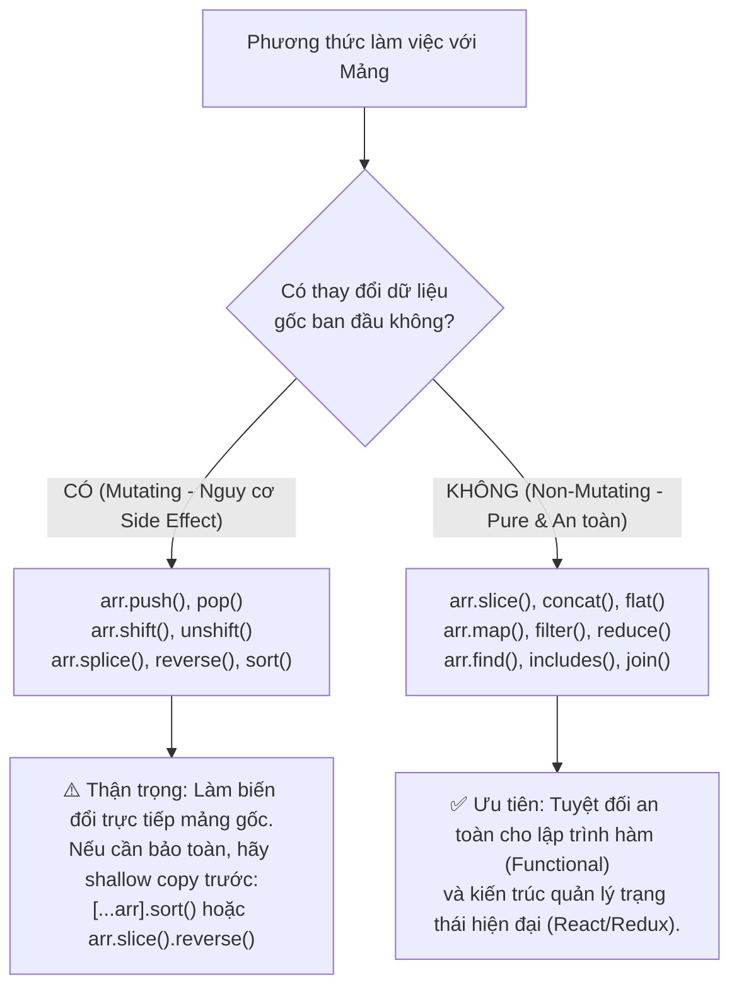

# 18 - Sổ Tay Tra Cứu Toàn Diện: Thuộc Tính & Phương Thức Trong JavaScript (API Reference & Cheat Sheet)

## Mục Lục

- [1. Quy Ước & Hướng Dẫn Sử Dụng Bảng Tra Cứu](#1-quy-ước--hướng-dẫn-sử-dụng-bảng-tra-cứu)
- [2. Nhóm Đối Tượng Toàn Cục Object (Object Constructor & Prototype)](#2-nhóm-đối-tượng-toàn-cục-object-object-constructor--prototype)
- [3. Nhóm Mảng Dữ Liệu Array (Array Prototype Methods)](#3-nhóm-mảng-dữ-liệu-array-array-prototype-methods)
  - [3.1. Các phương thức thay đổi mảng gốc (Mutating Methods)](#31-các-phương-thức-thay-đổi-mảng-gốc-mutating-methods)
  - [3.2. Các phương thức không làm thay đổi mảng gốc (Non-Mutating / Pure Methods)](#32-các-phương-thức-không-làm-thay-đổi-mảng-gốc-non-mutating--pure-methods)
  - [3.3. Các phương thức lặp và xử lý hàm bậc cao (Higher-Order Iteration Methods)](#33-các-phương-thức-lặp-và-xử-lý-hàm-bậc-cao-higher-order-iteration-methods)
- [4. Nhóm Chuỗi Ký Tự String (String Prototype Methods)](#4-nhóm-chuỗi-ký-tự-string-string-prototype-methods)
- [5. Nhóm Số Học & Hàm Toán Học (Number, Math & Global Conversion)](#5-nhóm-số-học--hàm-toán-học-number-math--global-conversion)
  - [5.1. Hàm ép kiểu toàn cục & Number Methods](#51-hàm-ép-kiểu-toàn-cục--number-methods)
  - [5.2. Đối tượng toán học Math (Static Methods & Properties)](#52-đối-tượng-toán-học-math-static-methods--properties)
- [6. Nhóm Cấu Trúc Dữ Liệu Tập Hợp Map & Set](#6-nhóm-cấu-trúc-dữ-liệu-tập-hợp-map--set)
  - [6.1. Cấu trúc Map (Key-Value Collection)](#61-cấu-trúc-map-key-value-collection)
  - [6.2. Cấu trúc Set (Unique Value Collection)](#62-cấu-trúc-set-unique-value-collection)
- [7. Nhóm Định Dạng Dữ Liệu JSON (JavaScript Object Notation)](#7-nhóm-định-dạng-dữ-liệu-json-javascript-object-notation)
- [8. Nhóm Công Cụ Gỡ Lỗi & Hiệu Năng Console](#8-nhóm-công-cụ-gỡ-lỗi--hiệu-năng-console)
- [9. Nhóm Thao Tác Giao Diện DOM & Sự Kiện (Document & Element)](#9-nhóm-thao-tác-giao-diện-dom--sự-kiện-document--element)
- [10. Nhóm Quản Lý Lỗi & Ngoại Lệ (Error & Exception Handling)](#10-nhóm-quản-lý-lỗi--ngoại-lệ-error--exception-handling)
- [11. Tổng Kết Triết Lý: Mutating vs Non-Mutating (Bảo Toàn Trạng Thái)](#11-tổng-kết-triết-lý-mutating-vs-non-mutating-bảo-toàn-trạng-thái)

---

## 1. Quy Ước & Hướng Dẫn Sử Dụng Bảng Tra Cứu

Tài liệu này là **Sổ tay tra cứu chuẩn xác (Cheat Sheet Manual)** tổng hợp toàn bộ các thuộc tính, phương thức, hàm tích hợp sẵn của JavaScript được giảng dạy và ứng dụng xuyên suốt 17 bài học của dự án `JavaScript Study Program`.

Mỗi mục tra cứu tập trung giải quyết **2 yếu tố cốt lõi quan trọng nhất** trong lập trình:
1. **Giá trị nhận vào (Input / Parameters):** Tên tham số, kiểu dữ liệu (`String`, `Number`, `Boolean`, `Object`, `Array`, `Function`, `any`), trạng thái bắt buộc hay tùy chọn (`[optional]`), và giá trị mặc định.
2. **Giá trị trả về (Output / Return Value):** Kiểu dữ liệu trả về và ý nghĩa logic của kết quả.

> [!TIP]
> **Quy ước ký hiệu kiểu dữ liệu:**
> - `T`: Kiểu dữ liệu tổng quát (Generic).
> - `T[]`: Mảng chứa các phần tử kiểu `T`.
> - `[param]`: Tham số tùy chọn, có thể bỏ qua khi gọi hàm.
> - `void` / `undefined`: Hàm thực thi hành động (side-effect) và không trả về giá trị hữu ích.
> - `Mutates: Có`: Phương thức làm thay đổi trực tiếp dữ liệu gốc (Side-effect).
> - `Mutates: Không`: Phương thức trả về dữ liệu mới, giữ nguyên vẹn dữ liệu ban đầu (Pure / Immutable).

[⬆️ Quay lại Mục lục](#mục-lục)

---

## 2. Nhóm Đối Tượng Toàn Cục Object (Object Constructor & Prototype)

Xuất hiện chủ đạo trong [Bài 12: Đối Tượng (Object) & this](file:///d:/github/studyProgram/javascript/docs/12-objects.md) và [Bài 13: Vòng Lặp For-In & For-Of](file:///d:/github/studyProgram/javascript/docs/13-for-in-and-for-of.md).

| Phương thức / Cú pháp | Giá trị nhận vào (Input) | Giá trị trả lại (Output) | Biến đổi gốc? | Ví dụ minh họa thực tế |
| :--- | :--- | :--- | :--- | :--- |
| `Object.keys(obj)` | `obj: Object` (Đối tượng cần lấy khóa) | `string[]`: Mảng chứa toàn bộ tên thuộc tính (keys) dạng chuỗi | Không | `Object.keys({ a: 1, b: 2 })` → `['a', 'b']` |
| `Object.values(obj)` | `obj: Object` (Đối tượng cần lấy giá trị) | `any[]`: Mảng chứa toàn bộ giá trị (values) của các thuộc tính | Không | `Object.values({ a: 1, b: 2 })` → `[1, 2]` |
| `Object.entries(obj)` | `obj: Object` (Đối tượng cần duyệt) | `[string, any][]`: Mảng các cặp `[key, value]` | Không | `Object.entries({ x: 10 })` → `[['x', 10]]` |
| `Object.fromEntries(iterable)` | `iterable: Iterable<[key, value]>` (Mảng hoặc Map chứa các cặp key-value) | `Object`: Đối tượng mới được tái tạo từ các cặp key-value | Không | `Object.fromEntries([['name', 'An']])` → `{ name: 'An' }` |
| `Object.freeze(obj)` | `obj: Object` (Đối tượng cần đóng băng) | `Object`: Chính đối tượng đó sau khi đã bị đóng băng bất biến nông (Shallow Freeze) | **Có** (Khóa đối tượng) | `const o = Object.freeze({ x: 1 }); o.x = 2;` → `o.x` vẫn là `1` |
| `Object.isFrozen(obj)` | `obj: Object` (Đối tượng cần kiểm tra) | `boolean`: `true` nếu đối tượng đã đóng băng, ngược lại `false` | Không | `Object.isFrozen(Object.freeze({}))` → `true` |
| `Object.assign(target, ...sources)` | - `target: Object` (Đối tượng đích) - `...sources: Object[]` (Một hoặc nhiều đối tượng nguồn) | `Object`: Trả về chính `target` sau khi đã sao chép nông các thuộc tính từ các `sources` | **Có** (Sửa `target`) | `Object.assign({ a: 1 }, { b: 2 })` → `{ a: 1, b: 2 }` |
| `Object.hasOwn(obj, prop)` | - `obj: Object` - `prop: string \| symbol` (Tên thuộc tính) | `boolean`: `true` nếu thuộc tính thuộc sở hữu trực tiếp của `obj`, không kế thừa qua prototype | Không | `Object.hasOwn({ x: 5 }, 'x')` → `true` |
| `obj.hasOwnProperty(prop)` | `prop: string \| symbol` (Tên thuộc tính) | `boolean`: `true` nếu thuộc tính trực tiếp thuộc về `obj` | Không | `const o = { a: 1 }; o.hasOwnProperty('a')` → `true` |
| `delete obj.prop` (Toán tử) | `obj.prop` hoặc `obj[prop]` | `boolean`: `true` nếu xóa thuộc tính thành công | **Có** (Xóa key) | `const o = { a: 1 }; delete o.a;` → `o` thành `{}` |
| `'key' in obj` (Toán tử) | - Vế trái: `string \| symbol` - Vế phải: `Object` | `boolean`: `true` nếu `key` tồn tại trong `obj` hoặc trong chuỗi Prototype | Không | `'toString' in {}` → `true` (kế thừa từ prototype) |

[⬆️ Quay lại Mục lục](#mục-lục)

---

## 3. Nhóm Mảng Dữ Liệu Array (Array Prototype Methods)

Xuất hiện chủ đạo trong [Bài 11: Mảng trong JavaScript](file:///d:/github/studyProgram/javascript/docs/11-arrays.md) và [Bài 13: Vòng Lặp For-In & For-Of](file:///d:/github/studyProgram/javascript/docs/13-for-in-and-for-of.md).

### 3.1. Các phương thức thay đổi mảng gốc (Mutating Methods)

> [!WARNING]
> Các phương thức trong nhóm này **làm biến đổi trực tiếp mảng ban đầu**. Cần hết sức thận trọng khi làm việc với dữ liệu dùng chung để tránh gây ra lỗi không mong muốn (Side-effects).

| Phương thức | Giá trị nhận vào (Input) | Giá trị trả lại (Output) | Biến đổi gốc? | Ví dụ minh họa thực tế |
| :--- | :--- | :--- | :--- | :--- |
| `arr.push(...items)` | `...items: any[]` (Một hoặc nhiều phần tử cần thêm vào cuối mảng) | `number`: Độ dài mới (`length`) của mảng sau khi thêm | **Có** | `const a = [1]; a.push(2, 3);` → trả về `3`, `a` thành `[1, 2, 3]` |
| `arr.pop()` | *Không có* | `any \| undefined`: Phần tử cuối cùng vừa bị lấy ra (hoặc `undefined` nếu mảng rỗng) | **Có** | `const a = [1, 2]; a.pop();` → trả về `2`, `a` thành `[1]` |
| `arr.unshift(...items)` | `...items: any[]` (Một hoặc nhiều phần tử cần thêm vào đầu mảng) | `number`: Độ dài mới (`length`) của mảng sau khi thêm | **Có** | `const a = [2]; a.unshift(1);` → trả về `2`, `a` thành `[1, 2]` |
| `arr.shift()` | *Không có* | `any \| undefined`: Phần tử đầu tiên vừa bị lấy ra (hoặc `undefined` nếu mảng rỗng) | **Có** | `const a = [1, 2]; a.shift();` → trả về `1`, `a` thành `[2]` |
| `arr.splice(start, deleteCount, ...items)` | - `start: number` (Vị trí bắt đầu) - `[deleteCount]: number` (Số phần tử cần xóa) - `[...items]: any[]` (Các phần tử chèn thêm) | `any[]`: Mảng chứa các phần tử đã bị xóa bỏ | **Có** | `const a = [1, 2, 3]; a.splice(1, 1, 99);` → xóa `[2]`, `a` thành `[1, 99, 3]` |
| `arr.reverse()` | *Không có* | `any[]`: Trả về chính mảng `arr` sau khi đã đảo ngược thứ tự các phần tử | **Có** | `const a = [1, 2, 3]; a.reverse();` → `a` thành `[3, 2, 1]` |
| `arr.sort([compareFn])` | `[compareFn]: (a, b) => number` (Hàm so sánh xác định thứ tự) | `any[]`: Trả về chính mảng `arr` sau khi đã sắp xếp | **Có** | `[10, 2].sort((a, b) => a - b)` → `[2, 10]` (mặc định sort chuỗi: `[10, 2]`) |

### 3.2. Các phương thức không làm thay đổi mảng gốc (Non-Mutating / Pure Methods)

| Phương thức | Giá trị nhận vào (Input) | Giá trị trả lại (Output) | Biến đổi gốc? | Ví dụ minh họa thực tế |
| :--- | :--- | :--- | :--- | :--- |
| `Array.isArray(value)` | `value: any` (Giá trị cần kiểm tra) | `boolean`: `true` nếu là Mảng, ngược lại `false` | Không | `Array.isArray([])` → `true`; `Array.isArray({})` → `false` |
| `arr.slice([start], [end])` | - `[start]: number` (Chỉ số bắt đầu, mặc định `0`) - `[end]: number` (Chỉ số kết thúc không bao gồm) | `any[]`: Mảng mới chứa phần tử được trích xuất (Shallow Copy) | Không | `[1, 2, 3, 4].slice(1, 3)` → `[2, 3]` |
| `arr.concat(...items)` | `...items: (any \| any[])[]` (Các giá trị hoặc mảng cần nối) | `any[]`: Mảng mới kết hợp từ mảng gốc và các tham số | Không | `[1].concat([2], 3)` → `[1, 2, 3]` |
| `arr.includes(value, [fromIndex])` | - `value: any` (Giá trị cần tìm) - `[fromIndex]: number` (Vị trí bắt đầu tìm) | `boolean`: `true` nếu tìm thấy phần tử, ngược lại `false` | Không | `[1, 2, 3].includes(2)` → `true` (nhận diện được cả `NaN`) |
| `arr.indexOf(value, [fromIndex])` | - `value: any` (Giá trị cần tìm) - `[fromIndex]: number` (Vị trí bắt đầu) | `number`: Chỉ số (index) đầu tiên tìm thấy, hoặc `-1` nếu không có | Không | `['a', 'b'].indexOf('b')` → `1`; không tìm thấy → `-1` |
| `arr.lastIndexOf(value)` | `value: any` (Giá trị cần tìm) | `number`: Chỉ số cuối cùng tìm thấy, hoặc `-1` | Không | `[1, 2, 1].lastIndexOf(1)` → `2` |
| `arr.join([separator])` | `[separator]: string` (Ký tự ngăn cách, mặc định là dấu phẩy `','`) | `string`: Chuỗi ký tự ghép từ tất cả các phần tử | Không | `['JS', 'HTML', 'CSS'].join(' - ')` → `'JS - HTML - CSS'` |
| `arr.flat([depth])` | `[depth]: number` (Độ sâu làm phẳng, mặc định là `1`, hoặc `Infinity`) | `any[]`: Mảng mới được làm phẳng các tầng lồng nhau | Không | `[1, [2, [3]]].flat(2)` → `[1, 2, 3]` |

### 3.3. Các phương thức lặp và xử lý hàm bậc cao (Higher-Order Iteration Methods)

| Phương thức | Giá trị nhận vào (Input Callback) | Giá trị trả lại (Output) | Biến đổi gốc? | Ví dụ minh họa thực tế |
| :--- | :--- | :--- | :--- | :--- |
| `arr.forEach(callback)` | `callback: (item, index, arr) => void` | `undefined`: Luôn luôn không trả về giá trị (dùng để thực thi side-effect) | Không (trừ khi tự gán) | `[1, 2].forEach(n => console.log(n))` → in ra từng số |
| `arr.map(callback)` | `callback: (item, index, arr) => any` | `any[]`: Mảng MỚI có cùng độ dài, chứa các giá trị biến đổi từ kết quả của callback | Không | `[1, 2, 3].map(x => x * 2)` → `[2, 4, 6]` |
| `arr.filter(callback)` | `callback: (item, index, arr) => boolean` | `any[]`: Mảng MỚI chỉ chứa các phần tử thỏa mãn callback trả về Truthy | Không | `[1, 2, 3, 4].filter(x => x % 2 === 0)` → `[2, 4]` |
| `arr.find(callback)` | `callback: (item, index, arr) => boolean` | `any \| undefined`: Phần tử ĐẦU TIÊN thỏa mãn điều kiện, hoặc `undefined` nếu không thấy | Không | `[5, 12, 8].find(x => x > 10)` → `12` |
| `arr.findIndex(callback)` | `callback: (item, index, arr) => boolean` | `number`: Chỉ số (index) đầu tiên thỏa mãn điều kiện, hoặc `-1` | Không | `[5, 12, 8].findIndex(x => x > 10)` → `1` |
| `arr.some(callback)` | `callback: (item, index, arr) => boolean` | `boolean`: `true` nếu có ÍT NHẤT 1 phần tử thỏa mãn điều kiện, ngược lại `false` | Không | `[1, 3, 5, 8].some(x => x % 2 === 0)` → `true` |
| `arr.every(callback)` | `callback: (item, index, arr) => boolean` | `boolean`: `true` nếu TẤT CẢ phần tử đều thỏa mãn điều kiện, ngược lại `false` | Không | `[2, 4, 6].every(x => x % 2 === 0)` → `true` |
| `arr.reduce(callback, [initialValue])` | - `callback: (accumulator, item, index, arr) => any` - `[initialValue]: any` (Giá trị tích lũy khởi tạo) | `any`: Giá trị tích lũy cuối cùng sau khi đã duyệt qua toàn bộ mảng | Không | `[1, 2, 3].reduce((sum, n) => sum + n, 0)` → `6` |

[⬆️ Quay lại Mục lục](#mục-lục)

---

## 4. Nhóm Chuỗi Ký Tự String (String Prototype Methods)

Xuất hiện chủ đạo trong [Bài 04: Chuỗi & Template Literals](file:///d:/github/studyProgram/javascript/docs/04-strings.md).

> [!NOTE]
> Trong JavaScript, chuỗi là **kiểu dữ liệu nguyên thủy bất biến (Immutable)**. Mọi phương thức của chuỗi **100% không bao giờ làm thay đổi chuỗi gốc** mà luôn luôn trả về một chuỗi mới!

| Thuộc tính / Phương thức | Giá trị nhận vào (Input) | Giá trị trả lại (Output) | Biến đổi gốc? | Ví dụ minh họa thực tế |
| :--- | :--- | :--- | :--- | :--- |
| `str.length` (Thuộc tính) | *Không có* | `number`: Tổng số lượng ký tự (UTF-16 code units) trong chuỗi | Không | `'Hello'.length` → `5` |
| `str.charAt(index)` | `index: number` (Chỉ số vị trí ký tự) | `string`: Ký tự tại vị trí chỉ định, hoặc chuỗi rỗng `''` nếu vượt biên | Không | `'JS'.charAt(0)` → `'J'` |
| `str.includes(searchStr, [pos])` | - `searchStr: string` - `[pos]: number` (Vị trí bắt đầu tìm kiếm) | `boolean`: `true` nếu chuỗi chứa `searchStr`, ngược lại `false` | Không | `'JavaScript'.includes('Script')` → `true` |
| `str.indexOf(searchStr, [pos])` | - `searchStr: string` - `[pos]: number` | `number`: Vị trí đầu tiên xuất hiện của chuỗi con, hoặc `-1` | Không | `'hello'.indexOf('l')` → `2` |
| `str.lastIndexOf(searchStr)` | `searchStr: string` | `number`: Vị trí cuối cùng xuất hiện của chuỗi con, hoặc `-1` | Không | `'hello'.lastIndexOf('l')` → `3` |
| `str.startsWith(prefix, [pos])` | `prefix: string` (Chuỗi tiền tố) | `boolean`: `true` nếu chuỗi bắt đầu bằng `prefix` | Không | `'https://google.com'.startsWith('https')` → `true` |
| `str.endsWith(suffix, [pos])` | `suffix: string` (Chuỗi hậu tố) | `boolean`: `true` nếu chuỗi kết thúc bằng `suffix` | Không | `'avatar.png'.endsWith('.png')` → `true` |
| `str.slice(start, [end])` | - `start: number` (Chỉ số bắt đầu, nhận số âm tính từ cuối) - `[end]: number` (Chỉ số kết thúc) | `string`: Chuỗi con được cắt ra từ `start` đến `end - 1` | Không | `'Hello World'.slice(0, 5)` → `'Hello'` |
| `str.substring(start, [end])` | - `start: number` - `[end]: number` | `string`: Tương tự slice nhưng tự động hoán đổi nếu `start > end`, không nhận số âm | Không | `'Hello'.substring(4, 1)` → `'ell'` |
| `str.toLowerCase()` | *Không có* | `string`: Chuỗi mới được chuyển toàn bộ sang chữ thường | Không | `'JAVASCRIPT'.toLowerCase()` → `'javascript'` |
| `str.toUpperCase()` | *Không có* | `string`: Chuỗi mới được chuyển toàn bộ sang chữ in hoa | Không | `'hello'.toUpperCase()` → `'HELLO'` |
| `str.trim()` | *Không có* | `string`: Chuỗi mới sau khi đã loại bỏ khoảng trắng ở cả 2 đầu | Không | `'  clean me  '.trim()` → `'clean me'` |
| `str.trimStart()` / `trimEnd()` | *Không có* | `string`: Loại bỏ khoảng trắng ở đầu hoặc cuối chuỗi | Không | `'  hi'.trimStart()` → `'hi'` |
| `str.replace(searchValue, replaceValue)` | - `searchValue: string \| RegExp` - `replaceValue: string \| Function` | `string`: Chuỗi mới sau khi thay thế vị trí khớp ĐẦU TIÊN | Không | `'a-b-c'.replace('-', '_')` → `'a_b-c'` |
| `str.replaceAll(searchValue, replaceValue)` | - `searchValue: string \| RegExp` - `replaceValue: string \| Function` | `string`: Chuỗi mới sau khi thay thế TẤT CẢ các vị trí khớp | Không | `'a-b-c'.replaceAll('-', '_')` → `'a_b_c'` |
| `str.split([separator], [limit])` | - `[separator]: string \| RegExp` (Ký tự phân tách) - `[limit]: number` (Số lượng phần tử tối đa) | `string[]`: Mảng các chuỗi con được phân tách | Không | `'HTML,CSS,JS'.split(',')` → `['HTML', 'CSS', 'JS']` |
| `str.repeat(count)` | `count: number` (Số lần lặp lại >= 0) | `string`: Chuỗi mới gồm chuỗi gốc lặp lại `count` lần | Không | `'ha'.repeat(3)` → `'hahaha'` |

[⬆️ Quay lại Mục lục](#mục-lục)

---

## 5. Nhóm Số Học & Hàm Toán Học (Number, Math & Global Conversion)

Xuất hiện chủ đạo trong [Bài 03: Khai Báo Biến & Kiểu Dữ Liệu](file:///d:/github/studyProgram/javascript/docs/03-variables-and-data-types.md) và [Bài 08: Ép Kiểu & Vòng Lặp](file:///d:/github/studyProgram/javascript/docs/08-loops-and-type-coercion.md).

### 5.1. Hàm ép kiểu toàn cục & Number Methods

| Hàm / Phương thức | Giá trị nhận vào (Input) | Giá trị trả lại (Output) | Biến đổi gốc? | Ví dụ minh họa thực tế |
| :--- | :--- | :--- | :--- | :--- |
| `Number(value)` (hoặc `+value`) | `value: any` (Giá trị cần ép kiểu sang số) | `number`: Trả về số hợp lệ, hoặc `NaN` nếu chuỗi dính chữ, `0` nếu rỗng/null, `1` nếu `true` | Không | `Number('123')` → `123`; `Number('50k')` → `NaN` |
| `parseInt(str, [radix])` | - `str: string` (Chuỗi cần bóc tách số nguyên) - `[radix]: number` (Hệ cơ số từ 2 đến 36, **luôn dùng 10**) | `number`: Số nguyên bóc tách được từ đầu chuỗi, hoặc `NaN` nếu ký tự đầu là chữ | Không | `parseInt('32px', 10)` → `32`; `parseInt('FF', 16)` → `255` |
| `parseFloat(str)` | `str: string` (Chuỗi cần bóc tách số thực) | `number`: Số thực bóc tách được từ đầu chuỗi (hệ cơ số 10) | Không | `parseFloat('1.75rem')` → `1.75` |
| `Number.isNaN(value)` | `value: any` (Giá trị cần kiểm tra) | `boolean`: `true` CHỈ KHI giá trị truyền vào có kiểu Number và bằng chính xác `NaN` | Không | `Number.isNaN(NaN)` → `true`; `Number.isNaN('abc')` → `false` |
| `Number.isInteger(value)` | `value: any` (Giá trị cần kiểm tra) | `boolean`: `true` nếu là số nguyên, ngược lại `false` | Không | `Number.isInteger(5)` → `true`; `Number.isInteger(5.5)` → `false` |
| `num.toFixed([digits])` | `[digits]: number` (Số chữ số sau dấu thập phân, mặc định là `0`) | `string`: Chuỗi đại diện cho số đã được làm tròn | Không | `(12.3456).toFixed(2)` → `'12.35'` (Lưu ý: trả về chuỗi!) |

### 5.2. Đối tượng toán học Math (Static Methods & Properties)

| Thuộc tính / Phương thức | Giá trị nhận vào (Input) | Giá trị trả lại (Output) | Biến đổi gốc? | Ví dụ minh họa thực tế |
| :--- | :--- | :--- | :--- | :--- |
| `Math.PI` (Hằng số) | *Không có* | `number`: Giá trị số π ≈ 3.141592653589793 | Không | `Math.PI * 2` → `6.28318...` |
| `Math.round(x)` | `x: number` | `number`: Số nguyên gần nhất theo quy tắc làm tròn chuẩn (từ `.5` làm tròn lên) | Không | `Math.round(4.7)` → `5`; `Math.round(4.4)` → `4` |
| `Math.floor(x)` | `x: number` | `number`: Số nguyên lớn nhất nhỏ hơn hoặc bằng `x` (làm tròn xuống) | Không | `Math.floor(4.9)` → `4`; `Math.floor(-4.1)` → `-5` |
| `Math.ceil(x)` | `x: number` | `number`: Số nguyên nhỏ nhất lớn hơn hoặc bằng `x` (làm tròn lên) | Không | `Math.ceil(4.1)` → `5` |
| `Math.abs(x)` | `x: number` | `number`: Giá trị tuyệt đối của số `x` (|x| >= 0) | Không | `Math.abs(-15)` → `15` |
| `Math.max(...values)` | `...values: number[]` (Danh sách các số) | `number`: Số lớn nhất trong các tham số | Không | `Math.max(3, 9, 1, 7)` → `9`; `Math.max(...[4, 8])` → `8` |
| `Math.min(...values)` | `...values: number[]` (Danh sách các số) | `number`: Số nhỏ nhất trong các tham số | Không | `Math.min(3, 9, 1, 7)` → `1` |
| `Math.random()` | *Không có* | `number`: Số thực ngẫu nhiên dạng số thập phân trong nửa khoảng [0, 1) | Không | `Math.floor(Math.random() * 10) + 1` → số ngẫu nhiên 1 đến 10 |
| `Math.pow(base, exponent)` | - `base: number` (Cơ số) - `exponent: number` (Số mũ) | `number`: Lũy thừa base^exponent (tương đương toán tử `**`) | Không | `Math.pow(2, 3)` → `8`; tương đương `2 ** 3` |
| `Math.sqrt(x)` | `x: number` (Số >= 0) | `number`: Căn bậc hai √x | Không | `Math.sqrt(16)` → `4` |

[⬆️ Quay lại Mục lục](#mục-lục)

---

## 6. Nhóm Cấu Trúc Dữ Liệu Tập Hợp Map & Set

Xuất hiện chủ đạo trong [Bài 15: Cấu Trúc Map & Set](file:///d:/github/studyProgram/javascript/docs/15-map-and-set.md).

### 6.1. Cấu trúc Map (Key-Value Collection)

| Thuộc tính / Phương thức | Giá trị nhận vào (Input) | Giá trị trả lại (Output) | Biến đổi gốc? | Ví dụ minh họa thực tế |
| :--- | :--- | :--- | :--- | :--- |
| `new Map([iterable])` | `[iterable]: Iterable<[key, value]>` | `Map`: Đối tượng Map mới được khởi tạo | Không | `const m = new Map([['a', 1]])` |
| `map.size` (Thuộc tính) | *Không có* | `number`: Tổng số lượng cặp key-value đang lưu trong Map | Không | `m.size` → `1` |
| `map.set(key, value)` | - `key: any` (Chấp nhận mọi kiểu: Object, Hàm, Primitive) - `value: any` | `Map`: Trả về CHÍNH đối tượng Map đó (hỗ trợ gọi chuỗi method chaining) | **Có** | `m.set('k1', 10).set('k2', 20)` |
| `map.get(key)` | `key: any` | `any \| undefined`: Giá trị tương ứng với key, hoặc `undefined` nếu không tồn tại | Không | `m.get('k1')` → `10` |
| `map.has(key)` | `key: any` | `boolean`: `true` nếu key tồn tại trong Map, ngược lại `false` | Không | `m.has('k1')` → `true` |
| `map.delete(key)` | `key: any` | `boolean`: `true` nếu phần tử tồn tại và đã bị xóa, ngược lại `false` | **Có** | `m.delete('k1')` → `true` |
| `map.clear()` | *Không có* | `undefined`: Xóa sạch toàn bộ phần tử trong Map | **Có** | `m.clear(); m.size` → `0` |
| `map.keys()` / `values()` | *Không có* | `MapIterator`: Iterator duyệt qua toàn bộ khóa hoặc giá trị | Không | `[...m.keys()]` → mảng các keys |
| `map.forEach(callback)` | `callback: (value, key, map) => void` | `undefined`: Duyệt qua từng cặp theo thứ tự chèn | Không | `m.forEach((v, k) => console.log(k, v))` |

### 6.2. Cấu trúc Set (Unique Value Collection)

| Thuộc tính / Phương thức | Giá trị nhận vào (Input) | Giá trị trả lại (Output) | Biến đổi gốc? | Ví dụ minh họa thực tế |
| :--- | :--- | :--- | :--- | :--- |
| `new Set([iterable])` | `[iterable]: Iterable<any>` (Thường là mảng cần lọc trùng) | `Set`: Đối tượng Set mới chỉ chứa các giá trị duy nhất | Không | `const s = new Set([1, 2, 2, 3])` → chứa `1, 2, 3` |
| `set.size` (Thuộc tính) | *Không có* | `number`: Tổng số lượng phần tử duy nhất trong Set | Không | `s.size` → `3` |
| `set.add(value)` | `value: any` (Giá trị cần thêm vào Set) | `Set`: Trả về CHÍNH đối tượng Set đó (hỗ trợ chaining) | **Có** | `s.add(4).add(4)` → chỉ thêm 1 lần số 4 |
| `set.has(value)` | `value: any` (Giá trị cần kiểm tra) | `boolean`: `true` nếu giá trị có mặt trong Set | Không | `s.has(2)` → `true` |
| `set.delete(value)` | `value: any` | `boolean`: `true` nếu xóa thành công, ngược lại `false` | **Có** | `s.delete(2)` → `true` |
| `set.clear()` | *Không có* | `undefined`: Xóa toàn bộ phần tử trong Set | **Có** | `s.clear(); s.size` → `0` |
| `[...new Set(arr)]` (Kỹ thuật) | `arr: any[]` (Mảng chứa phần tử trùng lặp) | `any[]`: Mảng MỚI đã được lọc sạch phần tử trùng lặp | Không | `[...new Set([1, 1, 2, 3])]` → `[1, 2, 3]` |

[⬆️ Quay lại Mục lục](#mục-lục)

---

## 7. Nhóm Định Dạng Dữ Liệu JSON (JavaScript Object Notation)

Xuất hiện chủ đạo trong [Bài 17: Định Dạng JSON & Xử Lý Lỗi](file:///d:/github/studyProgram/javascript/docs/17-json-and-error-handling.md).

| Phương thức | Giá trị nhận vào (Input) | Giá trị trả lại (Output) | Biến đổi gốc? | Ví dụ minh họa thực tế |
| :--- | :--- | :--- | :--- | :--- |
| `JSON.stringify(value, [replacer], [space])` | - `value: any` (Đối tượng / Mảng cần chuyển thành chuỗi JSON) - `[replacer]: Function \| (string \| number)[]` (Bộ lọc thuộc tính) - `[space]: string \| number` (Khoảng thụt đầu dòng để format dễ đọc) | `string`: Chuỗi văn bản JSON chuẩn, hoặc `undefined` nếu truyền vào Function/Symbol thuần túy | Không | `JSON.stringify({ a: 1 }, null, 2)` → chuỗi JSON được format thụt lề 2 spaces |
| `JSON.parse(text, [reviver])` | - `text: string` (Chuỗi JSON cần giải mã) - `[reviver]: (key, value) => any` (Hàm biến đổi dữ liệu sau parse) | `any`: Đối tượng, Mảng hoặc giá trị JavaScript tương ứng. **Ném lỗi `SyntaxError` nếu chuỗi sai cú pháp!** | Không | `JSON.parse('{"id": 101}')` → `{ id: 101 }` |

[⬆️ Quay lại Mục lục](#mục-lục)

---

## 8. Nhóm Công Cụ Gỡ Lỗi & Hiệu Năng Console

Xuất hiện xuyên suốt từ [Bài 01: Tổng Quan Về JavaScript](file:///d:/github/studyProgram/javascript/docs/01-javascript-overview.md) đến tất cả các bài tập trong dự án.

| Phương thức | Giá trị nhận vào (Input) | Giá trị trả lại (Output) | Biến đổi gốc? | Ví dụ minh họa thực tế |
| :--- | :--- | :--- | :--- | :--- |
| `console.log(...data)` | `...data: any[]` (Danh sách các giá trị cần in ra) | `undefined`: Ghi log thông thường ra màn hình Console | Không | `console.log('User:', user)` |
| `console.error(...data)` | `...data: any[]` (Nội dung thông báo lỗi) | `undefined`: Ghi log màu đỏ có kèm stack trace | Không | `console.error('Lỗi kết nối:', err.message)` |
| `console.warn(...data)` | `...data: any[]` (Nội dung cảnh báo) | `undefined`: Ghi log màu vàng cảnh báo | Không | `console.warn('API sắp bị deprecated!')` |
| `console.table(tabularData, [properties])` | - `tabularData: Object \| Array` (Dữ liệu dạng bảng) - `[properties]: string[]` (Danh sách các cột cần hiển thị) | `undefined`: Hiển thị mảng/đối tượng dưới dạng bảng tương tác trực quan | Không | `console.table([{ id: 1, name: 'An' }, { id: 2, name: 'Bình' }])` |
| `console.time(label)` | `[label]: string` (Tên định danh bộ đếm thời gian, mặc định `'default'`) | `undefined`: Bắt đầu bấm giờ đo lường hiệu năng | Không | `console.time('FetchData')` |
| `console.timeEnd(label)` | `[label]: string` (Tên định danh tương ứng) | `undefined`: Dừng bộ đếm và in ra thời gian thực thi mili-giây (`ms`) | Không | `console.timeEnd('FetchData')` → in `FetchData: 12.45ms` |
| `console.clear()` | *Không có* | `undefined`: Xóa sạch màn hình Console hiện tại | Không | `console.clear()` |

[⬆️ Quay lại Mục lục](#mục-lục)

---

## 9. Nhóm Thao Tác Giao Diện DOM & Sự Kiện (Document & Element)

Xuất hiện chủ đạo trong [Bài 16: Thao Tác DOM & Sự Kiện](file:///d:/github/studyProgram/javascript/docs/16-dom-basics.md).

| Thuộc tính / Phương thức | Giá trị nhận vào (Input) | Giá trị trả lại (Output) | Biến đổi gốc? | Ví dụ minh họa thực tế |
| :--- | :--- | :--- | :--- | :--- |
| `document.querySelector(selectors)` | `selectors: string` (Chuỗi CSS Selector hợp lệ, VD: `'.btn'`, `'#app'`) | `Element \| null`: Phần tử HTML đầu tiên khớp bộ chọn, hoặc `null` nếu không tìm thấy | Không | `const btn = document.querySelector('#btn-submit')` |
| `document.querySelectorAll(selectors)` | `selectors: string` (Chuỗi CSS Selector) | `NodeList`: Tập hợp danh sách các phần tử khớp (hỗ trợ duyệt bằng `forEach`, `for...of`) | Không | `const items = document.querySelectorAll('.todo-item')` |
| `el.addEventListener(type, listener, [options])` | - `type: string` (Tên sự kiện: `'click'`, `'input'`, `'submit'`) - `listener: (event) => void` (Hàm callback xử lý) - `[options]: boolean \| Object` | `undefined`: Đăng ký lắng nghe sự kiện trên phần tử | **Có** (Gán listener) | `btn.addEventListener('click', (e) => console.log('Clicked!'))` |
| `el.removeEventListener(type, listener)` | - `type: string` - `listener: Function` (Hàm đã đăng ký trước đó) | `undefined`: Hủy đăng ký lắng nghe sự kiện | **Có** | `btn.removeEventListener('click', handleClick)` |
| `event.preventDefault()` | *Không có* | `undefined`: Ngăn chặn hành vi mặc định của trình duyệt (chống reload form, chống nhảy link `<a>`) | Không | `form.addEventListener('submit', (e) => e.preventDefault())` |
| `event.stopPropagation()` | *Không có* | `undefined`: Ngăn chặn sự kiện nổi bọt (Event Bubbling) lên các thẻ cha | Không | `btn.addEventListener('click', (e) => e.stopPropagation())` |
| `el.classList.add(...tokens)` | `...tokens: string[]` (Tên các class CSS cần thêm) | `undefined`: Bổ sung class vào phần tử | **Có** (Sửa DOM) | `el.classList.add('active', 'visible')` |
| `el.classList.remove(...tokens)` | `...tokens: string[]` (Tên các class CSS cần xóa) | `undefined`: Xóa class khỏi phần tử | **Có** (Sửa DOM) | `el.classList.remove('hidden')` |
| `el.classList.toggle(token, [force])` | - `token: string` - `[force]: boolean` | `boolean`: `true` nếu class vừa được thêm vào, `false` nếu vừa bị xóa bỏ | **Có** (Sửa DOM) | `el.classList.toggle('dark-mode')` |
| `el.classList.contains(token)` | `token: string` | `boolean`: `true` nếu phần tử đang sở hữu class này | Không | `if (el.classList.contains('active')) { ... }` |
| `el.textContent` (Thuộc tính) | `string` (Khi gán) hoặc *không có* (khi đọc) | `string`: Nội dung văn bản thuần túy bên trong phần tử (tự động loại bỏ mã độc XSS) | **Có** (khi gán) | `el.textContent = 'Chào bạn!'` |
| `el.innerHTML` (Thuộc tính) | `string` (Khi gán) hoặc *không có* (khi đọc) | `string`: Chuỗi mã HTML bên trong phần tử (cần cẩn trọng nguy cơ XSS) | **Có** (khi gán) | `list.innerHTML = '<li>Item mới</li>'` |
| `el.setAttribute(name, value)` | - `name: string` (Tên thuộc tính HTML) - `value: string` (Giá trị thuộc tính) | `undefined`: Thiết lập thuộc tính cho phần tử | **Có** | `img.setAttribute('src', 'logo.png')` |
| `el.getAttribute(name)` | `name: string` | `string \| null`: Giá trị của thuộc tính, hoặc `null` | Không | `link.getAttribute('href')` → `'#about'` |

[⬆️ Quay lại Mục lục](#mục-lục)

---

## 10. Nhóm Quản Lý Lỗi & Ngoại Lệ (Error & Exception Handling)

Xuất hiện chủ đạo trong [Bài 17: Định Dạng JSON & Xử Lý Lỗi](file:///d:/github/studyProgram/javascript/docs/17-json-and-error-handling.md).

| Kiểu / Thuộc tính / Từ khóa | Giá trị nhận vào (Input) | Giá trị trả lại (Output) | Biến đổi gốc? | Ví dụ minh họa thực tế |
| :--- | :--- | :--- | :--- | :--- |
| `new Error([message])` | `[message]: string` (Thông điệp mô tả lỗi) | `Error`: Đối tượng lỗi chuẩn kèm tên lỗi và Stack Trace | Không | `throw new Error('Dữ liệu không hợp lệ!')` |
| `new TypeError([message])` | `[message]: string` | `TypeError`: Đối tượng lỗi về kiểu dữ liệu không đúng mong đợi | Không | `throw new TypeError('Tham số phải là một Hàm!')` |
| `new ReferenceError([message])` | `[message]: string` | `ReferenceError`: Đối tượng lỗi khi truy cập biến không tồn tại / TDZ | Không | Lỗi khi dùng biến trong Temporal Dead Zone |
| `new SyntaxError([message])` | `[message]: string` | `SyntaxError`: Đối tượng lỗi khi phân tích cú pháp sai (VD: JSON sai định dạng) | Không | Sinh ra khi gọi `JSON.parse('chuỗi sai')` |
| `err.name` (Thuộc tính) | *Không có* | `string`: Tên định danh của loại lỗi (VD: `'TypeError'`, `'Error'`) | Không | `console.log(err.name)` |
| `err.message` (Thuộc tính) | *Không có* | `string`: Chuỗi thông điệp mô tả chi tiết nguyên nhân lỗi | Không | `console.log(err.message)` |
| `throw expression` (Từ khóa) | `expression: any` (Thường là đối tượng `Error`) | *Không có*: Ngắt luồng thực thi bình thường và chuyển quyền điều khiển sang khối `catch` gần nhất | Không | `if (age < 0) throw new RangeError('Tuổi không thể âm');` |

[⬆️ Quay lại Mục lục](#mục-lục)

---

## 11. Tổng Kết Triết Lý: Mutating vs Non-Mutating (Bảo Toàn Trạng Thái)

Một trong những cạm bẫy lớn nhất của người học JavaScript là **nhầm lẫn giữa phương thức làm biến đổi mảng gốc (Mutating)** và **phương thức trả về bản sao mới (Non-Mutating)**:

> [!IMPORTANT]
> **Quy Tắc Vàng Dành Cho Lập Trình Viên:**
> - Khi muốn sắp xếp hoặc đảo ngược mà **không làm hỏng mảng ban đầu**, luôn tạo bản sao trước: `const sorted = [...originalArray].sort((a, b) => a - b);`.
> - Khi cần biến đổi từng phần tử và giữ nguyên số lượng: Dùng `.map()`.
> - Khi cần lọc bớt phần tử: Dùng `.filter()`.
> - Khi cần gộp mảng thành 1 giá trị duy nhất (tổng, object gom nhóm): Dùng `.reduce()`.

[⬆️ Quay lại Mục lục](#mục-lục)
